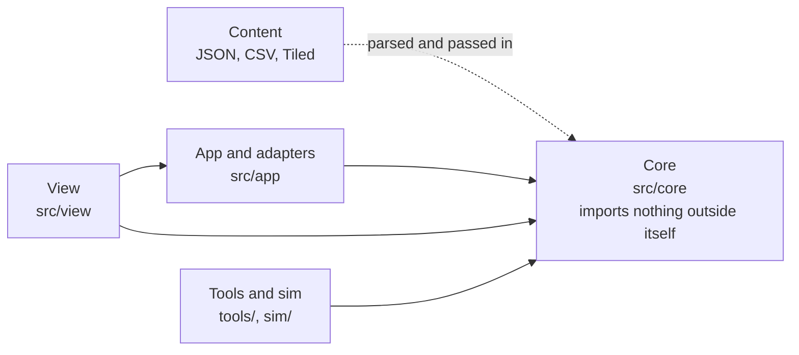

# Body Inc. Software Architecture

Status: proposal for team review, 2026-10-23. This document refines section 13 of the design doc (`docs/design-doc.md`) and the asset contract in section 13 of the art direction guide (`docs/art-direction.md`). Where they disagree on code structure, this document is the intended replacement once the team accepts it; the construction plan that implements it is `docs/build-plan.md`.

## 1. Purpose and the one rule

The game has two kinds of work that change for different reasons and are owned by different people. Mechanics (sleep debt, tags, floor load, damage, the rebuttal stamp gauge, exam scoring) change when the fact-check or the balance simulation says so. Presentation (sprites, animation, tilesets, portraits, paper-and-ink UI, particles, sound, Chinese text layout) changes when the art lead or a playtest says so. The architecture exists to let either side change without touching the other.

The rule that everything below follows is a dependency direction: **game rules never import presentation, and presentation never decides an outcome.** Rules are TypeScript that runs in Node without a browser, a canvas, or Phaser, including movement and collision. Presentation reads rule state and listens to rule events; it sends player intent back as commands. Anything that would change the result of a fight, a day, or an exam lives on the rules side, even when it feels like "feel" (hit-stop length, invincibility frames, the 15% slow cap), because the design doc treats those numbers as contracts (design doc 5.1).

Terms used throughout:

- **Core**: the rules layer, `src/core/`. Pure TypeScript functions and plain state objects. No Phaser, DOM, `window`, `localStorage`, `Math.random`, or wall-clock time.
- **View**: the presentation layer, `src/view/`. Phaser scenes, sprites, UI drawing, audio, text layout.
- **Adapter**: thin code in `src/app/` that connects core to the outside world (input devices, storage, the asset manifest, Tiled files).
- **Content**: data authored by non-programmers, `content/` and `public/assets/maps/`. JSON, CSV, and Tiled maps, validated by schema.
- **Command**: a plain object the view or an adapter submits to core to express intent, for example `{ type: "attack", heavy: false }`.
- **Domain event**: a plain object core emits when something happened, for example `{ type: "hit", target: "e12", outcome: "dispersed" }`. The view turns events into feedback.
- **Logical id**: a stable string naming a thing in rules terms (`adenosine`, `stapler`, `brain-coffee-room`). Core uses only logical ids; the view resolves them to atlas keys, frames, and sounds.

## 2. Current state

Three pieces exist today and shape the design.

The art pipeline (`tools/art/`) already produces everything under `public/assets/` from sources in `art-src/`. Its output is addressed through `public/assets/manifest.json`, which lists every animated logical asset with its frame size, anchor, and animation tags. The placeholder generator turns the manifest into atlases in the same Aseprite JSON format the real art will use. This is already a clean contract on the presentation side: code asks for `operator.walk_down`, never for a file.

The old strategy simulation (`sim/`) is a single mutable-state JavaScript loop (`sim/model.js`, `runGame`) driven by strategy scripts, with parameters in `sim/params.js`. It proves that the outer-day model can run headless and be batch-tested, which is exactly the property core needs. Its model (tokens, department resentment, crisis director) is obsolete per design doc 9.4, and its parameters live in a JavaScript module, which keeps them out of reach of the content schema and the game.

The design doc section 13.1 splits the program into a simulation layer and a presentation layer, but draws the line around the outer day only. Combat, rooms, tags-to-map variants, the stamp gauge, and boss logic are described inside Phaser scenes, and `Boss` and `Exam` are listed as separate scenes. That placement would put most of the game's rules inside presentation code, where they cannot be tested without a browser and where an art change (a new animation length, a different tileset) can silently change a rule. This document moves that line.

## 3. Layers

The program has five layers. Arrows mean "may import".



| Layer | Owns | May import | Must not |
| --- | --- | --- | --- |
| Content | Card, event, enemy, stationery, boss, perk, handbook data; dialogue CSV; strings; params; Tiled rooms | nothing (data) | contain code or file paths to art other than through logical ids |
| Core | Clock, tags and the condition language, causal log, outer day, semester load and lights, exam scoring, combat rules, movement and collision, room model, save schema, seeded RNG | other core modules, parsed content passed in | touch Phaser, DOM, storage, time, or `Math.random`; mention atlas keys, colors, sprite sizes, Chinese text |
| App | Game loop driver, command queue, event bus, store, adapters for input, storage, manifest, map loading | core | decide an outcome |
| View | Phaser scenes, sprite and UI views, animation selection, particles, camera, audio, CJK text layout | app, core (read-only types and selectors) | mutate core state; call core rule functions that change state |
| Tools | Schema check, map check, asset checks, art pipeline, balance simulation | core, content | be imported by the game |

Content is passed into core at startup as parsed objects, so core never reads files and the same core runs under Vite in the browser and under Node in tests and simulation.

## 4. The boundary contract

Four kinds of objects cross between core and view. Nothing else does.

**Commands, view to core.** Input devices map keys to intents in the app layer (`input.ts`), so rebinding, mouse aim, and the "attack as toggle" assist never reach core. Core receives intents such as `move {x, y}`, `attack {heavy}`, `dodge`, `partnerSkill`, `swapStationery`, `stamp`, `interact`, and outer-layer commands such as `playCard {id}`, `chooseOption {eventId, option}`, `enterFloor {id}`, `sleep`.

**Domain events, core to view.** Every outcome the player should perceive is an event with a logical id and a reason: `hit`, `dispersed`, `reformed`, `immuneBounce {solution}`, `stampVoid {message}`, `perfectDodge`, `heartLost {cause}`, `forcedLeave`, `tagAdded {tag, source}`, `ticketStamped {dept}`, `bossProposal {move}`, `proposalRejected`. The view maps events to feedback through a data table (`content/feedback.json`: event type to animation, particle preset, sound, shake, hit-stop display), so the art and audio owners tune feedback without editing rules.

**Snapshots, core to view.** Each frame the view reads a read-only snapshot through selector functions (`selectHearts(state)`, `selectActors(state)`, `selectLights(state)`). Selectors are the only way the view sees state; renaming a field inside core then breaks one selector instead of every scene.

**Logical ids and message keys, both ways.** Core says `adenosine`, `stamp.void.sleep`, `handbook.caffeine`. The view resolves `adenosine` to `manifest["adenosine"]` and `stamp.void.sleep` to a Chinese string in `content/strings/`. Core never holds display text, so the fact-check reviewer reads one strings file with `fact` columns instead of hunting through code.

## 5. Subsystems on each side of the line

The split below is the practical answer to "which side does this go on". A useful test: if changing it could change who wins a fight, how a day ends, or what the report says, it is core.

| Subsystem | Core (rules) | View and app (presentation) |
| --- | --- | --- |
| Movement | Max speed, acceleration frames, slow sources and the 15% cap (design doc 5.1, 5.3); position integration and wall resolution against the room's collision grid | Sprite position interpolated between ticks; facing and walk animation chosen from the velocity in the snapshot |
| Attacks and dodge | Frame data (startup, active, recovery, i-frames 2 to 11, buffer 0.35 s, cooldown), hitbox and hurtbox overlap, damage in half hearts, hit-stop length as a rule-time freeze | Flash, shake, paper particles, sound, combo pitch; debug overlay that draws core boxes |
| Enemy categories | `category` and `solution` flags, the rule that immune objects ignore damage, reforming after 6 s, adenosine stick stacks | Badge, purple dashed outline, grey hatching, the "bounce" sound; all keyed off the category the core reports |
| Enemy and boss behaviour | State machines as pure functions of (state, perception, rng) returning actions; boss move tables from `content/bosses/` | Telegraph art for the three warning tiers, the proposal sheet animation |
| Rebuttal stamp | Gauge sources and the P multiplier, radius, effects, cancel-on-proposal, void outcome | Raising animation, stamp decal, grey "nothing to reject" stamp text |
| Tags and conditions | The tag dictionary, the `when` condition parser and evaluator, causal log entries with source and timestamp | Ticket-stamp flight animation toward the building |
| Rooms | Room model parsed from Tiled JSON: sockets, objects, variant layers with conditions, which variant is active | Tilemap rendering with extruded tilesets, layer depth, lighting overlays |
| Outer day and cards | Hourly clock, card effects, event draws, sleep and caffeine formulas, end-of-day settlement | Card table UI, paper-and-ink drawing, card animations |
| Semester mode | Floor load, lights, perks, overtime clauses, hospital and bankruptcy | Elevator panel, light icons, settlement screen |
| Exam | Question flow, preparedness, score with S factor | Exam room presentation, sheet face sprite |
| Reports | Causal chain reconstruction, ordering and merge rules from `ux-spec.md` | Evidence wall layout, red string, notes, stamps |
| Dialogue | Condition evaluation and effects (`unlock:handbook_caffeine`) | Portrait choice, box layout, CJK line breaking, typewriter effect |
| Assist options | Rule assists: damage x0.5, no forced leave, auto perfect dodge | View assists: no shake, fewer flashes, captions; the 80% and 70% game speed lives in the loop driver |
| Save | Versioned schema, migration functions, serialize and deserialize core state | `localStorage` adapter in app |
| Randomness | Seeded RNG streams owned by core (map gen, events, enemy decisions) | Cosmetic randomness (particles, idle blinks) uses a separate unseeded source so it can never shift gameplay |

Two items deserve explanation.

**Collision lives in core; Phaser only draws.** Phaser's Arcade Physics is not used. Core owns a small collision module: axis-aligned boxes for bodies, hitboxes and hurtboxes, circles for radius effects (stamp landing, soft lock), and the room's solid-tile grid for walls. Movement is resolved per axis against the grid each tick, which is enough for a top-down game with no slopes, about six enemies per room, and short-lived projectiles. The cost is roughly one extra week of combat work in the first two weeks. What it buys is that an entire fight runs headless: the same seed and command log produce the same fight in Node and in the browser, boss patterns can be balanced by simulation alongside the outer-day model, and no rule ever depends on a physics engine's internal ordering. The view never asks Phaser whether two things touch; it draws what the snapshot says.

**Hit-stop is a rule.** The design doc freezes the fight, not the scene, during hit-stop (13.1). Because hit-stop changes when the next input lands, its length lives in core frame data and core emits `freeze {frames}`; core stops advancing combat for that many ticks while the HUD and UI scenes keep running.

## 6. Time, determinism, and the loop

Core advances in fixed 60 Hz ticks (one tick is one frame of the design doc's frame data). The app loop driver accumulates real elapsed time from Phaser's update, multiplies it by the assist game speed, and calls `core.step(state, commands, rng)` zero or more times per rendered frame. The view interpolates sprites between the last two ticks. Outer-layer time (hours, days) is a separate clock inside core that combat never advances directly; "forced nap advances the clock one hour" is a core event.

Determinism matters for three reasons the design doc already relies on: the fixed-seed demo saves (14.1), the batch report check that every strategy yields complete report templates (13.5), and the balance re-simulation (9.6). Under the rules above, a given seed and command log replays the same game in Node and in the browser. A replay test in CI records a short command log and asserts the resulting state hash.

## 7. Assets and content contracts

`public/assets/manifest.json` remains the single contract between art and code (art direction 13.5). The view's asset registry is built from it at boot, so a missing tag fails at load with a readable message instead of at the first attack. Tilesets are referenced through `public/assets/tilesets/tilesets.json`, which the art pipeline writes together with the extruded images, so margin and spacing are never typed by hand (art direction 13.6).

Content files are validated by JSON Schema in `tools/check-content.ts`, and the same schemas generate the TypeScript types core uses for parsed content, so a field renamed in data and not in code fails to compile. Tiled maps are validated by `tools/check-maps.ts`, which imports the same room parser and condition parser that core uses at runtime. Sharing the parser is what makes the check meaningful: the checker cannot accept a condition the game would reject, or the reverse. Each check is verified against a deliberately broken fixture that must fail (design doc 13.3).

Parameters move from `sim/params.js` to `content/params.json`. Core receives them as an argument; the simulation and the game read the same file, which removes the risk that the balance numbers the team tested are not the numbers the game uses.

## 8. Source layout

```
src/
  core/                    pure rules, runs in Node
    rng.ts clock.ts
    tags/                  dictionary loader, condition parser and evaluator, causal log
    outer/                 cards, events, day settlement, sleep and caffeine formulas
    semester/              floors, load, lights, perks, overtime clauses
    exam/
    combat/                frame data, health, stamp gauge, categories, enemies/, bosses/
    collision/             boxes, circles, tile grid, per-axis movement resolution
    rooms/                 Tiled JSON to room model, variant selection
    report/                causal chain reconstruction
    dialogue/              condition and effect evaluation
    save/                  schema version, migrations
    index.ts               createGame, step, selectors
  app/
    loop.ts commands.ts events.ts store.ts
    adapters/              input.ts storage.ts assets.ts maps.ts
  view/
    scenes/                Boot Title Outer World Dialogue Exam Report Handbook Elevator Settlement Hud
    actors/                sprite views per logical category
    ui/                    paper-and-ink drawing (from the midterm draw.js)
    fx/ audio/ text/       feedback presets, sound, CJK line breaking
content/                   params, cards, events, enemies, stationery, bosses, perks, handbook, strings, feedback, dialogue/*.csv
public/assets/             produced by tools/art, plus maps/<world>/*.tmj
sim/                       balance runner and strategies, imports src/core (the old JS model stays until replaced)
tools/                     art/ (Python), check-content.ts, check-maps.ts, check-boundaries.ts
test/                      core unit tests, replay tests, fixtures that must fail
```

`Boss` is no longer a scene: a boss arena is a World room whose spawn is a boss controller, so the boss reuses movement, hits, stamp, and feedback paths. `Exam` stays a scene because its presentation differs, but its scoring is `core/exam`, shared with the semester mode as the design doc requires (14.2). `Hud` is a separate overlay scene at scale 1 so UI is never frozen by hit-stop.

## 9. How the boundary is enforced

A rule that is only written down erodes within a week of six people merging pull requests, so four mechanical checks guard it.

- Core compiles under its own `tsconfig.core.json` with `lib: ["ES2022"]` and `types: []`. With no DOM library and no Phaser types in scope, any reference to `window`, `document`, `localStorage`, or a Phaser type in `src/core/` is a compile error rather than a review comment.
- `tools/check-boundaries.ts` covers what the compiler cannot: any file under `src/core/` that imports from `src/app/`, `src/view/`, or `phaser`, or calls `Math.random`, `Date.now`, or `performance.now`, fails the build. It is verified with fixture files that violate each item.
- Core tests run under Vitest with the `node` environment and no DOM shim. If a core module depends on the browser, the test run fails at import.
- The view gets state only through exported selectors that return `Readonly` types, so assigning to a snapshot from `src/view/` is a compile error; a frozen snapshot in development builds catches casts at runtime.

## 10. Ownership

The split maps onto the team suggestion in design doc 15 so that each module has one owner and one reviewer.

| Module | Owner | Notes |
| --- | --- | --- |
| `app/`, `rooms/`, `save/`, boundaries and CI | 黃晨瑋 | integration, deploy, map loading |
| `core/combat`, `core/collision`, combat views, feedback table | 楊成宇 | rules and feel are split across core and view but kept in one person's hands; 黃晨瑋 pairs on `core/collision` in the first two weeks |
| `core/outer`, `core/tags`, `core/report`, `core/dialogue`, card and report views | 王晨嬡 | also reviews `fact` columns in strings and dialogue |
| `content/params.json`, `core/semester`, `core/exam`, `sim/` | 王欣媛 | the simulation imports the same core |
| Manifest, `public/assets/`, sprite and UI art | 江兆耘 | no code ownership; changes land as assets |
| Dialogue CSV, strings, Tiled rooms | 黃苡晴, 劉哲瑋 | content only; checked by schema and map checks |

## 11. Changes to the design doc

If the team accepts this document, design doc 13.1 should change in four places: the simulation layer becomes the core and includes combat rules, collision, rooms, and the condition language; Arcade Physics is dropped in favour of core collision, with hit-stop as a core freeze; `Boss` is removed from the scene list and `Hud` added; and the parameter file moves to `content/params.json`. Section 13.2 gains `content/feedback.json` and `content/strings/`. The remaining sections (13.3 Tiled, 13.4 tag dictionary, 13.5 causal log and saves) already fit and only need a pointer to the modules above.

## 12. Decisions and open items

Decided by the PM on 2026-10-23: the code is TypeScript (strict mode) throughout `src/`, `tools/` checks, and the new simulation; and collision is part of core, with Arcade Physics not used. The old `sim/` stays JavaScript until the semester prototype replaces it (build plan L3), after which it is removed. The art pipeline in `tools/art/` stays Python.

Still open: one exact Phaser 3.x version is pinned in week one. The asset notes were verified against the 3.80 source (`AnimationManager.createFromAseprite`); a newer 3.x must be re-checked for that behaviour before pinning.
