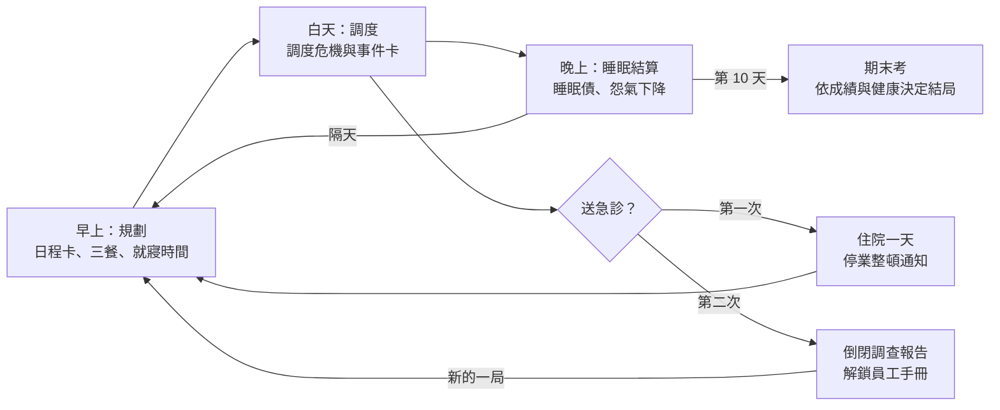
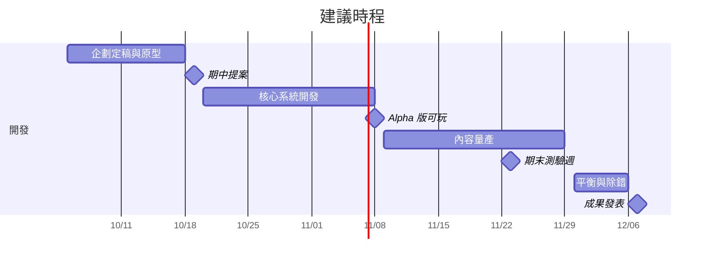

# 人體股份有限公司：遊戲設計文件

2026-10-12 · Isaries

## 目錄

1. [概述](#概述)
2. [世界觀與調性](#世界觀與調性)
3. [核心玩法循環](#核心玩法循環)
4. [人體剖面圖與血球代幣](#人體剖面圖與血球代幣)
5. [部門員工設定](#部門員工設定)
6. [事件卡與連鎖反應](#事件卡與連鎖反應)
7. [大學生事件庫](#大學生事件庫)
   1. [嚴重度分級](#嚴重度分級)
   2. [出現機率](#出現機率)
   3. [升級規則](#升級規則)
   4. [事件清單](#事件清單)
   5. [應變事件與機會事件](#應變事件與機會事件)
8. [資源與數值系統](#資源與數值系統)
   1. [時間與日程](#時間與日程)
   2. [第一層：全公司指標](#第一層全公司指標)
   3. [第二層：部門](#第二層部門)
   4. [特殊公式](#特殊公式)
   5. [玩家看得到的數字](#玩家看得到的數字)
   6. [數值驗證](#數值驗證)
9. [Game Over 與倒閉調查報告](#game-over-與倒閉調查報告)
10. [跨局進度與宿主解鎖](#跨局進度與宿主解鎖)
    1. [結局與年終評價](#結局與年終評價)
    2. [難度階梯](#難度階梯)
11. [教育設計與衛教查證原則](#教育設計與衛教查證原則)
12. [技術架構](#技術架構)
13. [分工與時程](#分工與時程)
14. [待決事項與風險](#待決事項與風險)
15. [附錄](#附錄)

## 概述

《人體股份有限公司》是一款單人的經營養成遊戲，以 p5.js 開發，作為遊戲程式設計課程（115-1）的期末專題。玩家扮演一間「人體公司」的營運長，在一個學期內調度各器官部門，讓宿主撐到期末考。

目標玩家是大學生。遊戲以職場諷刺的笑點包裝衛教知識，讓玩家在經營失敗與重來的過程中，理解作息、飲食與壓力對身體的影響。

課程規定期末專題「必須有助於教育或教學應用」，並避免暴力等不當內容。本作的教育內容直接長在玩法裡，失敗結果以「送急診、期末考缺考」呈現而不涉及死亡，美術與文字素材以自製為原則。提案於 Week7（約 10/19）進行，成果發表於 Week14 與 Week15（約 12/7 與 12/14）。

## 世界觀與調性

宿主是一位名叫小晨的大二生，身體被描寫成一間公司，各器官是公司裡的部門與員工。玩家是被「大腦董事長」空降聘來的營運長，任務是讓公司撐到期末考而不倒閉。

整體調性是職場諷刺搞笑。器官員工會加班、抱怨、罷工，甚至遞辭呈；董事長會畫大餅，年底還有年終評鑑。這些笑點取材自台灣學生與上班族熟悉的職場文化，目的是讓玩家一看就懂、願意繼續玩。

每一個笑點都必須對應一個真實的生理知識。例如「肝從不抱怨，直到某天直接離職」，對應的是肝臟病變初期常無明顯症狀。笑點與知識不一致時，以知識正確為優先。

## 核心玩法循環

單局為 10 天，約 25 至 30 分鐘，第 5 天為期中考、第 10 天為期末考。每一天分為三個階段：早上選日程卡與三餐、白天處理暫停式調度危機與事件卡、晚上睡眠結算。白天預設自動推進，玩家的決策集中在時間暫停的時刻，而不是持續拖曳代幣。



白天若觸發倒閉條件（定義見〈Game Over 與倒閉調查報告〉），該局立即結束並產生倒閉調查報告；報告解鎖的手冊頁面與福利帶入下一局，玩家可選擇從頭開始或從期中考重來。撐到第 10 天則以期末成績與健康報告決定結局。

一天的長度由玩家的就寢與起床時間決定，不再固定為 07:00 至 01:00。舊版設定等於預設每天只睡 6 小時，使玩家不作為也會自動累積睡眠債，已於審查後修正。

## 人體剖面圖與血球代幣

主畫面是一張人體剖面圖。每個器官是一間辦公室隔間，裡面坐著該部門的小員工；血管是公司的物流路線，以不同顏色的粒子表示氧氣、血糖與水分的流動。

美術方向於 2026-10-12 決定。主畫面採人體輪廓，器官畫成符合解剖位置的辦公室，免疫部暫定放在胸腺位置，心臟與腎臟依原設定只以顏色呈現狀態。整體風格為手繪筆記本風：米白橫線紙、藍色原子筆線條、紅筆標註與螢光筆底色，線條不求完美，以降低單一美術的工作量。員工採器官擬人化，員工就是器官本人，並以配件呼應人設，例如戴眼鏡、冒冷汗的肝，皺眉的胃，戴警衛帽的免疫。字型方面，標題與手寫元素使用霞鶩文楷（LXGW WenKai TC，OFL 授權），內文與介面維持 Noto Sans TC。提案簡報第 5 張的主畫面示意圖與第 3 張的小晨造型可作為構圖參考，正式美術由江兆耘繪製。

部門狀態直接畫在隔間上。負荷過高時隔間閃紅燈、員工滿頭大汗；罷工時員工舉抗議牌、器官變灰；離職時隔間只剩空椅子與辭職信。職場笑點以員工頭上的對話泡泡，以及畫面底部的公司跑馬燈呈現。

血球代幣（以下簡稱代幣）代表各部門的資源預算。一枚代幣是一單位的預算，部門分到幾枚，就有多少產能；代幣放下後，該部門的產能條立即變化。初始共 12 枚。大腦固定保障 2 枚且不可挪動，對應大腦血流的自動調節機制。玩家可以額外加派代幣給大腦，每枚使讀書效率提升 10%，這部分在遊戲中稱為「專注力預算」，而非「多送血到腦」：大腦總血流相當穩定，實際上是正在用功的腦區局部調度血流（神經血管耦合），員工手冊需如此說明，避免與上一段破除的迷思互相矛盾。

每個部門有基礎需求，加上活動與標籤造成的加成，除以該部門的效率後，得到當下需要的代幣數。各部門需求如下表，數字為初版：

| 部門 | 基礎需求 | 加成來源 |
| --- | --- | --- |
| 大腦 | 2（固定保障） | 上課與讀書時改為 2 ÷ 睡眠係數 S；報告死線期間 +2；超過需求的代幣視為加派 |
| 胃 | 1 | 用餐後依食物 +2 至 +4、持續約 2 小時；宵夜 +2 |
| 腸道菌 | 1 | 「腸道菌失衡」+2；腹瀉期間 +1 |
| 肝 | 1 | 空腹至午餐前 +1；飲酒時現有代幣全數鎖定代謝酒精，日常工作另需 +1 |
| 免疫 | 1 | 徵兆「喉嚨有點癢」+1；感冒 +3；發燒 +5 |
| 肌肉 | 1 | 運動時 +4 |

基礎需求合計 7 枚，其餘 5 枚是玩家可自由配置的部分；沒有分配出去的代幣留在「待命池」。部門出現缺口時，若總缺口不超過待命池，由待命池自動補足、不暫停，跑馬燈顯示「物流部自動領取 3 枚待命代幣」；總缺口超過待命池時才觸發調度危機，時間暫停。玩家把越多代幣加派給大腦，待命池越小，危機越容易發生，「貪讀書效率」與「保留緩衝」因此成為取捨。

暫停決策的節奏由「危機導演」控制：調度危機與事件卡合計每天 3 至 5 次。一天分為起床至 12:00、12:00 至 18:00、18:00 至就寢三個時窗，每個時窗至少一個決策點；若某時窗剩 1 小時仍沒有調度危機或事件卡，導演改插入一張事件卡，例如上課中「教授突然點名」，而不硬造超過待命池的需求突波；待命池足以補足的缺口一律自動補足，以保住「保留緩衝」的取捨。一次危機後 1.5 小時內不再暫停，期間的缺口合併到下一次；第 5 次之後的缺口直接轉為積壓。玩家也可以隨時按「手動調度」主動暫停，不計入次數。第 1 天依教學腳本只有 2 次，住院日沒有危機。

挪動代幣有代價：每次危機中，每個被挪走代幣的部門怨氣 +10。玩家也可以「向夜班借調」，待命池立即增加 2 枚直到就寢，代價是當晚睡眠效率再乘 0.7，每天最多一次。也可以選擇「暫不處理」，缺口部門會累積積壓。挪代幣與暫不處理的代價刻意相近，玩家的判斷在於哪個部門離怨氣門檻比較近。

「飯後血流被胃搬走所以大腦想睡」是常見但不正確的說法。飯後腸胃道血流確實增加，但大腦血流受自動調節保護；飯後想睡主要與生理時鐘的午後低點及荷爾蒙有關，因此遊戲中以獨立的「午後低點」事件呈現。

## 部門員工設定

最小可行版本（MVP）先實作六個可分配代幣的部門：大腦、胃、腸道菌、肝、免疫、肌肉。心臟與腎臟在 MVP 中只以顏色反映運動量與水分，不參與代幣分配，也不影響其他數值。兩者不會罷工，最嚴重只到「緊急警報」「帳目凍結」的抱怨狀態，避免出現器官衰竭的意象。每個部門的人設都對應一項可查證的知識。

| 部門 | 員工人設 | 對應知識 | MVP |
| --- | --- | --- | --- |
| 大腦 | 很會畫大餅的董事長，熬夜開會後隔天言不及義 | 睡眠不足降低注意力與記憶力；大腦血流自動調節 | 是 |
| 胃 | 脾氣暴躁的物流主管，宵夜與吃太快會讓他抓狂 | 消化需要時間；睡前進食影響睡眠 | 是 |
| 腸道菌 | 外包的菌團隊，族群越多元越好，最愛纖維 | 腸道菌相與膳食纖維；抗生素會影響菌相 | 是 |
| 肝 | 資深社畜，從不抱怨，直到某天遞辭呈 | 肝臟病變初期常無症狀；空腹時釋放葡萄糖維持血糖；酒精代謝速率有上限 | 是 |
| 免疫 | 太過熱血的保全，偶爾誤報，壓力大時預算被砍 | 過敏是免疫過度反應；長期壓力壓抑免疫 | 是 |
| 肌肉 | 業務部，太久沒活動就被裁員 | 肌肉不使用會流失；運動改善睡眠與壓力 | 是 |
| 心臟 | 全年無休、不能請假的員工 | 規律運動對心血管有益 | 僅顏色顯示 |
| 腎臟 | 會計部，水喝太少帳就做不平 | 腎臟過濾需要足夠水分；消炎止痛藥加上脫水可能傷腎 | 僅顏色顯示 |

表中「對應知識」一欄為初稿，正式寫入遊戲前需由衛教查證負責人逐條對照官方資料確認。

## 事件卡與連鎖反應

事件卡是推動劇情與製造取捨的主要手段。設計原則是沒有標準答案：社交在遊戲中也是一種資源，拒絕室友的宵夜邀約會降低社交並提高壓力，因此玩家面對的是取捨，而非健康生活選擇題。

每張事件卡包含五個欄位：

| 欄位 | 內容 | 例子 |
| --- | --- | --- |
| 觸發條件 | 出現的時機與前提 | 第 3 天以後、晚上、壓力高於 60 |
| 情境 | 搞笑的描述 | 室友在群組揪：「鹹酥雞，來不來？」 |
| 選項 | 二到三個選擇，每個都有代價 | 去／不去／請室友幫忙帶 |
| 效果 | 立即效果與狀態標籤 | 社交 +2、胃部夜班、睡眠 -1 小時 |
| 手冊連結 | 與哪一頁衛教相關 | 〈睡前進食與睡眠〉 |

連鎖反應不以「A 事件後必然發生 B 事件」的方式寫死，而是透過狀態標籤自然產生。狀態標籤是掛在公司上、具有持續時間的狀態，例如「睡眠債」「高壓」「肝臟超載」「腸道菌失衡」。標籤會改變部門產能與後續事件的出現機率，累積超過門檻時觸發危機事件。這樣每一局的連鎖都不同，玩家無法靠背誦過關。

每個標籤都記錄自己是由哪個事件加上的。這份因果紀錄讓 Game Over 時的倒閉調查報告能夠自動往回追溯事故經過。

MVP 先實作五條核心連鎖：

| 連鎖 | 過程 | 對應知識 |
| --- | --- | --- |
| 咖啡因陷阱 | 熬夜 → 隔天大腦產能下降 → 喝咖啡提神 → 晚上睡不著 → 睡眠債加深 | 咖啡因半衰期約 5 小時 |
| 早餐翹班 | 沒吃早餐 → 肝臟加班釋放葡萄糖維持血糖、上午飢餓感升高 → 中午暴食加手搖飲 → 大量糖分後的疲倦 → 下午讀書效率下降 | 健康者不吃早餐不會低血糖（肝臟維持）；高糖飲食後的疲倦感（證據有限，保守描述）。本連鎖為助攻型，很少單獨造成急診 |
| 壓力螺旋 | 報告死線 → 長期高壓 → 免疫部預算被砍 → 感冒 → 讀書時間不足 → 壓力更大 | 長期壓力壓抑免疫功能 |
| 聚餐宿醉 | 社團聚餐喝酒 → 肝臟優先代謝酒精、其他工作延後 → 睡眠品質變差 | 酒精代謝速率有上限；酒精影響睡眠；空腹喝酒時肝臟難以維持血糖；未滿 18 歲不得飲酒 |
| 抗生素陷阱 | 感冒就醫時醫師不開抗生素 → 宿主改吃室友剩下的抗生素 → 感冒未改善、腸道菌團隊被誤殺 → 腹瀉 | 感冒多為病毒感染，抗生素對病毒無效；腹瀉是常見副作用；抗藥性是細菌產生的，不是身體產生的 |

正向連鎖同樣存在，讓玩家有翻身的途徑，例如運動帶來較佳睡眠與較低壓力、纖維支援腸道菌、短暫午睡恢復部分大腦產能。

為避免玩家學會知識後遊戲就被一套固定作息解掉，知識以「時機與劑量」呈現，而非禁令。例如早上的咖啡是合理用法，傍晚的咖啡才會傷害睡眠；考前一晚恰當的早睡，比通宵有效。此外，讀書、睡眠與社交所需的時數加總後會超過一天可用時數，玩家每天都必須選擇犧牲哪一項。

每局開始時隨機抽取 2 張學期設定卡，例如「滿堂早八」「週末打工」「夜貓室友」「乳糖不耐」，改變該局的可用時數、事件機率或食物效果，使每一局的最佳策略不同。

危機爆發前一定先出現徵兆。部門會以小抱怨的形式說出真實的早期症狀，例如免疫部的「喉嚨有點癢」、大腦的「同一行字看了三次」。這是 roguelite 類遊戲公平性的關鍵，也讓「察覺身體警訊」成為玩家學到的能力。

事件卡以 JSON 資料撰寫，內容負責人不需修改程式即可新增卡片：

```json
{
  "id": "late_night_snack",
  "trigger": { "minDay": 3, "time": "night" },
  "text": "室友在群組揪：「鹹酥雞，來不來？」",
  "choices": [
    { "label": "走啊！", "effects": { "social": 2 }, "addTags": [{ "tag": "stomach_night_shift", "days": 1 }], "bedtimeDelayHours": 1 },
    { "label": "不了，我要睡", "effects": { "social": -1, "stress": 5 } },
    { "label": "幫我帶一份", "effects": { "social": 1 }, "addTags": [{ "tag": "stomach_night_shift", "days": 1 }] }
  ],
  "handbook": "eating_before_sleep"
}
```

## 大學生事件庫

事件庫以大學生活中常見、且與健康有關的情境為主，依嚴重度分為四級，並以「基礎機率 × 條件倍率」決定出現與否。嚴重與危機事件不靠隨機抽中，只在宿主狀態達到門檻時觸發，並保證至少提前一個時段出現徵兆，讓玩家有機會攔截。

### 嚴重度分級

| 嚴重度 | 頻率 | 影響 | 例子 |
| --- | --- | --- | --- |
| 日常 | 每天 1 至 2 張 | 小幅數值變化，或 1 天內的標籤 | 全糖手搖飲、睡前滑手機 |
| 中等 | 每局約 6 至 10 張 | 持續 1 至 3 天的標籤，影響部門產能 | 系烤、室友感冒、報告死線 |
| 嚴重 | 每局約 1 至 3 張，條件觸發 | 部門可能罷工，需要休息或就醫 | 發燒、腸胃炎 |
| 危機 | 狀態達門檻且徵兆被忽略時 | 處理不當即送急診 | 急性酒精中毒、嚴重脫水 |

### 出現機率

每天分為早上、午餐、下午、晚上、深夜五個事件時段，每個時段最多出現一張事件卡。日常與中等事件以加權抽籤決定，權重為：

```math
w_e = \text{基礎機率}_e \times \prod \text{條件倍率}
```

條件倍率來自日期、時段、狀態標籤與學期設定卡，例如期中週（第 4、5 天）與期末週（第 8、9 天）死線類事件 × 2，「長期高壓」標籤下疾病類事件 × 1.5，學期設定「夜貓室友」下深夜類事件 × 2。同一張事件被抽中後 2 天內權重 × 0.2，避免重複。每局保證每條核心連鎖的起點事件至少出現一次，確保玩家接觸到主要的衛教內容。

### 升級規則

同一主題的事件會依玩家的處理逐級升級，每一級都有一個「正確處理」選項可以止住升級，教的是及早處理。以感冒為例：

1. 日常：免疫部抱怨「喉嚨有點癢」。多喝水、當晚早睡可降低惡化機率。
2. 中等：感冒，讀書效率下降，持續 2 天。休息可降低惡化機率；就醫可緩解症狀並確認是否為流感，但一般感冒通常 1 至 2 週自癒；此時若吃室友剩的抗生素，進入抗生素陷阱。
3. 嚴重：未休息又熬夜，升級為發燒，免疫部滿載、讀書效率 × 0.5。此時應請假休息；發燒超過 3 天，或出現呼吸困難、胸痛、意識不清時應就醫；未服退燒藥且退燒滿 24 小時再回學校。
4. 危機：發燒期間同時脫水或另一部門罷工，觸發送急診。

### 事件清單

基礎機率為該事件在適用時段的出現機率初值，實際出現與否由上述加權抽籤決定。

| 事件 | 類別 | 嚴重度 | 基礎機率 | 觸發與加權 | 主要效果 | 手冊 |
| --- | --- | --- | --- | --- | --- | --- |
| 新生健檢報告 | 預防 | 日常（正向） | 第 1 天固定 | 無 | 揭露肝臟等沉默部門的目前狀態 | 〈健康檢查〉 |
| 全糖手搖飲團購 | 飲食 | 日常 | 40% | 下午、讀書日加權 | 社交 +1；「飯後倦怠」2 小時 | 〈糖分與疲倦〉 |
| 鹹酥雞宵夜 | 飲食 | 日常 | 25% | 深夜、室友在宿舍 | 社交 +2；胃夜班；睡眠效率 × 0.9 | 〈睡前進食與睡眠〉 |
| 睡前滑手機停不下來 | 作息 | 日常 | 35% | 壓力高於 50 時加權 | 入睡延後 0.5 至 1 小時 | 〈睡前螢幕使用〉 |
| 早八賴床 | 作息 | 日常 | 30% | 睡眠債 2 小時以上；「滿堂早八」 | 不吃早餐或遲到二選一 | 〈早餐與肝臟〉 |
| 久坐趕報告肩頸痠痛 | 身體 | 日常 | 20% | 連續讀書 3 小時以上 | 讀書效率 × 0.95，起身伸展可緩解 | 〈久坐與伸展〉 |
| 電子菸邀約 | 社交 | 日常 | 每局 1 次 | 社團事件後 | 拒絕選項；說明台灣自 2023 年起全面禁止電子菸，使用者也會受罰 | 〈菸害與電子菸〉 |
| 衛保組自費流感疫苗 | 預防 | 日常（正向） | 每局 1 次 | 第 1 至 3 天 | 流感感染機率下降（遊戲中隔天生效，實際約需兩週），不影響一般感冒；手臂痠痛 1 至 2 天 | 〈流感疫苗〉 |
| 報告死線 | 學業 | 中等 | 20% | 期中週、期末週 × 2 | 壓力 +20；出現熬夜選項 | 〈壓力與免疫〉 |
| 組員擺爛 | 學業 | 中等 | 每局 1 至 2 次 | 有分組報告時 | 讀書需求 +2 小時，或社交衝突 | 〈壓力管理〉 |
| 能量飲料連灌 | 飲食 | 中等 | 死線事件後 50% | 深夜讀書時 | 咖啡因 +150；心悸使大腦效率波動 | 〈咖啡因與能量飲料〉 |
| 系烤或迎新喝酒 | 社交 | 中等 | 每局 1 至 2 次 | 第 2 至 4 天 | 社交 +3；可選喝多少；酒精標籤 | 〈酒精代謝〉 |
| 「乾杯！」勸酒 | 社交 | 中等，可升級 | 系烤中 40% | 已喝 2 杯以上 | 拒絕則社交 −1；繼續喝可能升級為危機 | 〈拒絕勸酒〉 |
| 室友感冒 | 疾病 | 中等 | 15% | 住宿生、冬季加權 | 進行一般感冒感染判定（與流感分開計算） | 〈感冒與病毒〉 |
| 夜衝 | 社交 | 中等，可升級 | 每局 1 次 | 期中考後 | 社交 +3、睡眠債 +4；凌晨回程疲勞騎車徵兆；迷思選項「吹風聽音樂硬撐」 | 〈疲勞駕駛〉 |
| 系際盃扭傷 | 運動 | 中等 | 運動時段 10% | 未暖身時加權 | 肌肉部罷工 1 天；頭幾天保護、包紮、抬高，不熱敷不按摩；變形或不能踩地時就醫 | 〈暖身與運動傷害〉 |
| 打工大夜班 | 作息 | 中等 | 「排班表」設定下每局 1 次 | 週末 | 隔天睡眠效率 × 0.85 | 〈輪班與生理時鐘〉 |
| 想家或分手後情緒低落 | 心理 | 中等 | 每局 0 至 1 次 | 社交低於 3、壓力高於 60 時加權 | 壓力上升速度 × 1.5；可選找朋友聊或預約學校諮商中心 | 〈情緒低落與求助〉 |
| 吃室友剩的抗生素 | 醫療 | 中等 | 感冒就醫時 | 無 | 見抗生素陷阱 | 〈抗生素不治感冒〉 |
| 發燒 | 疾病 | 嚴重 | 條件觸發 | 感冒後未休息 1 天以上 | 免疫部滿載；讀書效率 × 0.5；就醫選項 | 〈發燒與就醫時機〉 |
| 腸胃炎 | 疾病 | 嚴重 | 條件觸發 | 外食不潔事件後 5%；室友腸胃炎 | 腸道菌失衡；脫水風險 | 〈腸胃炎與補充水分〉 |
| 同學喝到叫不醒 | 危機 | 危機 | 條件觸發 | 系烤中有人連續被勸酒 | 叫不醒就打 119，讓對方側躺、不留下獨處、不催吐；迷思選項：灌咖啡、沖冷水、讓他睡一覺就好 | 〈酒精中毒急救〉 |
| 宿主急性酒精中毒 | 危機 | 危機 | 條件觸發 | 勸酒升級且短時間大量飲酒 | 送急診 | 〈酒精中毒〉 |
| 嚴重脫水 | 危機 | 危機 | 條件觸發 | 腸胃炎期間水分低於 20 | 徵兆階段喝口服電解質液；危機階段（喝了就吐、整天幾乎沒尿）的正確處理是立刻就醫，否則送急診 | 〈脫水〉 |
| 頭痛欲裂 | 身體 | 日常 | 20% | 期中週、期末週、睡眠債 2 小時以上、宿醉隔天時加權 | 選項：照標示吃一顆止痛藥／先喝水休息／「多吃兩顆比較快」（加上「藥物疊加」標籤） | 〈成藥不是糖果〉 |
| 感冒藥加止痛藥 | 醫療 | 中等 | 感冒期間頭痛時 40% | 已吃綜合感冒藥 | 沒看成分就再吃止痛藥，加上「重複用藥」標籤；肝需求 +1 但不出現徵兆，只有健檢或抽血才會揭露 | 〈成藥不是糖果〉 |
| 會計部帳目凍結 | 醫療 | 嚴重 | 條件觸發 | 「藥物疊加」期間又脫水（腸胃炎、運動大量流汗、宿醉） | 尿變少、腳踝浮腫；正確處理：停止自行加藥、補充水分、就醫 | 〈成藥不是糖果〉 |
| 起身頭暈險些暈倒 | 危機 | 危機 | 條件觸發 | 帳目凍結期間仍未處理，且水分低於 30 | 送急診；停業整頓通知揭露「急性腎損傷」 | 〈脫水〉 |

事件清單為初版，數字需經策略模擬調整。表中涉及醫療處置與法規的內容，包括酒精中毒急救、扭傷處理、流感疫苗效果、電子菸法規、睡前螢幕使用的影響，已於 2026-10-05 完成逐條查證，上表已依查證結果修正，逐條來源見附錄「衛教查證表」；尚未確認的條目仍需由衛教查證負責人補齊。飲酒相關事件需註明未滿 18 歲不得飲酒，心理相關手冊頁附上 1925 安心專線。心理健康相關事件只提供求助管道，不做診斷，也不出現自傷內容。最後四列為「成藥疊疊樂」事件組，有兩個分支：消炎止痛藥加上脫水可能造成急性腎損傷，頭暈險些暈倒則由脫水觸發；綜合感冒藥常已含乙醯胺酚，再另外吃止痛藥等於重複用藥，過量會傷肝，而肝照例不出現徵兆。用藥事件只教「照標示、看成分、多喝水、問藥師」，不寫任何劑量數字，避免玩家把數字當成安全上限。依據：消炎止痛藥減少腎臟血流、體液不足者風險較高（台灣藥物不良反應通報與藥物安全研究基金會）；多種市售感冒藥含乙醯胺酚，同時服用可能過量導致急性肝衰竭（中國醫藥大學新竹附設醫院）。

### 應變事件與機會事件

這組事件用來解決「學會之後遊戲就被解掉」的問題：讓健康作息成為基本盤，懂得應變的玩家拿高分。模擬發現，只是挪動白天時段對「照抄作息」的玩家幾乎沒有影響，因為他本來就把空檔排滿讀書；真正有效的是打亂睡眠時段的事件，以及需要前一晚決定的事。新增的學期設定卡與事件應遵循這個原則。

大多數應變事件與機會事件會在前一天晚上結算時預告，少數突發。機會事件要在前一晚報名才能參加，獎勵的是「看到預告、提前調整」的規劃能力。

| 名稱 | 類型 | 規則 |
| --- | --- | --- |
| 實驗課 | 學期設定卡 | 隨機 2 個平日，課程改為 14:00 至 21:00，早上空出來 |
| 排班表 | 學期設定卡，取代週末打工 | 隨機 3 個班：週末一次大夜班 22:00 至 03:00，其餘兩班 19:00 至 22:00 |
| 社團成果發表 | 學期設定卡 | 期中後連續 3 晚 21:00 至 24:00 排練，算社交 |
| 補課通知 | 應變事件（80% 預告） | 每局 1 次，隔天 07:00 點名，06:00 就要起床 |
| 颱風假 | 應變事件（預告，正向） | 30% 的局出現，當天停課，可拿來讀書或補眠 |
| 室友期末派對 | 應變事件（預告） | 每局 2 次，當晚 23:00 前就寢則睡眠效率 × 0.8 |
| 教授 office hour | 機會事件（預告、需報名） | 每局 2 次，下次考試分數 × 1.08；學業進度未達「3.5 × 已過天數」時聽不懂，沒有加成 |
| 讀書會 | 機會事件（預告、需報名） | 每局 2 次，19:00 至 21:00 讀書效率 × 1.2，同時算社交 |
| 深夜讀書會 | 機會事件（預告、需報名） | 每局 2 次，22:00 至 01:00 讀書效率 × 2.5，但至少 01:00 才睡 |
| 校園健走 | 機會事件（預告、需報名） | 每局 2 次，16:00，同時算運動與社交 |
| 學長姐考古題 | 機會事件（突發） | 花一小時社交，期末分數 × 1.05 |

深夜讀書會是「高風險高報酬」的選項。模擬中，期中前一週、隔天能補眠時去一次，總分比不去高 1.8%；兩次考前一晚都去，總分低 6.9%。這延續「時機與劑量」的教學主軸。office hour 的門檻確保幾乎不讀書的玩家無法靠加成過關：養生派參加的 office hour 只有 37% 聽得懂，期末及格率仍為 0%。「主動求教、跟同學一起讀書」在遊戲中以一般學習建議呈現，不包裝成醫學知識。

## 資源與數值系統

數值設計的首要原則是讓教育訊息從數字中自然浮現，而不是由遊戲直接說教：只靠熬夜的策略前期領先但數日後被反超，只顧健康而不讀書的策略過不了期末考，兼顧兩者並懂得掌握時機的策略表現最好。數值同時必須排除審查中發現的兩個漏洞，即考前通宵與零代價的咖啡。以下數字皆為初版，需經策略模擬驗證後調整。

### 時間與日程

一天為 24 小時，第 1 天為星期一，第 6、7 天為週末，第 5 天期中考、第 10 天期末考。預設 07:00 起床、23:00 就寢。玩家每天早上決定就寢時間，範圍為 22:00 至隔天 07:00，讓「真正通宵」也是可以做出的選擇。一天切成早餐、上午（4 小時）、午餐、下午（4 小時）、晚餐、晚上（4 小時）與深夜（0 至 5 小時，視就寢時間），玩家選擇 3 至 4 張日程卡放入上午、下午、晚上與深夜，三餐從食物卡中挑選。前一天的安排可直接沿用，每個時段開始時可免費喝水一次。白天每個遊戲小時約 5 秒，提供 1×、2×、3× 三種速度，出現徵兆時自動降速，調度危機與事件卡出現時時間暫停。

時間硬缺口的具體設定為：平日必要活動 7 小時（三餐與盥洗 3 小時、上課 4 小時），睡滿 8 小時後只剩 9 小時可支配。模擬顯示，每天運動 1 小時、社交 2 小時的「全都要」作息只剩 6 小時讀書，期末及格率只有 51%；穩定及格大約需要每天讀書 7 小時，因此玩家每天都得犧牲一些東西。

及格門檻為期中 18 點、期末 37 點乘上難度倍率（以「考試分數 = 累積學業進度 × 考試當天 S」計，學業進度從第 1 天起累積），期末門檻為配合重玩性的驗收標準從 40 調整為 37。畫面上換算成百分制，讓 60 分代表及格：考試百分 = min(100, 60 × 考試分數 ÷ 及格門檻)，學期成績 = 0.4 × 期中百分 + 0.6 × 期末百分。

### 第一層：全公司指標

| 指標 | 範圍 | 變化方式 | 影響 |
| --- | --- | --- | --- |
| 血糖 | 0 至 100 | 依食物釋放曲線補充；空腹時由肝臟釋放葡萄糖維持在正常範圍，代價是肝臟需求上升 | 短時間攝取大量糖分後加上 1 至 2 小時的「飯後倦怠」標籤，讀書效率 × 0.85 |
| 水分 | 0 至 100 | 每小時 -4，運動時 -8；喝水補充 | 低於 40 時腎臟變色、讀書效率 × 0.9 |
| 睡眠債 | 小時，下限 0 | 每晚增加「8 − 有效睡眠時數」；有效睡眠超過 8 小時，超出部分只有 50% 用於償還 | 決定睡眠係數 |
| 壓力 | 0 至 100 | 死線與讀書時上升；睡眠、運動、社交時下降 | 連續兩天高於 70 時加上「長期高壓」標籤 |
| 社交 | 0 至 10 | 社交日程卡與事件使其上升，未社交的日子 -1 | 低於 3 時壓力每天額外 +10 |
| 學業進度 | 累積點數 | 每小時讀書累積「讀書效率」點 | 考試分數的基礎 |

讀書效率由大腦加派的代幣、睡眠債與標籤共同決定：

```math
\text{讀書效率} = (1 + 0.1 \times \text{加派代幣}) \times S \times \text{咖啡因係數} \times \text{其他標籤係數}
```

```math
S = \max(0.3,\ 1 - 0.07 \times \text{睡眠債})
```

睡眠係數 S 設有 0.3 的下限，避免睡眠債過高時大腦產能歸零、遊戲進入無事可做的空轉；嚴重睡眠債改由部門罷工與倒閉條件處理。

考試分數以考試當天早上的睡眠係數打折，對應睡眠有助於記憶鞏固的知識，也使考前通宵不再划算：

```math
\text{考試分數} = \text{累積學業進度} \times S_{\text{考試當天}}
```

### 第二層：部門

每個部門有四個數值。需求是每小時要處理的工作量，由當下活動與標籤決定；產能等於代幣數乘以效率；積壓是需求超過產能的累積量；怨氣介於 0 至 100。舊版文件中未定義的「士氣」已刪除，效率直接由怨氣決定：效率 = 1 − 怨氣 / 200。

怨氣每小時增加「積壓 × 5」，被挪走代幣時立即 +10，睡眠時每一小時有效睡眠減少 8。怨氣超過 60 時部門開始抱怨，即出現早期症狀；超過 85 時部門罷工，產能歸零並觸發症狀事件。罷工時該部門的積壓清零；否則罷工期間積壓只增不減，睡一晚也清不掉，模擬中會變成死局。

### 特殊公式

咖啡因採連續函數，避免單一門檻造成的斷崖。每杯咖啡使體內殘留量 +100，殘留量每 5 個遊戲小時減半；殘留量不低於 25 時咖啡因係數為 1.2，否則為 1。就寢時的殘留量影響睡眠效率，殘留低於 15 時不影響：

```math
\text{咖啡因睡眠係數} = 1 - 0.4 \times \min\left(1,\ \frac{\text{就寢殘留}}{100}\right)
```

依此公式，08:00 喝一杯、23:00 就寢時殘留約 12，低於 15，不影響睡眠；15:00 喝一杯時殘留約 33，係數約 0.87；20:00 喝一杯、01:00 就寢時殘留 50，係數為 0.8。早上的咖啡因此幾乎沒有代價，越晚喝代價越大，玩家學到的是時機而非禁令。連續 3 天每天喝 2 杯以上會產生耐受，加成降為 1.1；之後停喝的第一天讀書效率 × 0.9，對應戒斷頭痛。遊戲取半衰期 5 小時；實際一般成人約 3 至 5 小時，個體差異很大，手冊需註明。成人每日咖啡因建議不超過 300 毫克（衛福部）。

酒精在體內時，肝臟的代幣全數用於代謝酒精，其他工作延後。肝臟每小時約可代謝 8 至 10 公克酒精，台灣的一個標準杯為 10 公克，體重較輕者更慢，多喝不會代謝得更快；空腹喝酒時，酒精會妨礙肝臟維持血糖；當晚睡眠效率 × 0.8。

睡眠效率為各項係數的乘積，包括咖啡因睡眠係數、酒精 0.8、宵夜 0.9、長期高壓 0.9、向夜班借調 0.7、夜貓室友 0.9，以及運動（距就寢 4 小時以上 1.05，不到 2 小時 0.95）；有效睡眠等於睡眠時數乘以睡眠效率。

每次接觸病毒時的感染機率如下。研究顯示每晚睡 5 至 6 小時者發生感冒的勝算，約為睡 7 小時以上者的 4 倍（樣本 164 人，誤差範圍大），遊戲取 1.4 倍屬保守設定。一般感冒與流感分開判定，流感疫苗只降低流感機率；病毒接觸頻率暫定為室友感冒每天 15%、校園每天 10%：

```math
P = 0.3 \times \left(1 + \frac{\text{免疫怨氣}}{100}\right) \times m_{\text{高壓}} \times m_{\text{睡眠債}}
```

其中「長期高壓」標籤存在時 m高壓 = 1.5，否則為 1；睡眠債達 3 小時以上時 m睡眠債 = 1.4，否則為 1。

### 玩家看得到的數字

剖面圖以顏色、表情與對話泡泡呈現各部門狀態，代幣數與產能條則直接顯示。MVP 只有兩頁員工手冊附帶額外資訊：〈咖啡因〉解鎖咖啡因殘留曲線，〈睡眠債〉解鎖睡眠債儀表。

### 數值驗證

數值以策略模擬腳本驗證，每種固定策略各跑數百局，確認結果符合六項預期：熬夜派數日後被反超、養生派不及格、平衡派過關、通宵派總分低於平衡派、咖啡因依賴派陷入惡性循環、早上咖啡派小幅優於平衡派。若模擬顯示熬夜或通宵反而最強，代表數值在傳達錯誤的知識，必須修正。

下表為加入應變事件、機會事件與難度階梯後，在難度 0 的結果：每種策略 500 局，每局隨機事件加上 2 張學期設定卡。「應變派」是早上喝咖啡、22:30 睡、會讀前一天預告並調整的健康玩家；「固定作息派」是同樣健康的最佳作息、但每天照抄、不讀預告。

| 策略 | 期中＋期末平均 | 期中／期末及格率 | 住院率 | 倒閉率 |
| --- | --- | --- | --- | --- |
| 應變派 | 88.3 | 98%／95% | 3% | 0% |
| 早上咖啡派（23:00 睡） | 85.0 | 97%／94% | 4% | 0% |
| 平衡派 | 78.7 | 94%／93% | 3% | 0% |
| 固定作息派 | 67.0 | 89%／72% | 7% | 0% |
| 考前熬到 03:00 | 49.0 | 58%／28% | 4% | 0% |
| 養生派 | 32.2 | 0%／0% | 2% | 0% |
| 考前真通宵 | 30.1 | 6%／3% | 41% | 3% |
| 熬夜派（每天睡 6 小時） | 15.1 | 0%／0% | 100% | 31% |
| 咖啡因依賴派 | 7.1 | 1%／0% | 100% | 97% |

六項教育預期全部成立：熬夜派前幾天領先後被反超，養生派不及格，平衡派過關，通宵派總分低於平衡派，咖啡因依賴派每天杯數上升、陷入惡性循環，早上咖啡派小幅優於平衡派。

「遊戲被解掉」的問題已在模擬中解決。下表為各難度各 1000 局的結果（平均總分／期末及格率）：

| 難度 | 應變派 | 應變派（不讀預告） | 固定作息派 | 平衡派 |
| --- | --- | --- | --- | --- |
| 0 新生 | 90.8／96% | 76.5／90% | 67.6／73% | 77.8／94% |
| 1 大一下 | 90.8／94% | 76.5／85% | 67.6／67% | 77.8／90% |
| 2 大二 | 87.0／91% | 73.1／79% | 62.3／48% | 74.7／85% |
| 3 大三 | 85.9／85% | 73.1／71% | 62.3／38% | 73.8／77% |
| 4 大四 | 77.1／72% | 65.2／50% | 50.6／8% | 66.0／54% |
| 5 延畢生 | 67.2／58% | 56.7／31% | 38.1／0% | 60.5／43% |

在新生難度，照抄健康作息的人仍有 73% 能過期末，但總分比應變派低 25.5%；應變派及格率隨難度逐級下降，延畢生仍有 58% 能過，照抄的人則為 0%。驗收標準全部通過。關掉預告時，應變派與固定作息派的分差從 23.1 縮到 8.9，證明優勢確實來自「看預告、提前調整」。照抄作息的人主要吃虧在打亂睡眠的事件（抽到排班表時及格率約 9%），以及需要前一晚決定的報名與早睡。

模擬的檢查有鑑別力：故意把睡眠債係數改成 0.01、或拿掉考試打折時，都會有檢查失敗。模擬程式在 sim/ 資料夾，執行 node check.js 重跑教育檢查，node accept.js 重跑重玩性的驗收。目前模擬的部門模型仍為簡化版，尚未納入部門需求表與危機導演。

## Game Over 與倒閉調查報告

本作採用會 Game Over 並重新開局的設計。倒閉條件定義如下：任一部門連續罷工滿 6 個遊戲小時，且同時有第二個部門罷工，或宿主身上帶有危機標籤（感染、急性酒精、脫水）時，宿主被送進急診。每局第一次送急診改為「住院一天」，第二次才宣告倒閉。失敗結果不涉及死亡，以符合課程避免暴力內容的規定，也維持搞笑基調。

住院一天的處理如下：隔天整天在醫院度過，無法讀書與社交；所有罷工解除，各部門怨氣降為 40；睡眠債減半，否則因睡眠債送急診的人幾乎必定再進一次急診；壓力 +15，反映擔心進度落後；該局年終評價點數 −20%。出院時跳出一份簡短的「停業整頓通知」，以與倒閉調查報告相同的因果追溯說明這次為何送急診，讓玩家在真正倒閉前就讀到原因、有機會修正作息。若住院那天剛好是考試日，宿主缺考，該次考試以 0 分計。模擬中，熬夜派住院後若改正作息，倒閉率從 18% 降到 2%，表示「住院是第二次機會」這個設計有效。

為降低重來成本，倒閉後玩家可選擇從頭開始，或從第 5 天期中考的存檔點重來；從期中重來時，該局的年終評價點數減半。開發期間需實測新手首次倒閉的時間點，若明顯晚於單局中段，代表懲罰太輕、roguelite 循環轉不起來，需調整怨氣累積速率。

每次倒閉都會產生一份倒閉調查報告。報告以正式公文的口吻，依據狀態標籤的因果紀錄，逐層追溯事故經過，並建議玩家閱讀對應的員工手冊頁面。範例如下：

> **事故經過**：第 6 天，宿主連續三晚熬夜趕報告，大腦部門持續加班；夜班清潔隊因睡眠不足無法完成修復；免疫保全部預算連續遭緊急應變小組挪用。第 7 天，室友的流感病毒長驅直入。 **結果**：宿主期中考當天發燒請假，公司宣告倒閉。 **調查委員會建議**：解鎖員工手冊〈睡眠與免疫力〉。

倒閉調查報告同時承擔三項功能。其一是教育，失敗原因以衛教知識解釋，玩家在最想知道「為什麼會輸」的時刻讀到知識；其二是跨局進度，報告解鎖的手冊頁面永久保留；其三是記憶點，正經公文搭配荒謬內容的反差，適合在成果發表時展示。

報告的難點在文案而非資料結構。MVP 以模板拼接，每份最多 5 句，並需要「連續 N 晚」這類合併句型，才能從條列的因果紀錄寫出公文口吻。每條連鎖都要有對應模板，並以批次模擬產生大量報告，檢查是否有缺模板或語意不通的情況。

## 跨局進度與宿主解鎖

跨局進度分為兩條線，讓每次倒閉都留下收穫，降低重來的挫折感。

第一條線是員工手冊，也是主要的跨局進度。員工手冊是遊戲內的衛教圖鑑，每頁對應一個知識主題，透過觸發事件或閱讀倒閉調查報告解鎖，並永久保留。手冊帶來的是資訊與新選項，而非數值加成：部分頁面解鎖額外資訊，例如〈咖啡因〉解鎖殘留曲線；部分頁面解鎖新的日程卡或食物卡，例如〈短暫午睡〉解鎖 20 分鐘午睡。玩家變強的主要原因是學會了知識。MVP 目標為 12 頁手冊。

第二條線是公司福利。每局結束時依表現給予年終評價點數，可兌換福利。福利不採用單純的數值膨脹（例如代幣 +1），也不替玩家做決策（例如自動準備早餐），而是提供新選項或有代價的替換。MVP 實作 3 項，例如健身房會員卡（60 點；解鎖 1.5 小時的「健身房訓練」日程卡，用較少時間紓壓，但午餐後胃多要 1 枚代幣）、室友和解（50 點；社交事件多一個選項，但每局會出現「室友求救」事件）、自備便當（70 點；解鎖釋放最穩定的食物卡，但帶便當的日子上午晚 1 小時開始）。每局開局時最多攜帶 2 項已兌換的福利，「帶哪兩項」本身成為依學期設定卡調整的取捨。

宿主採解鎖制。首位宿主為大學生，過關後依序解鎖其他宿主。各宿主共用同一套公司組織與系統，差異在於事件卡、數值與衛教重點，因此新增宿主主要是新增內容，而非重寫系統。

| 宿主 | 目標 | 衛教重點 |
| --- | --- | --- |
| 大學生 | 撐到期末考 | 睡眠、飲食、壓力 |
| 研究生 | 撐到論文口試 | 咖啡因依賴、久坐 |
| 新鮮人工程師 | 撐到專案上線 | 外食、應酬飲酒 |
| 退休阿公 | 撐到孫子婚禮 | 慢性病管理、肌肉流失、按時服藥 |

MVP 僅實作大學生；其餘宿主的目標與重點為初步構想，視進度增補。

### 結局與年終評價

撐到第 10 天後，以學期成績與健康分決定結局。健康分 = max(0, 100 − 4 × 期末睡眠債 − 5 × 長期高壓天數 − min(30, 2 × 罷工總時數) − 10 × 嚴重或危機事件次數)，75 以上為「優」，50 至 74 為「普通」，未滿 50 為「差」。判定時先看是否在期末考當天住院，其餘依成績與健康對照。

| 結局 | 條件 | 結局標題 |
| --- | --- | --- |
| 期末考當天停業整頓 | 期末考當天住院 | 「期末考當天，公司正在醫院開檢討會。」 |
| 年度模範營運長 | 成績 80 以上，健康優 | 「董事長本季第一次沒畫大餅，因為餅真的做出來了。」 |
| 業績長紅，員工集體請辭 | 成績 60 以上，健康差 | 「營收創新高，人資部收到一疊辭職信。」 |
| 穩健經營，股東小賺 | 成績 60 以上、健康優或普通，且不符合年度模範營運長 | 「沒有爆紅，也沒有爆肝，股東表示可以接受。」 |
| 全體員工健康，只有成績單生病 | 成績未滿 60，健康優或普通 | 「員工滿意度 100%，期末考成績請勿外流。」 |
| 虧損又爆肝，聲請重整 | 成績未滿 60，健康差 | 「本公司今年同時達成財務與健康雙赤字。」 |

年終評價點數的計算如下。過關的局：點數 = round((0.5 × 學期成績 + 0.5 × 健康分 + 5 × 本局新解鎖手冊頁數) × 0.8^住院次數 × k)；倒閉的局：點數 = round((3 × 存活天數 + 5 × 本局新解鎖手冊頁數) × k)。從期中考存檔點重來時 k = 0.5，否則為 1。依此計算，第一次倒閉的新手約得 22 點，平衡過關的局約 83 點，福利價格 50 至 70 點，倒閉約 3 次或過關 1 次可換一項。

### 難度階梯

過關後解鎖下一級難度，提供學會知識之後的長期挑戰。各級條件如下，數字已經模擬驗證。

| 難度 | 期末門檻倍率 | 打亂型設定卡 | 其他 |
| --- | --- | --- | --- |
| 0 新生 | 1.0 | 隨機 | 無 |
| 1 大一下 | 1.1 | 隨機 | 無 |
| 2 大二 | 1.1 | 至少 1 張 | 無 |
| 3 大三 | 1.2 | 至少 1 張 | 機會事件少 1 個 |
| 4 大四 | 1.2 | 2 張 | 病毒接觸頻率 × 1.5 |
| 5 延畢生 | 1.2 | 2 張 | 開局帶 1.5 小時睡眠債 |

難度名稱沿用學年。每升一級，倒閉調查報告與結局的文案也可以換稱呼，例如延畢生的報告由「教務處」發文，讓重玩時也有新笑點。

## 教育設計與衛教查證原則

本作的教育策略是讓知識成為遊戲規則，而非在遊戲中插入題目。玩家理解了咖啡因的半衰期，就懂得避開下午的咖啡；理解了長期壓力與免疫的關係，就會在死線前主動安排休息。懂得越多的玩家表現越好，這是教育內容與遊戲性結合的核心。

學習發生在三個時刻。第一是決策時刻，事件卡迫使玩家在健康、學業與社交之間取捨；第二是警訊時刻，部門的小抱怨對應真實的早期症狀，玩家學會察覺身體的警訊；第三是失敗時刻，倒閉調查報告把失敗原因與衛教知識連結起來。

衛教內容必須正確，笑點不得凌駕事實。查證遵循以下原則：

1. 每一則寫入遊戲的生理知識，都需附上至少一個可信來源，優先採用衛生福利部國民健康署等政府機關或醫學會的公開資料。
2. 數值是對現象的簡化，只要求方向與相對大小正確，例如睡眠不足降低注意力，但不宣稱精確的百分比為醫學事實。員工手冊中需說明遊戲數值為簡化模型。
3. 常見迷思要特別小心。開發過程中已發現「飯後血流被胃搬走導致大腦想睡」為不正確的說法並已修正；審查又發現「不吃早餐會低血糖」「一晚最多補回 2 小時睡眠」「每小時代謝一個標準杯（以美國 14 公克計）」等說法不正確或不適用於台灣，已一併修正；第二輪查證又修正了流感疫苗的生效時間與適用範圍、嚴重脫水的處置、「就醫可縮短感冒病程」的說法，以及睡眠與感冒研究的數字解讀；另外「吃成藥會腎水腫」並不正確，腎水腫多由尿路阻塞造成，用藥過量相關的是急性腎損傷。類似的流行說法都需逐條查證。
4. 涉及疾病與用藥的內容只做一般衛教，不提供個人化的醫療建議，並在手冊中提醒身體不適時應就醫。

## 技術架構

遊戲以 p5.js 開發，在瀏覽器中執行。p5.js 是 Processing 的 JavaScript 版本，課程簡報已列出其線上開發環境；組員中多人熟悉 JavaScript，且作品可直接以網址提供試玩。支援裝置包含電腦、平板與手機，因此代幣拖曳需支援觸控，手機需另外設計直式版面。使用 p5.js 而非 Processing（Java 版）一事已獲授課教師口頭同意，仍建議留下書面紀錄。

程式分為模擬層與呈現層。模擬層以純 JavaScript 實作時間推進、資源計算、部門產能、狀態標籤與事件觸發，不依賴畫面，因此可在 Node.js 中獨立執行，供策略模擬腳本與自動化測試使用。呈現層以 p5.js 繪製剖面圖、血流粒子、員工動畫與對話泡泡，只讀取模擬層的狀態。

內容採資料驅動。事件卡、食物、部門參數、員工手冊與宿主設定皆以 JSON 檔案描述，內容負責人不需修改程式即可新增或調整內容，也讓數值調整不必預先經過程式負責人。

狀態標籤系統需記錄因果關係。可行性審查已以約 200 行的 Node 原型驗證可自動追溯出事故經過，並踩到四個坑，實作時需遵守以下規則：

1. 所有指標變動都必須帶來源事件，不得為空值，否則追溯會中斷。
2. 標籤的成因要累積，不可在建立後凍結，否則後來加重標籤的行為（例如喝咖啡）會從報告中消失。
3. 因果關係要帶時間戳，追溯以危機發生時間為界，避免報告寫出急診之後才發生的事。
4. 以批次模擬跑出所有策略的倒閉報告，檢查是否有缺模板的情況。

存檔以瀏覽器的 localStorage 保存跨局進度，包括已解鎖的手冊頁面、福利、宿主與期中存檔點。雲端排行榜已從 MVP 中刪除。

中文對話泡泡需設定 `textWrap(CHAR)`。p5.js 預設只在空白處斷行，中文沒有空白會溢出泡泡，已於可行性審查中實測確認。字型採用 Noto Sans TC（OFL 授權）。

美術採 PNG 分層立繪。每位員工由身體、表情與道具三層組合，MVP 先做 6 個可分配代幣的部門各 3 種狀態，約 18 張圖，完整版為 8 位員工各 4 種狀態、約 32 張，對應課程 Week5 的圖片與角色切換。審查中的幾何繪圖原型表現力只到表情符號的程度，不足以支撐職場搞笑。音樂與音效對應 Week6 的影音進度，只使用自製或 CC0 授權素材。

程式庫結構設計以減少多人協作的衝突：`sim/` 放純 JavaScript 模擬層（可在 Node 測試），`ui/scenes/` 每個場景一個檔案，`data/events/` 每條連鎖一個 JSON 檔。JSON 以 schema 驗證腳本檢查，採功能分支與 Pull Request 合併，部署於 GitHub Pages。

模擬層已有初版，放在 sim/ 資料夾（ES module，Node 22 可直接執行），包含參數檔、逐小時推進的純函式、事件抽籤、策略與自動檢查。參數檔中每一項都標註來自本文件、暫時假設或建議修正，組員調數值後執行 node check.js，即可確認六項教育預期是否仍成立。存檔的 JSON 結構與因果紀錄格式見附錄「玩家體驗流程與文案規格」第 8 節。

## 分工與時程

全組 7 人。PM 由技術負責人黃晨瑋兼任；黃苡晴、劉哲瑋為機動支援，不撰寫程式，負責測試、文案與簡報。分工策略是由黃晨瑋先完成骨架、資料格式與共用元件（拖曳、按鈕、對話泡泡、面板、公文版面），其他組員在共用元件上實作功能與優化，前四週大家可以平行開工。程式審查由黃晨瑋與王晨嬡以 7:3 分配，讓第二位組員也熟悉全局。王晨嬡同時擔任骨架與整合的第二負責人，參與骨架設計，黃晨瑋無法投入時可直接接手；工作項目不重新分配。

範圍分為三級，決定 P0 與 P1 都做：

| 等級 | 內容 |
| --- | --- |
| P0 必做 | 核心循環、六部門、調度危機、五條核心連鎖、約 20 張事件卡、停業整頓通知與倒閉報告、8 頁手冊、發表模式、難度階梯 |
| P1 應做 | 應變事件與機會事件各 3 種、福利 1 項、事件卡增至約 25 張 |
| P2 有空再做 | 其餘事件與手冊頁、福利 3 項、立繪從 6 部門 × 3 狀態擴充至 8 部門 × 4 狀態、其他宿主 |

P0 與 P1 的工作量仍略多於全組可投入的量，而且估算誤差大，因此以 11/8 Alpha 檢查點作為取捨點。前期的骨架與共用元件由黃晨瑋主責，是全組能否平行開工的關鍵，需優先完成。

| 組員 | 負責 |
| --- | --- |
| 黃晨瑋 | PM；骨架與部署、資料格式、模擬層移植與部門危機模型、共用元件、結算／住院／報告／結局畫面、七成程式審查、整合主責 |
| 楊成宇 | 剖面圖與員工狀態顯示、血流粒子、代幣拖曳與調度危機面板、白天時間推進與速度控制；發表模式（發表存檔、備援快捷鍵）；「減少動態」設定與效能調校；Alpha 後負責手冊、福利與難度選擇畫面及存檔，並與王欣媛共同做數值平衡 |
| 王晨嬡 | 事件引擎（加權抽籤、條件觸發、升級規則、預告與報名）、事件卡介面、因果紀錄串接、報告文案系統（公文模板、句型組合、時間界線）；三成程式審查；衛教查證與手冊審核、來源清單維護、用藥與心理健康內容把關 |
| 王欣媛 | 公式模組（咖啡因、睡眠債、感染機率、考試換算）與單元測試；早上規劃畫面（日程卡、三餐、就寢時間）；事件卡、日程卡、食物卡與學期設定卡的 JSON 建檔、資料驗證腳本維護；參數表與模擬的同步；Alpha 後與楊成宇共同做數值平衡 |
| 江兆耘 | 員工角色設定與立繪（6 部門 × 3 狀態）、剖面圖背景；介面視覺系統（配色、字型、圖示、狀態標示）、事件卡與公文版面、標題畫面與遊戲標誌；風格板與簡報視覺模板；音效與背景音樂挑選、素材授權紀錄；色盲辨識等易用性檢查 |
| 黃苡晴 | 事件卡文案、員工台詞、報告句型庫、新手教學提示文字；遊戲內用語一致性對照表；試玩活動的招募、問卷、紀錄與回饋彙整；新手教學驗收；文案與衛教校對 |
| 劉哲瑋 | 員工手冊撰寫（王晨嬡查證）；提案與期末簡報、發表 demo 腳本與彩排；bug 回報與追蹤、回歸測試清單、跨瀏覽器與裝置測試、版本發佈前檢查 |

中後期的工作已預先分配：手冊、福利與難度選擇畫面及存檔由楊成宇負責，數值平衡由楊成宇與王欣媛共同負責，整合除錯由程式組共同分擔、黃晨瑋主責。於 11/8 Alpha 檢查點依進度調整；若屆時仍不足，先刪 P1 的福利、第三種機會事件與部分應變事件。

開發節奏為每週一次同步會，固定看三件事：模擬檢查（node check.js 與 node accept.js）是否通過、本週合併了哪些東西、下週誰卡住。每兩週做一次試玩。每人維護簡短的每週工作日誌，美術素材也透過 Git 提交，讓個人貢獻留在紀錄中。資料格式與共用元件都附使用說明，程式審查由黃晨瑋與王晨嬡共同負責。



日期依課程週次推算，提案為 10/19，成果發表為 12/7（本組的發表週次尚未公布，先以 12/7 規劃；若排到 12/14，多出的一週用於打磨）；各階段區間為建議值。提案以簡報搭配可點的畫面原型展示：原型走完一天流程（早上規劃、調度危機、事件卡），倒閉調查報告以固定範例呈現。

## 待決事項與風險

待決事項（提案前完成）：

- [ ] 向授課教師確認繳交方式、AI 輔助與 AI 素材規範、發表時長（使用 p5.js 已獲口頭同意）
- [x] 確認第 6、7 位組員，依新版分工表分配（已確認：黃苡晴、劉哲瑋，負責測試、文案與簡報）
- [ ] 黃晨瑋建立程式庫、部署流程與共用元件
- [ ] 完成提案用的可點畫面原型：一天流程、調度危機、事件卡，倒閉報告以固定範例呈現（提案改帶簡報加畫面原型，完整垂直切片延到核心系統開發階段）
- [ ] 江兆耘交出風格板，以及 1 位員工的 3 種狀態 PNG
- [x] 以新公式重跑策略模擬，確認六種策略的結果符合預期（已完成，見數值驗證）
- [x] 決定第一次送急診是否改為「住院一天」而非直接倒閉（已決定：改為住院一天）
- [x] 決定宿主的名字與外觀（已決定：名字為小晨；外觀草稿見提案簡報第 3 張，正式立繪由江兆耘繪製）

第二輪新增的待辦：

- [ ] 把部門需求表與危機導演納入模擬，統計每天調度危機次數是否落在 3 至 5 次
- [x] 設計「改變時段」的學期設定卡，重跑模擬確認固定作息派不再優於應變的玩家（已完成，見應變事件與機會事件、難度階梯）
- [ ] 組員審閱三份附錄，消除附錄與本文的已知差異
- [ ] 補齊待查證條目：乳糖不耐、手搖飲咖啡因含量、「肝臟幾乎沒有痛覺神經」、壓力與免疫的中文官方來源（咖啡因戒斷與短午睡的來源已在衛教查證表第 33、34 條找到）
- [ ] 用虛構品牌名稱取代食物卡中的真實速食品牌

提案準備期間（2026-10-12）發現、尚待討論的事項：

- [x] 危機導演的規則有矛盾：導演保證每個時窗至少暫停一次，但缺口小於待命池時又會自動補足、不暫停。需要決定注入的突波是否刻意大於待命池；若是，「保留緩衝」的取捨會失去意義。（已決定：待命池優先，導演只保證決策點、以事件卡補位，見「人體剖面圖與血球代幣」）
- [ ] 代幣調度對結果的影響尚未量化。六項教育預期主要來自作息與咖啡因的選擇，若調度好壞幾乎不影響結果，一局三十多次的暫停會變成重複操作；需與「部門需求表與危機導演納入模擬」一併處理。（已決定：Alpha 前納入模擬，驗收標準為「聰明調度」比「隨便調度」總分高 10% 以上且住院率明顯較低，未達標就調整數值）
- [ ] 單局 25 至 30 分鐘的估計未經實測。依每天 3 至 5 次危機、最多 5 張事件卡加上閱讀文案估算，新手可能超過 40 分鐘，需在原型階段計時。（已決定：請組外人試玩一天並計時，推算整局超過 30 分鐘時，先減少暫停，仍不足則縮為 7 天並重跑模擬）
- [ ] 決定手機直式版面的做法與優先級（P0 或 P1）。人體剖面圖加上側邊面板難以放進直式螢幕，代幣拖曳也需支援觸控。

風險一：教師不接受 p5.js。若只能使用 Processing（Java 版），模擬層需以 Java 重寫，黃晨瑋、王晨嬡都會 Java。授課教師已口頭同意使用 p5.js，此風險大致解除，剩下的工作是留下書面紀錄。

風險二：衛教錯誤。為了搞笑而寫出不正確的知識，會直接削弱教育作品的可信度；兩輪審查已發現並修正十餘處錯誤或誤導的說法。因應方式是由王晨嬡專責查證、黃苡晴協助校對，每則知識附來源。

風險三：發表時笑點沒有出現。單局 25 至 30 分鐘，笑點依賴狀態觸發，發表的 5 至 10 分鐘內不一定看得到倒閉報告。因應方式是準備「發表用存檔」，從第 4 天、睡眠債 3 小時開局，5 分鐘內走完咖啡因陷阱、罷工與「停業整頓通知」（倒閉需要第二次送急診，5 分鐘內不易自然發生，倒閉報告改用預先產生的範例展示），並讓台下舉手投票決定事件卡選項。

## 附錄

本文件只收錄設計決策與關鍵數字，完整的內容資料、介面流程與查證紀錄放在三份附錄。附錄為 2026-10-05 的初稿，尚待組員審閱；附錄與本文不一致時，以本文為準。檔案放在 docs/specs/，網頁閱讀版也附有同樣內容。

| 附錄 | 檔案 | 內容 |
| --- | --- | --- |
| 內容規格 | content-spec.md | 日程卡 11 張、食物卡 12 張、學期設定卡 8 張、員工手冊 12 頁（含來源）、結局與點數公式、福利規格，各附 JSON 範例 |
| 玩家體驗流程與文案規格 | ux-spec.md | 畫面清單與流程圖、新手教學、調度危機規則與面板、報告模板與句型庫、五份範例報告、員工台詞、發表 5 分鐘腳本、易用性、存檔結構 |
| 衛教查證表 | factcheck.md | 35 條衛教與法規說法的逐條判定、建議寫法與來源 |

期中提案簡報（10/19 使用）不屬於本文件的附錄，原始檔放在 slides/proposal/。簡報為了讓第一次接觸的觀眾看懂而做了簡化，例如模擬結果只列 5 種玩法；簡報與本文不一致時，以本文為準。

設計文件與三份附錄以本程式庫的 docs/ 資料夾為正本，以 Git 追蹤每次修改與貢獻；2026-10-12 搬遷前使用的線上協作版本已停止更新。網頁閱讀版由 docs/site/build.py 產生。

已知的附錄與本文差異：

1. 內容規格第 0 節的部門基礎需求合計 9 枚，本文採用合計 7 枚的需求表。
2. 內容規格的「上課」日程卡為 3 小時，本文以每天上課約 4 小時驗證數值，卡片時數需配合調整。
3. 內容規格第 5.1 節建議期末考只算第 6 至 9 天進度加期中前進度的 50%，本文採從第 1 天累積、門檻 40；若改用前者，門檻需重新模擬。
4. 玩家體驗流程規格的需求表、借調係數與發表腳本的數字只做過手算，尚未納入模擬。
5. 附錄中標示「待查證」的條目，查證完成前不得寫入遊戲。內容規格第 5.2 節的結局條件在「成績 80 以上、健康普通」時沒有對應結局，本文已補上。玩家體驗流程規格的範例報告與畫面描述部分沿用舊設定，包括咖啡因半衰期範圍、酒精每小時 7 至 10 公克、「在診間索取抗生素」的情境、結局 4 種與就寢上限 03:00，皆以本文為準。內容規格的學期設定卡仍寫「週末打工」，本文已改由「排班表」取代。
