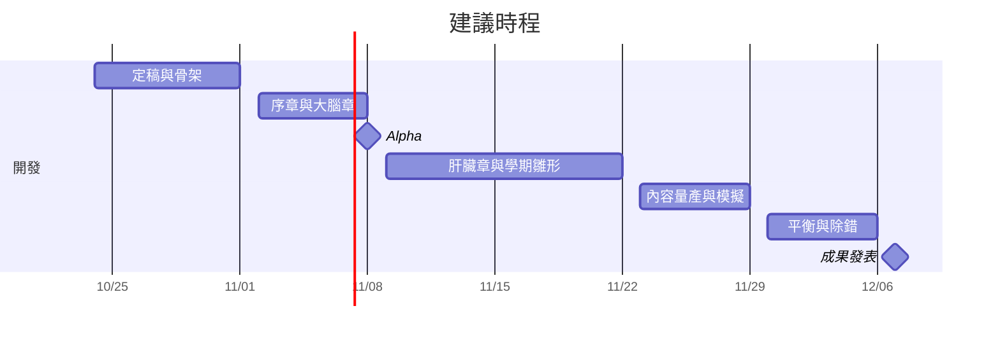

# 人體股份有限公司：遊戲設計文件（第二版）

2026-10-23 · 第七組 · 主企劃整合稿，待 PM 審稿

本文件取代 2026-10-12 版的設計文件（舊版保留在 Git 歷史）。內容依據 PM 拍板紀錄、總監的四面向整合與四份面向提案（學期模式、各章關卡、戰鬥與成長、主線劇情）、2026 年資工系現況研究，以及衛教查證表（docs/specs/factcheck.md，以下稱「查證表」，條目以「第 N 條」表示）。PM 拍板與其他來源不一致時，以 PM 拍板為準。

2026-10-23 第二輪修訂：依 PM 追加決策，宿主小晨由大二改為大三，故事模式每章的外層情境改掛一門大三常見的資工課程，學期模式新增選課系統（第 8.3 節，原 8.3 以後的小節編號順延一號），並同步調整事件庫、耐玩手法、內容守則、補查證清單、模擬項目與待決事項。

2026-10-23 美術修訂：依 PM 美術拍板，新增美術指南 `docs/art-direction.md`，本文件第 2、13.6 節的美術段落改為摘要，並更正立繪分層、走路動畫範圍、紅色分配、徽章與會回來對象的外觀、乙醛顏色、門接口、像素設定範圍、小晨插圖、營運長外觀、高對比預警與江兆耘分工等處。

## 目錄

1. 概述
2. 世界觀與調性
3. 宿主小晨
4. 遊戲結構
5. 操作與戰鬥
6. 文具、夥伴與故事模式成長
7. 各章設計
8. 學期模式（含 8.3 選課系統）
9. 數值與公式
10. 主線劇情與角色
11. 幽默與內容守則
12. 教育設計與衛教查證
13. 技術架構
14. 發表範圍與建議時程
15. 分工建議
16. 待決事項與風險
17. 附錄說明

## 1. 概述

《人體股份有限公司》是一款單人的俯視角 2D 探索冒險遊戲，以 Phaser 3 開發、地圖以 Tiled 編輯，部署於 GitHub Pages，作為國立臺灣師範大學「遊戲程式設計」（115-1）第七組的期末專題。玩家扮演一間「人體公司」新上任的營運長，在資工系大三生小晨的身體裡走動、與器官員工對話、解謎並進行輕戰鬥，對抗以「速效顧問集團」為名的壞習慣。目標玩家是大學生。課程規定作品「必須有助於教育或教學應用」並避免暴力等不當內容，本作的教育內容直接長在玩法裡：每個器官世界的核心機制就是那個器官的生理知識，玩家靠操作學到知識，而不是讀文字。成果發表約在 2026-12-07（可能延至 12-14）。

本作原本是一款管理模擬遊戲：玩家在人體剖面圖上拖曳血球代幣，調度器官部門的資源，10 天一局，第 5 天期中考、第 10 天期末考，作息選擇累積成狀態標籤，失敗時產生倒閉調查報告。該版設計的衛教內容、數值模擬與報告系統都已成形，但 PM 在 2026-10-23 判斷其玩法過於單調、不耐玩（白天唯一的動作是拖代幣），因此改為仿《光暈戰紀》（Guardian Tales）的探索冒險：保留職場諷刺的世界觀、狀態標籤與因果紀錄、員工手冊、倒閉調查報告與已查證的衛教內容，把「調度」換成「走進器官世界處理問題」。舊版的血球代幣、待命池、危機導演與部門怨氣全部刪除。

本作有兩個模式。故事模式由序章、五章、期中考與終章組成，每章教一個機制，首次遊玩約 110 到 125 分鐘。學期模式在故事破關後開放，是以 10 天為一局的隨機重玩模式，作為耐玩度的來源。兩個模式共用同一個核心原則：**外面的選擇，改變裡面的世界**。外層是小晨的生活，以快速卡片選擇作息、三餐與事件；內層是身體世界的探索。外層選擇變成內層的地形、機關、敵人與 NPC 狀態。

以下術語在全文中反覆出現，先集中定義。其他術語在第一次出現時定義。

| 術語 | 定義 |
| --- | --- |
| 外層 | 小晨在校園中的生活，以卡片選擇作息、飲食與事件回應 |
| 內層 | 身體裡的公司世界，玩家操控營運長在其中走動、解謎與戰鬥 |
| 標籤 | 掛在宿主身上、有持續時間並記錄成因的狀態，例如睡眠債、酒精、長期高壓；沿用舊版的因果紀錄系統 |
| 睡眠債 | 以小時計，每晚增加「8 − 有效睡眠時數」，下限 0 |
| S（睡眠係數） | S = max(0.3, 1 − 0.07 × 睡眠債)，代表大腦當天的工作能力 |
| P（董事長精神係數） | P = 0.5 + 0.5 × S，範圍 0.65 至 1.0，用於營運長的幹勁上限與駁回充能 |
| 腺苷 | 清醒時累積、造成睡意的物質；遊戲中化身為「睏意催收員」小怪，打散後會重組，只有睡眠能清（生理說法待查證，見第 12 節） |
| 咖啡因殘留 | 每杯咖啡 +100，每 5 遊戲小時減半的連續數值 |
| 幹勁 | 營運長的生命值，以愛心表示 |
| 負荷 | 學期模式中每層樓的 0 至 100 數值，代表該部門今天累積多少沒處理完的工作 |
| 巡視 | 學期模式中玩家一天一次進入某層樓的探索行動 |
| 修飾器 | 由標籤觸發、套用在手工房間上的變形規則，在資料上是一組具名條件的別名 |
| 修約 | 每章 Boss 被擊敗後與公司重新簽訂的合約，條款就是該章的衛教重點 |
| 違約遭遇 | 學期模式中玩家違反某條修約條款時，該經理在對應樓層再次登場 |
| 打不掉的對象 | 帶有生理旗標、無法以攻擊解決的敵人或物件，只能以正確的生理解法處理 |

## 2. 世界觀與調性

宿主是一位名叫小晨的資工系大三生，身體被描寫成一間公司，各器官是公司裡的部門與員工。玩家是被大腦董事長空降聘來的營運長，任務是讓公司撐到期末考。整體調性是職場諷刺搞笑：器官員工會加班、抱怨、寫便利貼，董事長會畫大餅，年底還有尾牙。笑點取材自台灣學生與上班族熟悉的職場文化，以及資工系的日常語彙（online judge、deadline、merge conflict、hotfix、segfault、office hour）。

世界觀的敘事主軸是一句話：**所有壞習慣都在向明天借錢**。咖啡向明天借清醒，熬夜向明天借時間，報復性宵夜向明天借睡眠，硬撐上課向下週借健康。速效顧問集團就是這筆債的放款人，每章的 Boss 是集團的一位經理；集團真正的老闆是大腦董事長凌晨兩點的分身「夜間董事長」，第五章才揭露。打贏 Boss 不是消滅它，而是改簽合約（修約），因為咖啡、宵夜、聚餐永遠不會從大學生的生活中消失，知識的重點是時機與劑量。

舊版「每一個笑點都必須對應一個真實的生理知識」的原則全部沿用。例如肝永遠不說話、只寫便利貼「我沒事」，對應的是肝臟病變初期常無明顯症狀（第 20 條）。笑點與知識不一致時，以知識正確為優先。

美術方向（摘要，完整規格見美術指南 `docs/art-direction.md`，兩者不一致時以美術指南為準）：世界是 32 像素原生的描邊像素畫，對話立繪與外層插圖維持江兆耘現有立繪的平塗貼紙風，介面是高解析度的紙墨層；舊版的「手繪筆記本風」保留在介面元素（公文、手冊、便利貼、紅筆預警），不套用到世界地圖。人形角色（營運長與速效顧問集團）以 32 × 48 像素畫四方向走路，畫下、側、上三向、左向翻轉，每方向 3 到 4 格；器官員工沒有腳，在世界中以無腳彈跳移動（2 格加程式彈跳），保持立繪的器官輪廓；會回來的對象漂浮；Boss 只畫正面與側面。世界精靈以小尺寸重新繪製，不由立繪縮小，因為立繪縮到 64 像素以下時道具會糊掉。對話時顯示大頭像，使用江兆耘已畫好的器官員工立繪（512 像素單張平塗，含 base、normal、warning、quit 四種狀態，對應學期模式的部門狀態）。對話所需的其他表情另行補畫，以 AI 依原立繪延伸或局部改臉，每個表情輸出為完整一張；若江兆耘保有分層原檔，提交後改為臉部圖層疊加。灰盒期以 CC0 圖塊填入固定的圖塊版位模板；正式版以 CC0 或 AI 紋理底稿量化到世界色票後覆蓋同一版位，地圖不需重擺。承載玩法或知識的物件（打卡機、就寢門、咖啡機、通風口、酒精桶、乙醛箱、產線機台、可推箱）一律自製。標題與手寫元素使用霞鶩文楷（LXGW WenKai TC），內文與介面使用 Noto Sans TC，兩者皆為 OFL 授權。授課教師已確認可以使用 AI 生成素材（2026-10-23）。使用時在素材授權紀錄中逐項記錄生成或輔助的工具與後製方式，並在 README 與製作群名單揭露哪些素材經 AI 生成或輔助；風格一致性仍由江兆耘把關。

## 3. 宿主小晨

小晨是台灣某大學資工系的大三生，住宿舍，有一位室友。學校與系所所在城市都不指名。小晨不知道自己體內有一間公司；他只在外層卡片中以日常口吻說話，常用的身體慣用語會被內層員工字面接收，形成固定笑點：小晨說「我腦袋當機了」，內層董事長真的在重開機；小晨說「在我電腦可以跑啊」，胃物流主管回「在你的大腦可以跑，在我這裡會崩潰」。

小晨的學期圍繞資工系大三的典型節奏。這一年常見的課程包括演算法、作業系統、軟體工程、計算機網路、資料庫，以及編譯器等選修與系上專題；這些課常見於大三，但各校排法不同，遊戲不寫特定學校的課表。程式作業在 online judge（線上自動評測系統，以下簡稱 OJ）上繳交，截止時間是常見壓力點，OJ 回傳的 Wrong Answer、Time Limit Exceeded（執行超過時間限制，以下簡稱 TLE）、Runtime Error 是日常語彙。作業系統一類的系統程式作業以「Segmentation fault (core dumped)」（程式存取了不該存取的記憶體而被系統終止，以下簡稱 segfault）聞名，除錯要花多久很難預估。軟體工程的團隊專案需要多人分工與合併程式碼；專題（大三起由指導教授帶領的長期研究或實作計畫）有固定的指導教授 meeting，也就是每週或隔週向教授報告進度的會議。考試有兩種：上機考是在電腦教室限時寫程式、由 OJ 評分；紙筆考是手寫證明與分析。

小晨同時擔任大二資料結構課的助教（teaching assistant），工作是批改手寫考卷與值 office hour，也就是每週固定時段開放學生來問問題；一年前他也坐在台下，現在換他看學弟妹的指標錯誤。大三也是實習申請季：暑期實習的徵才多在學期中開放，常見流程是投履歷、刷題（在刷題網站練習面試常考的演算法題）、線上測驗（限時的線上程式測驗，常排在晚上）與面試。常見的情境是部分大型企業的暑期實習只開放大三以上申請，大三因此是許多人第一次親自投遞的一年，實習焦慮從「看同學錄取」變成「自己在等通知」。系學會照例辦系烤與迎新，大三的小晨已經是被學弟妹敬酒的學長；校內外有黑客松與程式競賽的校內選拔。AI 寫程式工具在 2026 年已是學生日常，各校的使用規範由學校給框架、個別課程自訂，同一學期內有的課鼓勵使用、有的課的上機考禁止使用。新聞討論 AI 是否取代工程師、家族群組轉傳科系熱門度變化的報導，是小晨投履歷時的背景雜音。

遊戲對小晨的描寫遵守三條規則。第一，小晨普通、努力、偶爾放縱，從不被描述為笨或懶；倒閉調查報告的受文者永遠是營運長，小晨在報告中是「宿主」。第二，時事只寫情境結構，不寫數字與名稱：寫「晶圓大廠在校徵喊高薪」，不寫招募人數或年薪；寫「新的 AI 模型又發表了，群組又在吵哪個最強」，不寫模型名稱；寫「學校諮商中心」，不寫特定年度的補助方案名稱。研究稿中標為「未查證」的事實（例如資工系學生的 AI 使用比例、程式競賽的確切賽制時數、上機考是否普遍改制、各課程的壓力點）不得以事實口吻出現；實習只寫情境結構，不寫具體公司、職缺人數或錄取率。第三，AI 工具不寫成作弊也不寫成萬能，課程規則一律寫成「每門課不同，要看課綱」。

外層的小晨以 Q 版卡片插圖呈現（提案簡報第 3 張的造型為參考，正式插圖由江兆耘以 AI 輔助繪製並修整，依授權紀錄揭露；提案簡報中的小晨 SVG 須先查明來源並登錄後才可沿用）。他的生活卡片在故事模式與學期模式共用同一套介面。

## 4. 遊戲結構

### 4.1 兩個模式

故事模式是手工設計的線性冒險，章節順序依學期行事曆排列（PM 決策 X1）：序章（第 1 週，早餐與肝倉庫）、第一章大腦（第 4 週）、第二章胃（第 7 週，宵夜）、期中考（第 8 週）、第三章肝（第 9 週，系烤）、第四章免疫（第 12 週）、第五章腸道（第 13 週）、終章期末考前夜（第 18 週）、結局尾牙。週次是敘事時間，與學期模式的 10 天壓縮不需一致，手冊註明時間尺度為簡化即可。

學期模式在故事破關後開放，第一局是固定種子的教學學期「新生週」（PM 決策 S3）。之後每局 10 天，第 5 天期中考、第 10 天期末考（PM 決策 S1）。開局先在選課系統從課程池選 4 到 6 門課（修越多風險越高、回報也越高），每門課是一張課程卡，決定這學期的壓力形狀與專屬事件（第 8.3 節）；之後每天早上以卡片規劃作息，白天進入公司大樓的一層樓巡視，晚上睡眠結算。耐玩度來自選課組合（9 張課程卡選 4，每門課教不同的觀念，組合不同時整局的壓力節奏也不同）、部門福利卡、成就解鎖、加班條款自選難度與側向職涯樹（見第 8 節）。

### 4.2 外層與內層的連結

外層選擇透過標籤進入內層。標籤以一份共用的「狀態標籤字典」定義（見第 13.4 節），房間以 Tiled 的變體圖層讀取標籤條件，例如睡眠債 2 小時以上的走廊多兩個腺苷通風口、早上有運動的玩家多一條捷徑樓梯。每張卡片加上標籤時，畫面上有一枚「工單蓋章」飛向公司大樓的對應部門，讓玩家看見因果。

故事模式的外層選擇採「前提固定、可調劑量」（PM 決策 L1）。每章的危機起點由劇本給定（例如第一章小晨已經在晚上八點買了一大杯咖啡），玩家在章首選 2 到 3 張卡（例如昨晚幾點睡、早餐、要不要喝咖啡），章中遇到一張事件卡，章末高潮做一次關鍵選擇。這些選擇只決定嚴重程度與房間變體，不決定危機是否發生，任何組合都能破關；最差組合約使該章難度增加 30%。跨章延續只進入期中考、期末考與終章，並設保底（例如學業進度至少以 50% 計），章與章之間不延續其他狀態。這條限制同時是衛教要求：舊提案中「不吃早餐的肝加班值帶入後續章節」會暗示不吃早餐會累積傷肝，與查證表第 21、27 條矛盾，已刪除。

學期模式的外層選擇完全自由，病因只能在外層消除：睡眠債只能靠睡覺還、酒精只能等肝以固定速率代謝、感冒主要靠休息。內層巡視只能降低樓層負荷，防止部門罷工與送急診，無法讓病因消失。這條「病因在外層，止血在內層」的規則讓衛教知識成為策略本身，也讓動作技巧有實際價值，且兩者都不能單獨過關。

### 4.3 每個系統只負責一件事

整合四份提案時刪除了大量重疊系統，保留的系統各有單一職責，實作與文案不得再為同一個知識做第二種實作。被刪除的系統包括：夥伴切換（值班、待命、登場攻擊、待命被動）、便利貼與迴紋針兩把文具、故事模式的發票與文具改良與夥伴信賴、學期模式的文具零件與舊版公司福利、修飾器插槽物件、故事終章前的三天試營運週、終章的睡眠中互動歸檔、畫面暗角、能量飲料攻速加成，以及任何會鎖定輸入的身體減益。

| 系統 | 唯一職責 |
| --- | --- |
| 標籤與因果紀錄 | 記錄外層造成的身體狀態與成因，供房間變體、報告與手冊使用 |
| 房間變體圖層 | 把標籤畫進地圖 |
| 打不掉的對象 | 教「這個問題要用生理解法處理」 |
| 文具 | 營運長的戰鬥動詞與解謎動詞 |
| 夥伴 | 該器官的功能，只在自己的器官中出現 |
| 駁回印章 | 讀招反制與爆發，並統一說明「打不掉的對象不歸駁回管」 |
| 課程卡（學期） | 決定這學期的壓力形狀與專屬事件，每門課教一個不同的觀念；不做課程小遊戲，只透過外層卡片、事件與內層修飾器表現 |
| 負荷與燈號（學期） | 呈現各部門累積的工作，製造檢傷分類 |
| 部門福利卡（學期） | 局內變化與流派 |
| 職涯樹、成就、加班條款（學期） | 跨局的側向選擇、目標與難度 |
| 員工手冊 | 知識與新選項，不給數值 |
| 結案報告、倒閉調查報告 | 把結果追溯回原因 |

## 5. 操作與戰鬥

### 5.1 三條不可違反的規則

戰鬥的所有細節服從三條規則。第一條是**輸入回應神聖**：攻擊起手幀、閃身無敵幀、輸入緩衝與操作延遲，在任何身體狀態、任何難度、任何成長階段都不變。移動速度可以被降低，但必須有看得見的來源與名稱（黏在身上的腺苷、腳下的糖漿地板、頭上的狀態圖示），所有來源合計上限 15%，且不得出現隨機的輸入中斷（PM 決策 X3）。理由是玩家很難把「閃避變慢」歸因到「小晨昨晚沒睡」，只會覺得遊戲爛；看得見的拖累則本身就是好的教學畫面。第二條是**生理規則是旗標，不是數值**：「腺苷只能靠睡眠清除」「酒精只能走產線」「抗生素對病毒無效」在程式中是物件身上的屬性，不是很高的血量，任何成長、裝備、難度、輔助選項都不能繞過。第三條是**成長給動詞，不給大數字**：玩家變強主要來自新文具、新夥伴與自己的技術與知識，數值成長設硬上限。

### 5.2 操作方案

本作只支援鍵盤與滑鼠（PM 決策 C4）。預設配置讓沒有滑鼠的筆電玩家也能以「左手 WASD、右手 JKL」完整遊玩；接上滑鼠時左右鍵可替代攻擊與夥伴技能。所有按鍵可重新綁定。

| 動作 | 鍵盤 | 滑鼠 |
| --- | --- | --- |
| 移動（8 方向） | WASD 或方向鍵 | |
| 攻擊（點按普攻，按住特殊） | J | 左鍵 |
| 閃身 | 空白鍵或 K | |
| 夥伴技能 | L | 右鍵 |
| 切換文具（兩格互換） | F | 滾輪 |
| 駁回印章 | R | 中鍵 |
| 互動、對話、撿取 | E | |
| 召回菌隊（僅第五章與腸道樓層） | Q | |
| 選擇菌種（僅第五章與腸道樓層） | 1、2、3 | |
| 暫停與文具抽屜 | Esc | |
| 員工手冊與地圖 | Tab | |

瞄準預設為「面向瞄準加軟鎖定」：攻擊朝角色面向發出，面向左右 25 度、7 格內若有可攻擊目標，自動吸附到最近的一個。偵測到滑鼠移動即切換為滑鼠瞄準，放開滑鼠 3 秒後按方向鍵切回。新手教學分批教：序章教移動、攻擊、閃身、互動與駁回印章，第一章教夥伴技能與切換文具（拿到公文夾時），第五章才教菌隊指令。

### 5.3 手感數值

以下數字是第一次試玩的起始值，單位約定為 1 格等於 32 像素、1 幀等於 1/60 秒。

**移動。** 最高速度每秒 4.5 格，從靜止到最高速 4 幀，放開後 3 幀停下，斜向速度正規化。**攻擊。** 輕攻擊從按下到判定出現不超過 6 幀；收招可被閃身取消；連段輸入有 0.35 秒緩衝。**閃身。** 距離 2.5 格，耗時 13 幀，無敵幀為第 2 至 11 幀；結束後 6 幀收尾，之後 0.3 秒冷卻，冷卻內的輸入會被緩衝而非吃掉；不設體力條。完美閃身指敵人攻擊在無敵幀前 6 幀內命中判定區，觸發「準時下班」演出：時間減慢至 30% 持續 0.3 秒，畫面邊緣出現打卡鐘，駁回量表 +10。**受擊。** 玩家被命中時雙方凍結 4 幀、白閃、擊退 1 格、鏡頭震動 4 像素 0.12 秒，之後 1.0 秒受擊無敵；敵人被命中時凍結 3 幀（連段終結 6 幀、印章 10 幀）並噴出紙屑粒子。

**幹勁。** 營運長的生命值以愛心表示，每顆分兩半；一般攻擊扣半顆，重攻擊與 Boss 大招扣一顆，任何單擊不超過一顆半。基礎幹勁 6 顆心。幹勁上限與小晨的睡眠連動，見 5.6。

**敵人預警**分三級，每級同時有形狀、圖樣與聲音，不只靠顏色。一級（小怪近戰、單發子彈）預警 0.5 秒，敵人白閃兩次並出現「！」氣泡與短促「叮」聲。二級（範圍攻擊、衝撞）預警 0.8 秒，地面出現由外往內填滿的紅筆斜線區塊。三級（Boss 大招）預警 1.2 至 1.5 秒，Boss 頭上浮出一份蓋章欄空白的「提案書」並響起影印機聲；提案書同時是駁回印章的反制目標。每個 Boss 大招都必須能用閃身躲過，格擋只是額外解法。

**敵人原型。** 五種通用原型由各章換皮：推銷員（近戰衝刺，業績 4）、傳單手（遠程，業績 3，子彈可被公文夾反彈）、主管（正面持盾，業績 12，需繞背、反彈或重擊破防）、會議召集人（範圍施法，業績 10）、外包商（召喚型，業績 15，每 6 秒招 2 隻小怪）。一個戰鬥房 3 到 6 隻敵人，持續 30 到 60 秒。

### 5.4 駁回印章

印章在序章結尾由大腦董事長授予，象徵「董事長授權營運長對併購方的提案說不」。駁回量表 0 至 100，充能來源為：釘書針命中每發 +0.8、其他文具命中每次 +1.5、公文夾退件 +15、完美閃身 +10；充能速度乘上 P。睡飽的玩家約 25 秒充滿一次，P = 0.72（睡眠債 8 小時）時約 35 秒，P 的下限 0.65 時約 38 秒。

按 R 後營運長舉起印章，起手 0.35 秒（期間無敵）後蓋下，落點半徑 3.5 格。對一般敵人扣 25 業績，對 Boss 扣 40 年度預算。若 Boss 正在三級預警期間被蓋到，提案書被蓋上「駁回」，該招式取消，Boss 進入 4 秒「審核中」，期間不能行動且受傷乘 1.5。留著量表等提案比一充滿就放更有價值，這是 Boss 戰的主要決策點。對打不掉的對象蓋章時，出現灰色「查無可駁回事項」章與一行說明（例如對腺苷：「本件屬生理需求，請以睡眠辦理。」），量表照樣消耗。

### 5.5 打不掉的對象

所有敵人與可互動物件在資料上都有 `category` 與 `solution` 兩個屬性。`category` 分三類：可結案（defeatable，速效顧問集團的員工與壞習慣化身）、會回來（reforming，例如腺苷、機會菌）、打不動（immune，例如酒精桶、對抗生素無效的病毒）。`solution` 指出正確解法（sleep、conveyor、territory、guards、refuse 等），決定頭上的流程圖示與提示文字。

三類一眼可分。可結案的敵人穿西裝、打酒紅領帶，胸前與背後都有集團的閃電徽章，被攻擊時有正常受擊回饋；**有徽章的可以打，沒徽章的要想辦法**，這條規則在序章就教，之後從不例外。可被文具打壞的物件只能是集團的東西，並貼有帶閃電徽章的集團封條。會回來的對象圓滾滾、半透明、有紫色虛線輪廓並緩慢浮動、沒有徽章，被打散成棉絮後原地出現聚集圓環，6 秒後重組；打散有短暫效果（推開），但總數不減。打不動的對象有灰色斜線輪廓與流程圖示，命中時沒有命中停頓，發出軟彈的「啵嗯」聲並跳出正確處理方式，例如「非本部門權限：請送產線」，並以箭頭指向最近的產線。

打不掉的對象不造成直接傷害，威脅形式是累積與時間成本。以腺苷為例：它會黏上營運長，每層使移速 −5%，上限 3 層（剛好是 15% 上限）；累積達上限時，故事模式觸發「強制打盹」，時鐘前進 1 遊戲小時、黏身層數清空，考試戰中則是當下那一題作答失敗。每一種打不掉的對象第一次出現時都在沒有威脅的教學房，提示分三段升級：攻擊無效 3 次時夥伴說話、8 次時出現指向解法的箭頭、15 次時解法物件發光。正確解法的演出要比戰鬥更爽快，例如夜班清潔隊推著大吸塵器橫掃樓層，大字「睡眠：已結案」。

「打了反而更糟」只用在玩家主動選擇使用的工具上（例如抗生素炸彈），工具上一定印著警語，敵人本身永遠不會因為被攻擊而懲罰玩家。

### 5.6 小晨的身體狀態與營運長

睡眠債影響營運長的方式採戰鬥面向原案（PM 決策 X4）。S 只在每章開始（故事模式）或每天開始（學期模式）讀取一次，關卡進行中不變。

其一，**幹勁上限** = 四捨五入（基礎幹勁 × P），且不低於 4 顆。基礎 6 顆時，睡眠債 0 至 2 小時為 6 顆、3 至 7 小時為 5 顆、8 小時以上為 4 顆。被扣掉的心顯示為「加班單」包住的灰心，滑鼠移上或按 Tab 顯示原因，例如「睡眠債 8 小時：董事長精神不濟，2 顆心暫停營業」。其二，**駁回充能**乘上 P，對應「睡眠不足降低注意力與判斷」（第 17 條）。其三，**各章世界效果**：大腦章的腺苷數量與董事長護盾大小、學期模式的大腦樓層負荷。其四，**考試分數**的基礎分乘 S。加上腺苷黏身，一次睡眠不足在考試日共有五個管道同時生效。總監審查曾預警這可能被感受為刁難，PM 選擇保留原案，條件是列為原型試玩的優先觀察項目，以數據決定是否收斂（觀察方法見第 16 節）。

其他身體狀態不改變營運長本人，而是改變各自的世界與對應夥伴：長期高壓使免疫保全的技能冷卻乘 1.5，短期壓力（例如考試當天）反而讓保全有 30 秒警戒模式、冷卻乘 0.8，對應「長期壓力才抑制免疫，短暫壓力上調部分先天免疫」（第 23 條）；咖啡因在大腦世界是隱形斗篷，對其他樓層無效；酒精讓肝的產線塞滿。咖啡、酒、宵夜永遠不得成為戰鬥增益。

**回復。** 每個茶水間（打卡機旁）完整回復幹勁。隨身「保溫杯」每次回復 2 顆心，每章或每次巡視 3 次，到茶水間補滿。關卡中不放任何甜食或零食回復物，避免「吃糖回血」的錯誤訊息；保溫杯不與喝水量連動，避免暗示「喝水能讓身體恢復傷勢」。

**強制下班。** 幹勁歸零稱為「強制下班」：營運長癱坐冒白煙，被人資部的小推車推走。故事模式從最近的打卡機（存檔點）重來，房間敵人重置、已解機關保留、不扣任何東西。學期模式中該次巡視視為處理失敗，負荷降幅為 0、沒有福利卡，但不額外傷害小晨，避免把「戰鬥技術差」呈現成「身體變差」。

### 5.7 難度與輔助

發表版只做預設難度「正職」，另提供「彈性工時」輔助選單，可隨時開關：受到傷害乘 0.5、幹勁不會歸零、遊戲速度 80% 或 70%、攻擊改為切換式、閃身自動完美判定、關閉鏡頭震動、減少閃光、預警音效加字幕。預警以形狀、圖樣、聲音與字幕多重編碼，不另設高對比模式；發表場地的投影清晰度在 12/1 彩排時檢查，必要時直接調整斜線粗細或底色（美術指南第 10 節）。輔助選項不改變任何生理規則，選單上明寫：「彈性工時只調整營運長的工作條件，不調整小晨的身體。」「實習生」與「主管」兩檔戰鬥難度延到發表後。

### 5.8 非暴力演出

打擊爽感來自命中停頓、粒子、音效與連段節奏，與暴力無關。介面、對話與手冊一律使用下表右欄用語。

| 禁用 | 改用 |
| --- | --- |
| 殺、擊殺、消滅 | 擊退、結案、打散、請回 |
| 死亡、陣亡 | 強制下班（玩家）、結案（敵人）、調職或離職（Boss） |
| 血量、HP | 幹勁（玩家）、業績（一般敵人）、年度預算（Boss） |
| 攻擊病毒或細菌 | 驅離、隔離 |

敵人被擊退時原地轉一圈，領帶飛起，化為紙屑（腸道與免疫世界為泡泡），頭上浮出「結案」小章，0.4 秒內散去，不留任何遺體，表情是誇張的驚訝而非痛苦。營運長受傷時白閃、領帶歪掉、冒汗滴；幹勁剩一顆以下時畫面邊緣出現淡灰色紙張摺痕與時鐘滴答聲，不使用紅色暈影或心跳聲。命中粒子為紙片與藍色墨水點。世界與戰鬥 HUD 中的正紅（`#C8372D`）只保留給預警、駁回章與駁回量表；顧問領帶用暗酒紅，乙醛用紅紫色並加圓點圖樣，兩者以形狀與圖樣辨識，不靠紅色；幹勁愛心用珊瑚粉。文件層（報告、行事曆、燈號）的紅筆與紅章不受此限。Boss 年度預算歸零時，一個巨大的「駁回」章蓋在他的總提案書上，Boss 縮成更小的 Q 版，拎起公事包被調回總部或修約，不倒地、不消失。病原體一律以戴墨鏡、拖行李箱的「翻牆者」呈現，被保全請出大門或包進泡泡飄走，不使用寫實外觀。音效全部是文具聲：釘書機「喀擦」、公文夾「啪」、螢光筆「唰」、修正帶「嘶」、印章「碰」，連段時音高每段升半音，畫面顯示「批閱 × 12」。

## 6. 文具、夥伴與故事模式成長

### 6.1 文具

文具共四把，加上駁回印章（PM 決策 C2）。營運長同時攜帶兩把（主格與副格），按 F 互換，戰鬥中互換有 0.15 秒翻抽屜動畫但可被閃身取消；暫停選單的「文具抽屜」可隨時更換這兩格。每把文具同時是戰鬥工具與解謎工具，每秒傷害相近（約 4 到 6），差別在距離、控場與解謎用途。章節中的必要解謎只要求當章與之前的文具。

| 文具 | 取得 | 定位 | 普攻與特殊 | 解謎用途與知識 |
| --- | --- | --- | --- | --- |
| 釘書機 | 序章開場 | 遠程連射 | 每 10 幀一發，彈速每秒 14 格，射程 7 格，傷害 1；按住連射時移速 70%（主動選擇，不計入 15% 上限）。同一目標連中 5 發觸發「裝訂」，釘住 1.5 秒 | 釘住移動中的檔案櫃當踏板、射遠處開關 |
| 公文夾 | 第一章 | 近戰與格擋 | 三段揮擊，傷害 2／2／4。按住舉起格擋，正面 120 度擋下，移速 40%；舉起的前 9 幀為「退件」判定，彈回子彈（傷害乘 2）並使近戰敵人硬直 1.2 秒，量表 +15 | 第一章退件咖啡杯，教「不收下推銷」；第三章改名「婉拒」，格擋勸酒光波 |
| 螢光筆 | 第三章 | 弱點標記 | 普攻短距離畫線，傷害 1.5、可穿透。特殊：畫圈標記目標 8 秒，命中弱點傷害乘 2 | 「健康檢查」：照出肉眼看不到的狀態，例如肝的隱藏加班值與隱藏通道；學期模式中等同抽血。對應「肝病初期常無症狀，要靠檢查才知道」（第 20 條） |
| 修正帶 | 第五章 | 控場 | 向前拉出 4 格修正帶，持續 6 秒，敵人踩上移速 50%；按住可邊走邊拉，最長 10 格 | 菌隊沿修正帶行進，用來規劃路線；暫時蓋住腐蝕地板 |

第二章與第四章不給新文具，新動詞由夥伴提供。舊提案中的便利貼（為花粉貼上「自己人」標籤）會教出「過敏可以靠標記修正」的錯誤印象，與免疫章「遊戲不提供治好過敏的手段」直接矛盾，已刪除；迴紋針失去對應章節，也已刪除。

### 6.2 夥伴

一次只帶一位固定夥伴（PM 決策 C1）：故事模式由該章的器官員工同行，學期模式由該樓層的員工同行，終章例外可從已加入的夥伴中選一位支援。夥伴跟在身邊自動攻擊（傷害約為營運長的 20%），不會被打倒，受到大量攻擊時只會「暫時離席」5 秒。夥伴技能綁在 L 鍵，技能本身就是器官功能，而且器官功能只在自己的器官裡出現，這是衛教正確性的要求：若肝臟員工能在腸道樓層發揮功能，等於傳遞錯誤知識。

| 夥伴 | 登場 | 技能（L） | 戰鬥用途 | 解謎用途 | 對應知識 |
| --- | --- | --- | --- | --- | --- |
| 肝 | 序章、第三章 | 序章「倉庫盤點」；第三章「代謝產線」 | 第三章：把最近的乙醛箱推進第二產線，冷卻 14 秒；不加快任何產線 | 序章：讓附近的葡萄糖箱發光；第三章：協助清空通道 | 空腹時維持血糖（21）；代謝速率有上限（22、29） |
| 大腦董事長 | 第一章 | 「畫大餅」護盾 | 展開護盾擋下彈幕，大小與持續時間等於基準值乘 S | 擋住通風口的氣流前進 | 睡眠不足降低大腦表現（17） |
| 胃物流主管 | 第二章 | 「強制卸貨」 | 向前噴出 3 秒酸液區，持續傷害並擊退，冷卻 9 秒 | 溶解堵住通道的食物塊 | 胃酸分解食物（待查證） |
| 免疫保全隊長 | 第四章 | 「識別警報」 | 掃描半徑 6 格，標出真正的威脅，被標記者受傷 +50% 持續 6 秒，並由在場保全前往處理；冷卻 10 秒，長期高壓時乘 1.5 | 照出偽裝的門與變裝的病毒 | 免疫辨識；長期壓力抑制免疫（23） |
| 腸道菌外包團隊（領班阿酸） | 第五章 | 「號令」 | 把菌隊丟向游標位置圍攻目標，菌種越多元每隻傷害越高 | 分解對應纖維、佔領地盤、壓住開關 | 纖維與菌相多元（19） |

肝的產線技能只處理酒精桶與重複用藥的藥箱，不吸收一般敵人的投射物；全遊戲不使用「解毒」「排毒」字樣，避免成為坊間護肝話術的溫床。董事長的「畫大餅」護盾只在大腦章與大腦樓層以 S 縮放，是 PM 拍板的睡眠管道之外的夥伴特色。

肌肉業務部阿肌、腎臟會計部阿腎與心臟以 NPC 身分跨章出現，不當夥伴：阿肌在玩家選了運動卡時打開捷徑，阿腎發放口服電解質液並管理大廳的手冊資料室，心臟是大廳不能請假的值班員。

### 6.3 故事模式的成長

故事模式不設等級，成長來源只有四種，各有上限。第一是新文具（四把）。第二是新夥伴（每章一位）。第三是「員工感謝卡」：全故事共 8 片，分散在第一到第五章的支線與解謎裡，每集滿 4 片幹勁基礎值 +1，最多 +2，故事模式最大基礎幹勁 8 顆心；睡眠債 8 小時時仍扣到 6 顆（8 × 0.72 = 5.76，四捨五入為 6），身體狀態的懲罰在成長後仍然有感。第四是「職等」：每章結束晉升一級（試用期、正式員工、資深專員、副理、協理、營運長），只是結案報告中的稱號，不帶任何數值。舊提案中的發票貨幣、文具兩階改良與夥伴信賴全部刪除。

任何成長項目都不得抵銷壞習慣的代價，「熬夜耐性」「咖啡因抗性」一類的設計一律禁止；肝產線的處理速度被明確排除在所有成長、福利卡與輔助選項之外。

## 7. 各章設計

### 7.1 章節總表

| 段落 | 標題 | 器官世界 | 核心機制（一句話） | 新文具 | 夥伴 | Boss | 目標時長 |
| --- | --- | --- | --- | --- | --- | --- | --- |
| 序章 | 新人報到 | 公司大廳、肝醣倉庫 | 不吃早餐時，肝從倉庫調貨把血糖維持在正常範圍 | 釘書機、駁回印章 | 肝（暫時同行） | 無 | 6 到 8 分鐘 |
| 第一章 | 借來的清醒 | 大腦 | 腺苷只增不減，咖啡只能讓它看不見你，只有睡覺能清 | 公文夾 | 大腦董事長 | 續杯經理 卡費因 | 15 到 18 分鐘 |
| 第二章 | 報復性宵夜 | 胃 | 消化需要時間，深夜進貨讓胃在睡眠時段加班 | 無 | 胃物流主管 | 報復性宵夜部長 | 12 到 15 分鐘 |
| 期中考 | 期中考卷 | 大腦會議室考場 | 準備度乘睡眠，再乘臨場表現 | 無 | 大腦董事長 | 期中考卷（試煉型） | 約 4 分鐘 |
| 第三章 | 敬酒不勸酒 | 肝（化工廠） | 酒精不能打、不能加速，只能送上速度固定的產線 | 螢光筆 | 肝 | 敬酒部長 | 18 到 20 分鐘 |
| 第四章 | 全勤魔人 | 免疫 | 保全靠認得準，不是靠兇；長期壓力會砍保全預算 | 無 | 免疫保全隊長 | 全勤協理 | 18 到 20 分鐘 |
| 第五章 | 快好的誘惑 | 腸道 | 菌種越多元能開的門越多；抗生素炸彈不分敵我且打不到病毒 | 修正帶 | 腸道菌外包團隊 | 剩藥襄理 阿剩 | 約 20 分鐘 |
| 終章 | 期末考前夜 | 大腦（夜） | 前面所有機制同時出現，最後一擊是準時上床 | 無 | 任選一位 | 熬夜執行長、期末考卷 | 15 到 18 分鐘 |

首次遊玩總長約 110 到 125 分鐘。每章由 12 到 16 個房間與 1 個 Boss 場地組成，約 70% 依第 13.3 節的房間模組規格製作，可直接被學期模式抽用。

### 7.2 每章共通規則

**章內時鐘。** 畫面右上角有時鐘，進入新房間、完成解謎、對話都會推進時間。探索時 1 遊戲小時約等於 55 秒，Boss 戰另用加速時鐘，1 遊戲小時等於 6 秒（咖啡因半衰期 5 小時等於 30 秒），開場以時鐘快轉動畫示意。換算比例只在共用參數檔設定一處。

**章節固定結構。** 外層開場（2 到 3 張卡，前提由劇本給定）、內層警報、遇見本章夥伴（夥伴正陷入麻煩）、探索與解謎 2 到 3 區、中段轉折（揭露 Boss 的手法，通常就是一個迷思）、外層章中事件卡、外層高潮選擇、Boss 戰、修約過場（45 秒以內，每章形式不同）、外層結尾、結案報告與手冊頁。

**卡片的設計紀律。** 每張卡的每個選項都必須在關卡中有看得見的效果與好處，不可以出現「健康選項只有好處」的選擇題，例如早上的咖啡在第一章是真正有用的工具。某些手冊頁只有走不健康路線才拿得到，讓玩家有理由重玩同一章試另一組卡。

**結案報告。** 每章結束發出一份格式與倒閉調查報告相同的結案報告，事故經過寫本章玩家做過的事，例如「第 4 週深夜，營運長駁回續杯申請，夜班清潔隊準時進場」，結論欄是修約條款、新職等與解鎖的手冊頁。章中強制下班則發出一行「停業整頓通知」並從打卡機重來。

### 7.3 序章「新人報到」（第 1 週，大廳與肝醣倉庫）

**開場。** 第一個畫面是一份公文：大二下學期的倒閉調查報告，事故經過寫小晨在期末考當天睡過頭並發燒請假，主任委員肝照例缺席（書面意見：「我沒事。」），右下角蓋著紅色印章「營運長：從缺」。接著是一則徵才廣告：「人體股份有限公司誠徵營運長。工作內容：讓宿主撐到期末考。工時：責任制（24 小時）。待遇：以葡萄糖支付，面議。」玩家進入董事長辦公室面試，三個問題各有兩到三個回答，全部都會被錄取，只是評語不同。這段同時教對話框與選項操作。

**地圖。** 公司一樓大廳像百貨公司樓層導覽，五部電梯分別通往大腦、胃、肝、免疫、腸道，此時只有通往肝醣倉庫的貨梯亮著。大廳有人資櫃台、打卡機（全遊戲的存檔點）、茶水間（完整回復）、員工手冊資料室（阿腎管理）。肝醣倉庫是一排排葡萄糖貨架，通往「血糖調度口」。

**外層情境（資工系）。** 大三開學第一週，加退選開放的那一刻選課系統當機，小晨守著重新整理到凌晨一點，想修的軟體工程還卡在候補，只好隔天下課去找授課教師加簽；隔天早八是作業系統，他選擇不吃早餐準時出門。上課時投影片在講行程排程（scheduling，作業系統決定哪個工作先用處理器的規則），內層的肝倉庫管理員抱怨：「我們也有排程，排的是葡萄糖，只是上游一直沒進貨。」前提由劇本給定，序章沒有開場卡。

**核心機制。** 畫面左上有血糖表，0 到 100，正常帶 40 到 70，營運長走動時每 3 秒降 1。血糖低於 40 時，肝自動從倉庫調出葡萄糖補到 45。序章的血糖表在任何情況下都不會低於 35，這就是知識本身：健康的人不吃早餐，肝會釋放葡萄糖維持血糖，不會因此低血糖（第 21、27 條，手冊註明不適用於使用胰島素或部分降血糖藥的糖尿病患者，也不適用於喝酒後）。肝的「加班」只是當天的演出，不跨章延續，不累積任何肝負擔。

**流程與解謎。** 玩家在人資櫃台領識別證（學會走動與互動）、在打卡機打卡（學會存檔）、在人資窗口收到肝遞來的一本很薄的手冊與一張便利貼「歡迎。」（學會手冊介面）。此時警報響起，董事長大喊「血糖要崩了！」，營運長趕到倉庫，發現肝早就默默在搬貨，只是倉庫門被速效顧問集團塞進來的傳單堵住。傳單化為別著閃電徽章的「傳單紙怪」，這是戰鬥教學：釘書機連射、閃身、徽章規則。清完傳單後是推箱解謎：玩家協助肝把三箱葡萄糖推上輸送帶送到血糖調度口，肝的技能「倉庫盤點」讓箱子發光指出位置。推完後血糖指針回穩，董事長才發現：「原來是誤報？肝你怎麼不早講？」肝遞出便利貼：「已處理。」

**收尾與伏筆。** 中午小晨點了全糖大杯飲料，一位西裝筆挺的速效顧問出現在大廳，遞給董事長一份「提神三十秒，效果立刻見」的試用合約，董事長說「我考慮看看」，並把駁回印章交給營運長：「這個借你，看到奇怪的提案就蓋。」玩家在教學木樁上試蓋一次印章，並對一團沒有徽章、半透明的「睏意催收員」蓋章，看到灰色的「查無可駁回事項」。過場切到凌晨兩點，一隻戴墨鏡的手在合約上簽了名。序章結尾是第一張外層卡「今晚幾點睡？」，選項決定第一章開場的腺苷密度，讓玩家在第一分鐘就看到「外面的選擇改變裡面的世界」。同學阿凱在這一章的外層插圖中第一次出現，是小晨的同屆同學，兩人加簽成功後同一組做軟體工程的團隊專案，常一起在系館趕作業，為第三章的救援場景建立情感重量。

**手冊。** 〈早餐與肝臟〉（推完貨箱必得）。

### 7.4 第一章「借來的清醒」（第 4 週，大腦）

**外層情境（資工系）。** 演算法的 OJ 作業明天早上八點截止，小晨的答案在小測資上全對，最大的那組測資卻一直回 TLE；晚上八點他買了一大杯咖啡（劇本前提）。內層董事長把 TLE 讀成字面：「時間超過限制？誰的時間？我們的工時嗎？」章首卡：昨晚幾點睡（承接序章的卡，決定腺苷起始密度與董事長的 S）、早上喝不喝咖啡（決定開場殘留）、要不要先去運動。章中事件卡在傍晚出現：同學在系群組說「改成 O(n log n) 就過了」，選項是「今晚把 O(n²) 重寫成 O(n log n)」（時鐘延到 01:00、腺苷多兩波，上機練習量較高）或「先交目前的部分分數，明天去助教 office hour 問」（練習量較低，但今晚可以準時睡）；小晨自己也是助教，知道 office hour 其實沒什麼人來，問題是他不習慣當發問的那一個。這張卡的兩個選項分別影響期中上機考與紙筆考的準備度（第 7.6 節）。高潮選擇在晚上十一點：「再一杯撐到三點」或「先睡，明早六點起來寫」，前者讓 Boss 第二階段的腺苷數量加倍。外層結尾：小晨早上六點起床，刷牙時突然想到可以先排序再二分搜尋，一小時內把剩下的測資過完；他把這件事記成「睡一覺起來就看見了」，這是小晨的經驗，遊戲不把它寫成知識（待查證第 26 項）。大腦會議室的白板寫著「我們的演算法是 O(n log n)，我們的睡眠是 O(1)」。

**地圖。** 大腦總部是四層的辦公大樓。一樓接待大廳與兩台咖啡機（08:00 開放的一台在左、17:00 開放的一台在右）；二樓開放辦公區，腺苷從牆上的時鐘通風口持續冒出；三樓海馬迴檔案室，今天上課的「記憶文件」散落一地，角落有一群手機精；四樓董事長會議室是 Boss 戰場地；頂樓有一扇「就寢門」，是本章真正的終點。章內時鐘從 08:00 走到 23:00，約 15 分鐘。

**核心機制。** 腺苷（睏意催收員）從通風口生成，生成速度隨醒著的時數上升；開場密度由昨晚的睡眠決定，睡 8 小時起始 0 隻，睡 6 小時起始 4 隻且生成速度乘 1.3。腺苷的規則依第 5.5 節：不扣幹勁，黏身每層移速 −5%、上限 3 層，打散 6 秒後重組、總數不減，累積達上限時強制打盹、時鐘前進 1 小時。咖啡是「隱形斗篷」：每杯殘留 +100，每 5 遊戲小時減半；殘留 50 以上時腺苷看不見營運長，25 到 50 之間只在 2 格內察覺，低於 25 時斗篷失效。斗篷期間腺苷照樣生成、照樣在門外排隊，斗篷消失時玩家看見這段時間累積的全部腺苷，數量就是本來就會有的數量，刻意不做加倍反撲，因為「咖啡因退去後有額外的反彈性疲倦」沒有查證支持。清除腺苷只有兩種方法：章中的「午睡沙發」與章末的就寢門。

**新文具：公文夾。** 在一樓的總務處取得，取得後的教學房裡，能量飲料推銷員朝營運長丟出「試喝杯」，玩家學會在舉起公文夾的前 9 幀退件，把杯子彈回去，教的是「不收下推銷」；同一房間也教 F 鍵切換文具。

**教的知識。** 醒越久睡意壓力越高；咖啡因讓人暫時感覺不到睏，但沒有消除累積的睡意，效果隨半衰期慢慢退去；咖啡的時機比禁不禁更重要；短暫午睡改善表現；睡眠是唯一真正的清除手段；睡眠有助於記憶保存。

**解謎。** 其一，**就寢門的時機鎖**：門上有殘留量表，殘留低於 15 時門全開，夜班清潔隊全員出動；15 到 50 時門半開，清潔隊人數乘上咖啡因睡眠係數（15:00 喝一杯，23:00 殘留約 33，清潔隊只剩約 87%）；50 以上時門打不開，玩家必須在門前等殘留降下來，而等待期間腺苷持續累積。二樓有一條塞滿腺苷的走廊，最省力的過法是早上 08:00 喝一杯，到 23:00 殘留約 12，不影響就寢門；錯過早上那台、改喝 17:00 那台也能過走廊，但會在就寢門前付出代價。謎題不告訴答案，第一次失敗後咖啡機旁的〈咖啡因〉手冊頁會解鎖殘留曲線。其二，**海馬迴歸檔**：記憶文件散落在三樓，營運長一次只能拿 3 份，醒著時只能堆在「暫存桌」上，桌上的文件每遊戲小時淡化 5%；只有就寢後，夜班清潔隊才會把暫存桌上的文件正式歸檔。歸檔數量就是本章帶入期中紙筆考的準備度（保底 50%，見第 7.6 節），醒著堆在暫存桌、沒有經過睡眠歸檔的文件不計入，對應睡眠有助記憶保存（第 17 條）。其三，**再一支影片**：手機精在播「新的 AI 模型評測」「再一支就好」的短影片，靠近時進入對話，每答一次「再看一支」時鐘前進 30 分鐘，只有「關機」能離開；台詞以「時間被吃掉、內容讓腦袋興奮」為主，刻意不寫「藍光害你失眠」（第 5 條），也不寫任何模型名稱。

**午睡沙發。** 每章限用一次，20 分鐘午睡。在待查證第 3 項完成前，效果寫成「醒來後 60 秒內黏身層數清空、腺苷不會黏上」，只表現「午睡改善表現」（第 34 條）；查證若支持「短暫午睡降低睡眠壓力」，再改為「清掉目前房間一半的腺苷」。

**一般敵人。** 腺苷（會回來，解法為睡眠）。手機精「再一支」（不攻擊，只用對話吃時間，可以用印章關機但印章有冷卻，真正的解法是繞路）。能量飲料推銷員（可結案，別著徽章）：丟出能量飲料罐，撿起來只會使咖啡因殘留 +150 並觸發心悸演出（畫面輕微脈動與心跳音效，不鎖操作、不給任何增益）；本章累計殘留超過 300 時，推銷員改說「董事長，我在跳 Disco」，對應衛福部建議成人每日咖啡因不超過 300 毫克（第 9 條）。打倒推銷員後化為紙屑不再出現，代表拒絕推銷是有效的。

**夥伴。** 大腦董事長，睡飽時是天才，睡不飽時言不及義。技能「畫大餅」護盾的大小與持續時間乘 S；昨晚睡不飽時大餅只有銅板大，台詞變成「我們的願景是……那個……」。

**Boss：續杯經理 卡費因。** 名稱依「使用模式」命名（續杯），攻擊模式編碼咖啡因的時機與耐受。戰場畫面頂端常駐他的殘留曲線，Boss 時鐘下半衰期為 30 秒。第一階段「早晨推銷」：他每喝一杯殘留 +100，殘留 25 以上時移動與攻擊速度乘 1.2，朝玩家連丟咖啡杯彈幕（可用公文夾退件）；一杯的加成約維持 60 秒，正確打法是在他殘留高時閃避、降到 25 以下動作變慢時輸出。第二階段「耐受」：他開始連續喝，第三杯起加成降為 1.1（第 33 條），台詞「怎麼越喝越沒感覺」；他召喚腺苷想困住玩家，但自己披著斗篷看不見腺苷，腺苷在他腳邊越堆越多。若玩家在高潮選了「再一杯撐到三點」，本階段腺苷數量加倍。第三階段「斷電」：他的殘留在第二階段後首次降到 25 以下時，腳邊累積的腺苷全部黏上他，他進入 8 秒動彈不得，這是蓋印章的時機。修約過場是談判：卡費因提出離譜條款（「每天只能喝十杯」），玩家用印章蓋掉，剩下的就是正確條款：「卡費因經理僅限上午上班，下午三點後不得進入大樓；每日總量依衛福部建議不超過 300 毫克，購買時請看杯身紅黃綠標示。」退場台詞：「早上一杯其實還行啦，下午三點以後別找我。」咖啡時限統一為下午三點，理由是查證表第 26 條引 Drake（2013）指出睡前 6 小時攝取仍干擾睡眠，若寫「五點以後」等於暗示下午五點喝沒問題。

**手冊。** 〈咖啡因〉（早上咖啡機後方，必須在 08:00 到 10:00 之間抵達）、〈睡眠債〉（就寢門旁，破關必得）、〈短暫午睡〉（實際使用午睡沙發才掉出）、〈睡前螢幕使用〉（關掉三台手機精才拿得到）、〈咖啡因與能量飲料〉（推銷員掉落）。

### 7.5 第二章「報復性宵夜」（第 7 週，胃）

**外層情境（資工系）。** 期中考前一週，作業系統的多執行緒作業（讓程式同時執行多個工作的作業）週五截止，演算法期中的考古題也還沒寫，小晨連續三晚寫到很晚。今晚十點才開始除錯，凌晨十二點半程式終於跑起來，終端機卻只印出一行「Segmentation fault (core dumped)」。內層的大腦董事長照字面讀成「核心傾印」，以為公司的核心部門被整個倒出來了，下令全公司緊急盤點；胃物流主管冷冷地說：「傾印是我的工作，我每天都在卸貨。」凌晨一點小晨想著「今天被 segfault 搞成這樣，吃點好的獎勵自己」，叫了外送的鹹酥雞配大杯手搖飲（劇本前提），這就是報復性宵夜。胃物流主管的工單標題是「hotfix」，備註欄寫著「每天晚上都在 hotfix」。章首卡：晚餐吃什麼（便當、自助餐、炸雞配手搖飲，決定開場胃倉庫的貨量）、今晚預計幾點睡。章中事件卡：室友在宿舍群組揪鹹酥雞，選項「一起去但點小份」「不去，我要睡」「請室友幫帶一份，明天當早餐」，三個都合理，室友是好人，社交是資源。高潮選擇在凌晨一點外送抵達前：「吃完再睡」或「留到明天早餐，現在去睡」，前者讓 Boss 第二階段的加大份箱子增加。外層結尾：隔天早上小晨把留下的半份當早餐，重新打開那支程式，發現是某個執行緒在資源釋放後還去讀它；室友說：「你昨晚盯著同一行盯了兩個小時。」作業系統的課程卡在學期模式中把這種「除錯時長無法預估」做成規則（第 8.3 節）。

**地圖。** 消化物流中心：食道貨梯（入口）、胃倉庫（中央是大攪拌機，暴躁的胃物流主管坐鎮）、冷藏庫、小腸輸送走廊（貨物在此拆箱成小包裹）、夜間碼頭（外送箱從這裡進來）。章內時鐘從 18:00 走到隔天 02:00。

**核心機制。** 食物箱丟進胃攪拌機後要經過固定時間才變成可通過的小包裹。處理時間依「份量」決定：小份 15 秒、一般份 20 秒、加大份 40 秒；「油炸物消化較久」在待查證第 14 項完成前不做進數字。攪拌機一次只能處理 3 箱，塞第 4 箱會卡住，胃物流主管會暴怒並把所有箱子吐回來。深夜時段，攪拌機運轉中每 20 秒發出一次警報，讓就寢區的「睡眠進度條」中斷一次（半夜醒來）。這對應初步研究中「睡前 3 小時內進食的大學生較容易半夜醒來」（第 14 條，證據屬初步），因此只做「中斷」，不做「睡不著」，台詞一律寫成「有研究發現」而不是規則。

**教的知識。** 消化需要時間，吃太快太多只會塞車（第 18 條）；大量吃糖後半小時到一小時內反而比較累（第 13 條）；睡前進食與半夜醒來有關，但這是初步研究；犒賞自己沒有錯，錯的是時間和份量，真正補得回來的是睡眠。

**解謎。** 其一，**攪拌機節奏**：在限時開啟的小腸閘門前，算好投入的時機與份量才能讓包裹趕上閘門。其二，**分揀中心**：依份量把箱子分到快慢不同的輸送帶，宵夜箱若進了慢速帶就會壓到夜班時段。其三，**深夜加班**：若章中選了去吃鹹酥雞，深夜段攪拌機會在玩家通往就寢區時持續運轉，玩家要先清空攪拌機或繞到冷藏庫把箱子「冷藏」到明天（對應「請室友帶一份明天當早餐」的折衷）。

**一般敵人。** 全糖推銷員（可結案）：免費遞手搖飲，接受的話營運長身上出現「倦怠霧」標籤 45 秒（視野半徑縮小、移速乘 0.85，圖示寫明「全糖倦怠」），對應第 13 條；本章不做「糖後血糖暴跌」演出，因為查證只支持疲倦感。宵夜外送員（可結案）：深夜時段把炸物箱丟上輸送帶，用印章退貨使外層社交 −1，放行則攪拌機加班，兩者都是合法選擇。加大份推銷員（主管原型，正面持盾）。

**夥伴。** 胃物流主管，脾氣暴躁但講流程：「凌晨一點進貨，你知道物流也是有家庭的嗎？」「慢慢吃好不好！我又不是輸送帶！」技能「強制卸貨」溶解堵路的食物塊。

**Boss：報復性宵夜部長。** 台詞全是溫柔話術：「你今天辛苦了，你值得。」戰場是深夜的胃倉庫，攪拌機在中央。第一階段「午夜外送」：部長從四個外送口丟出炸物箱，箱子被自動吸進攪拌機（Boss 戰容量 4 箱），超過容量時攪拌機噴出不分敵我的範圍攻擊，演出名稱為「胃抗議」（待查證第 14 項完成前不命名為胃酸逆流）；玩家可在箱子被吸入前用公文夾退件，把箱子彈回去打部長，這是主要輸出手段。第二階段「加大份量」：箱子變成 2 格大的加大份，處理時間加倍，玩家必須挑著彈，讓攪拌機維持在容量內。第三階段「熄燈」：場地變暗，代表小晨該睡了，畫面底部出現睡眠進度條，攪拌機每處理一箱就中斷一次；部長的弱點只在攪拌機清空時暴露（他靠「胃還在加班」維持清醒），玩家要讓攪拌機清空並撐到睡眠進度條滿，才能蓋印章。中段轉折由部長自己說出：「你很累是真的啊。」營運長的選項之一是「所以該補的是睡眠」。修約形式是改營業時間牌：「本部建議早一點收單、份量小一點；考試前夕暫停營業；室友聚會照常歡迎。」

**手冊。** 〈睡前進食與睡眠〉（擊敗部長必得）、〈糖分與疲倦〉（全糖推銷員掉落）、〈消化需要時間〉（對胃物流主管說完三段抱怨對話才給，他會說「你是第一個問我好不好的人」）。

### 7.6 期中考「期中考卷」（第 8 週）

**外層情境（資工系）。** 期中考週，演算法的上機考與紙筆考排在同一週：週二上機考在電腦教室限時寫三題，由 OJ 評分；週四紙筆考手寫演算法的正確性證明與時間複雜度分析。上機考的課綱第一頁寫著「本課程上機考不得使用 AI 助手」，這只是這門課的規定，同一週的軟體工程反而鼓勵用 AI 工具產生測試，課程規則一律以「每門課不同，要看課綱」呈現。同一週小晨還要以助教身分監考資料結構的小考。考場在大腦的大會議室，考卷是試煉型 Boss，不是壞人：「我不是來害你的，我是來確認你有沒有讀。」

**機制。** 期中考戰分為上機與紙筆兩場，各約 2 分鐘，合計 3 到 4 分鐘，各分兩個階段。上機場的考題是會移動的「測資」，玩家用文具打中即通過；紙筆場的考題是要依序蓋章的「證明步驟」，順序錯了要重來。考卷會丟出干擾彈幕。開打前先顯示兩條「準備度條」與「本場狀態預報」（例如「腺苷 6 隻、咖啡斗篷 40 秒」），讓狀態的影響在戰前就被看見。

兩場的準備度來源不同，這是本作把「睡眠有助記憶保存」（第 17 條）做成規則的地方。**上機考的準備度來自練習**：第一章與第二章外層中實際寫過的題目都計入，包括熬夜寫的題目，因為寫程式的熟練來自動手做過，第一章選了「今晚重寫」的玩家在這裡拿到回報。**紙筆考的準備度只計睡眠歸檔的記憶**：只算第一章海馬迴暫存桌上被夜班清潔隊歸檔的文件，醒著堆在暫存桌、沒有經過睡眠的文件不計入；第一章高潮選了「再一杯撐到三點」的玩家，暫存桌上的文件當晚只歸檔一半。這個差異讓玩家看到熬夜並非全無用處，但熬夜換來的東西進不了紙筆考的檔案室。兩條準備度各自保底 50%。

分數公式與學期模式共用（第 9.3 節）：每一場的基礎分由該場準備度乘考試當天的 S 決定，再乘 0.75 到 1.25 的戰鬥表現係數（PM 決策 S2），期中總分取兩場平均。腺苷在考試戰中黏滿 3 層時，當下那一題作答失敗。

**結果。** 期中考不會讓故事失敗，分數寫進結案報告，報告把兩場的準備度、當天的 S 與表現係數分開列出，並連結到〈睡眠債〉；若上機分數明顯高於紙筆分數，報告多一句「練習有做，歸檔沒做」，並指向〈睡眠債〉中「睡眠有助記憶保存」的段落。考後系學會宣布系烤，引出第三章。

### 7.7 第三章「敬酒不勸酒」（第 9 週，肝）

本章採完整版加護欄（PM 決策 L2）。章首固定顯示：「本章含飲酒情境。在台灣，未滿 18 歲不得飲酒，也沒有人可以提供酒給未成年人。」飲酒在全章不提供任何戰鬥或數值上的好處；不拿小晨或同學喝醉的樣子當笑點；叫不醒同學的救援段不會失敗。發表前需向老師確認飲酒情境可接受，若老師有疑慮，退回「小晨全程拿烏龍茶，只處理勸酒壓力與同學救援」的保守版。

**外層情境（資工系）。** 期中考後，系學會辦系烤慶祝。大三的小晨已經是學長，資料結構班上的學弟妹輪流來敬他：「學長，謝謝你改考卷手下留情。」他沒先吃東西就到場，一輪下來連喝了兩杯（劇本前提）；同屆的阿凱則被大四學長拉去拚酒。章首卡：系烤前要不要先吃晚餐（決定是否帶「空腹」標籤）、今晚怎麼回宿舍（跟室友約好一起走，或一個人搭公車；前者讓救援段多一位幫手）。本章不提供騎車選項，因為前提包含飲酒，酒後不騎車寫在手冊〈酒精代謝〉。章中事件卡：大四學長起鬨要小晨帶學弟妹一起拚酒，選項「我用烏龍茶敬大家」「再喝一杯」「先帶學弟妹去旁邊吃東西」；身為學長，小晨的選項裡沒有任何一個是去勸學弟妹喝。高潮是 Boss 戰後的救援：照顧叫不醒的阿凱。外層結尾：小晨改拿烏龍茶，跟學弟妹和大四學長乾杯，學長說「好啊，敬你」，小晨補一句「期末 office hour 見」。

**地圖。** 肝臟化工廠：收貨區（喝下的每一杯變成一箱酒精出現在這裡）、第一產線（酒精轉成乙醛）、第二產線（乙醛轉成乙酸）、出貨口、肝醣倉庫（門上掛著「產線忙碌中，暫停出貨」）、肝的辦公室（抽屜裡有一封沒交出去的辭呈，以及堆到天花板的書面意見「我沒事」）、頂樓的系烤會場（外層世界的投影）。

**核心機制。** 每一箱酒精等於一個標準杯（10 公克）。第一產線每遊戲小時處理約 0.6 箱，也就是每杯約 1.7 遊戲小時、實際約 1.5 分鐘；這個速度依查證表第 29 條推算（50 到 70 公斤約每小時 4 到 7 公克，手冊寫「一小時大約只能處理半杯到一杯，體重越輕越慢」），不受任何道具、技能、福利或輔助選項影響。處理後的箱子變成紅紫色的乙醛箱（箱面為菱形標誌與「臉紅」小圖示），放在地上會產生 2 格範圍的「乙醛紅霧」（半透明紅紫色、圓點圖樣、點狀虛線邊界，與預警的紅色斜線區分；營運長在其中每 2 秒扣半顆心並臉紅），只能由玩家推進第二產線消除；酒精轉乙醛再轉乙酸的路徑與乙醛的毒性列為發表前必查（待查證第 4 項）。用釘書機打酒精箱，箱子只會晃一下，跳出「酒精無法用文具處理」。產線運作期間，肝醣倉庫暫停出貨；此時若玩家帶著「空腹」標籤，血糖表會跌破序章永遠不會跌破的 35，進入「頭暈冒冷汗」狀態（畫面變暗、移速 −15%，圖示寫明原因），對應查證表第 31 條，也是序章的伏筆回收。先吃晚餐的玩家，血糖表照常由其他庫存維持。

**教的知識。** 肝代謝酒精的速度有上限，多喝不會變快，體重越輕越慢（第 22、29 條）；空腹喝酒時肝無法維持血糖（第 31 條）；咖啡、冷水、催吐都無法加速代謝（第 2 條）；喝酒雖然較快睡著，但下半夜容易醒（第 29 條）；拒絕勸酒本身是一種技能；同學叫不醒時要打 119、讓他側躺、留在旁邊（第 2 條）；肝出問題常常沒有症狀，要靠檢查（第 20 條）。

**新文具：螢光筆。** 在倉庫一角的總務處取得，取得後的教學房要用螢光筆照出一條隱藏通道。螢光筆的「健康檢查」能照出肝的隱藏加班值：被照到時，肝的頭上浮出真實數字，便利貼改成「被你發現了啊」。

**解謎。** 其一，**排隊的產線**：工廠中段有一扇只在收貨區清空時才開的門，多喝一杯，門前就多等約 1.5 分鐘，等待期間沒有任何加速方法。會場裡的「醒酒咖啡」「冷水澡」「挖喉嚨」三個攤位都可以使用，但產線速度完全不變，各自跳出一句修正（咖啡攤：「你現在是一個清醒的醉漢，酒精一克都沒少」）。等待期間玩家手上一直有事做（推乙醛箱、探索支線），整章喝最多的路線總等待不超過 6 分鐘。其二，**乙醛的動線**：玩家規劃推箱路線，避免乙醛箱堆在通道。其三，**下半夜的鬧鐘**：章末就寢區的睡眠進度條在前半段走得特別快（喝酒比較快睡著），後半段每 15 秒被打斷一次，玩家在床邊按鍵重新入睡；喝越多杯，後半段打斷越頻繁。

**一般敵人。** 乾杯小弟（可結案，別著集團公關部徽章）：繞著玩家喊「乾啦」，放出的乾杯光波打中會在收貨區加一箱酒精；用公文夾在光波抵達時格擋（本章改名「婉拒」）會觸發一句從〈拒絕勸酒〉手冊抽出的實用說法，例如「我明天早上還要改考卷，喝茶就好」，格擋成功不加杯但外層社交 −0.5；用釘書機打只會讓他暫時退開，被婉拒 3 次後他自己離場。這是全遊戲唯一「用防禦而不是攻擊解決」的敵人。乙醛紅霧（區域危害）。醒酒迷思攤販（陷阱，不是敵人）。

**夥伴。** 肝。全程不說話，以便利貼與蓋章溝通。技能「代謝產線」把最近的乙醛箱推進第二產線，不加快任何產線。中段轉折：營運長到肝的辦公室找他，對他說「你可以抱怨」，肝第一次開口，只說了一個字：「……累。」辦公室堆滿文件是夜間董事長伏筆的假線索，讓玩家懷疑是肝在深夜簽約；第五章揭露時再說明那是書面意見。會計部阿腎作為 NPC 說明「多喝水不會讓酒精代謝變快」；「喝酒使尿量增加」在待查證第 8 項完成前不寫。

**Boss：敬酒部長。** 本章的 Boss 戰分兩段，第二段不是戰鬥。第一段「乾杯三巡」：部長在系烤會場中央唱歌，每一句副歌朝玩家放出環狀乾杯光波，被打中的每一波都在收貨區加一箱酒精，光波節奏隨歌曲加快；婉拒格擋可抵銷光波，判定與節奏遊戲類似。部長的弱點在每段副歌結束後的換氣 3 秒。收貨區箱子越多，營運長身上的「酒精工單」圖示層數越高，每層移速 −5%、上限 3 層，只隨產線處理慢慢退，迫使玩家在「多婉拒少輸出」與「多輸出多挨杯」之間取捨。部長年度預算歸零時並沒有被打倒，而是說：「好啦不勸你了，可是阿凱好像不太對。」

第二段「叫不醒的阿凱」：會場角落，阿凱趴著叫不醒。畫面轉為外層，語氣平實、不放笑點。玩家得到行動面板，正確步驟是「打 119」「讓他側躺」「留在旁邊」，迷思選項是「灌黑咖啡」「扶去沖冷水」「讓他睡一覺，大家先散了」。選到迷思選項時不懲罰阿凱，而是由小晨的朋友說明為什麼不行，再回到選單，直到三個正確步驟依序完成；若章首選了跟室友一起走，室友會主動接手「留在旁邊」。完成後播放救護車抵達的簡短演出，阿凱在終章出現向營運長道謝，確認他沒事。修約形式是敬酒部長自己改掉口號：「敬酒不勸酒；說不要就是不要；現場備有無酒精飲料；未滿 18 歲禁止供酒；喝酒前先吃東西。」

**手冊。** 〈酒精代謝〉（第一產線控制台）、〈拒絕勸酒〉（婉拒成功 10 次後由乾杯小弟交出）、〈酒精中毒急救〉（完成救援必得）、〈空腹喝酒〉（只有帶著空腹標籤觸發頭暈後才出現在倉庫門口，鼓勵重玩）、〈健康檢查〉（螢光筆教學房）。

### 7.8 第四章「全勤魔人」（第 12 週，免疫）

**外層情境（資工系）。** 軟體工程的團隊專案下週要做進度 demo，組員都說「我讓 AI 寫好了」，四份程式碼風格完全不同，合併時衝突一整夜；同一週的週四早上還有專題的指導教授 meeting，小晨的實驗數據還沒跑完。室友開始咳嗽；小晨喉嚨有點癢，但照常上課，因為「這堂有點名」（劇本前提）。章首卡：團隊專案怎麼收尾（今晚熬夜自己合併、拆成三天做、先跟組員開會訂好規格），直接決定開場壓力值；衛保組的自費流感疫苗（打、不打）。章中事件卡：室友感冒（戴口罩、照常同房）。深夜，有同學在系群組分享自己拿到暑期實習，而小晨三週前投出的履歷還沒有回音，他開始滑學長姐的作品集與程式碼平台上的綠格子，越滑越睡不著，接著是一段不放笑點的情緒低落場景（見下）。高潮選擇在進度 demo 前一晚：「帶病上台」或「跟組員說明、請假，由組員代為 demo，並寫信請指導教授把 meeting 延一週」，後者是正確選擇，在 Boss 戰中讓宿舍的床多亮一次。外層結尾：小晨請了病假，阿凱代為 demo，指導教授回信「先把身體養好，meeting 改到下週」，小晨的資料結構 office hour 由另一位助教代班；全勤協理在內層被迫請了人生第一次病假。

**地圖。** 免疫保全總部：呼吸道大門（入口與主要戰場，訪客與入侵者都從這裡進來）、淋巴結檢查哨（辨識入侵者）、通緝檔案室（已知入侵者的照片，也就是免疫記憶）、保全宿舍（休息與補充預算）、預算辦公室（全勤協理的辦公室）、健身房（阿肌所在）。

**核心機制。** 保全不是越兇越好，而是要認得準；長期壓力會砍保全預算。**預算**：保全人數上限等於 10 人乘預算係數。壓力表 0 到 100，由死線看板與事件推高；若連續 60 秒高於 70，加上「長期高壓」標籤，預算係數變為 0.6，部分保全被調去「支援專案」離開畫面；壓力短暫衝高但在 20 秒內降回時，保全反而短暫加速 15%（第 23 條）。保全宿舍的床讓營運長「睡一覺」，壓力降 30、時鐘前進 8 小時，期間大門無人看守的入侵會累積；長期高壓標籤不會因一覺而解除，必須讓壓力連續 90 秒低於 50 才解除，因為長期壓力之所以「長期」，就是一晚休息解除不了。健身房讓壓力降 15，並解鎖〈規律運動〉；手冊只寫「規律運動有助於紓壓與睡眠」（第 24 條），不寫「動一下壓力就消失」（待查證第 16 項）。**辨識**：每個從大門進來的角色都有剪影，保全要把它送去檢查哨比對；檔案室有照片的入侵者，保全 1 秒內出動；沒有照片的要在檢查哨花 10 秒「初次辨識」，辨識完照片存進檔案室，第二次遇到同一種就變快（免疫記憶，待查證第 10 項，免疫章製作前必查）。**過度反應**：門口會出現「花粉觀光客」等無害訪客，保全隊的一名新人把花粉的照片誤貼在通緝檔案裡（這就是過敏的設定），花粉經過時他帶頭追打，造成全場打噴嚏的震動與保全疲勞。玩家無法把照片撕下來，遊戲不提供治好過敏的手段，只能繞開花粉的路線或在花粉季關上側門，這是本章的「打不掉」。

**教的知識。** 長期壓力抑制免疫，短期壓力則不同（第 23、28 條）；過敏是免疫對通常無害的東西反應過度，不是當事人做錯什麼（第 23 條）；流感疫苗約兩週後才有保護力、只防流感不防一般感冒，一般感冒由數百種病毒引起（第 4 條）；睡眠不足與較容易感冒有關（第 32 條，只寫方向不寫倍數）；生病時請假休息、避免傳染，退燒 24 小時後再回學校（第 8 條）。本章的核心反誤解訊息是「免疫越強越好」是錯的。

**解謎。** 其一，**疫苗照片的兩週**：若章首打了疫苗，衛保組送來一張「流感病毒通緝照」，但照片要經過兩個遊戲日才會出現在檔案室；章中有一段以睡覺快轉兩天的段落，讓玩家實際體驗延遲。其二，**變裝大師**：一般感冒病毒每次進門的外觀都不同（從 6 種造型隨機），通緝照的效果有限，解法是保全人數足夠與休息，而不是靠一張照片。其三，**花粉季的側門**：檢查哨有兩條路，玩家切換閘門讓花粉走側門、病毒走主門。

**一般敵人。** 一般感冒病毒（打不動，解法為保全；營運長的釘書機只能拖慢它）。流感病毒（較強，有疫苗照片時保全立即出動）。死線小怪（可結案）：從預算辦公室湧出的公文怪，名稱是「merge conflict」「demo 投影片」「meeting 進度報告」，每存在一隻壓力每秒 +0.5，打倒就不再生，是本章唯一「打掉就有用」的敵人，對應「把事情拆成小塊處理掉，壓力就會降」，屬一般學習建議，不包裝成醫學。花粉觀光客（不是敵人，攻擊它會觸發過度反應）。

**夥伴。** 免疫保全隊長，熱血、偶爾誤報：「花粉！全員戒備！……報告，是花粉，但我已經打下去了。」技能「識別警報」標出真正的威脅並由在場保全前往處理，保全人數直接決定處理速度，玩家用夥伴的戰力感受「預算被砍」。

**情緒低落場景。** 深夜滑完同學的實習消息、又看了一次自己沒有新信件的信箱後，小晨在宿舍覺得撐不下去。這一段以平實語氣書寫，不放任何笑點，玩家選擇「打給好朋友」或「預約學校諮商中心」，兩者都是正確的；內層董事長在這一段不說笑話，只說：「求救不是認輸。」遊戲不替小晨做任何診斷，也不把焦慮擬人化為敵人。手冊〈情緒低落與求助〉末尾固定附上學校諮商中心與 1925 安心專線（24 小時免付費，第 11 條）。

**Boss：全勤協理。** 速效顧問集團人資處，認為請病假就是不夠拚：「38 度？那不是剛好比較溫暖嗎？」保全：「協理，那是我們在打仗。」第一階段「KPI 壓頂」：協理在場地四周插上死線看板（「demo 倒數」「meeting 前一晚」「履歷截止」），每塊倒數 30 秒，倒數期間壓力持續上升；打掉看板能停止倒數，但他會持續插新的，玩家要在「打看板」與「讓壓力不要高於 70 超過 60 秒」之間調度。第二階段「門戶開放」：協理打開呼吸道大門，放入一般感冒病毒與流感病毒，保全人數取決於第一階段結束時的預算係數；若章首打了疫苗且已生效，流感病毒會被立即辨識。第三階段「挑撥」：協理把花粉觀光客趕進場地，想讓保全反應過度耗盡體力，玩家切換閘門把花粉導開。協理的弱點在他「親自去宿舍叫醒保全加班」的時候：宿舍的床會發光，營運長走上床休息，使他的壓力光環消失 10 秒，這是唯一可以蓋印章的時機。整場的編碼是：壓力持續過高才傷預算、休息是反擊、免疫靠準而不是靠兇。修約形式是協理被迫請病假：「生病時請假在家休息，避免傳染；退燒滿 24 小時再返校；發燒時依手冊判斷就醫時機。」

**手冊。** 〈壓力與免疫〉（擊敗協理必得）、〈流感疫苗〉（照片生效時）、〈睡眠與免疫力〉（使用過宿舍的床才出現）、〈過敏〉（側門閘門控制台）、〈發燒與就醫時機〉（讓流感病毒衝進宿舍一次才掉出，鼓勵探索失敗結果）、〈情緒低落與求助〉（情緒低落場景後必得）、〈規律運動〉（健身房）。

### 7.9 第五章「快好的誘惑」（第 13 週，腸道）

**外層情境（資工系）。** 感冒拖了一週。演算法的期末賽是一場排行榜賽：題目是一個 NP-hard 問題（目前沒有已知的有效率解法，只能比誰的近似解比較好），OJ 每晚更新一次全班排名，排行榜沒有滿分，只有「比別人好一點」；偏偏兩天後就是小晨第一場實習技術面試。小晨去看醫生，醫生說是病毒感染，不需要抗生素，這被呈現為專業。當晚凌晨兩點，排行榜剛更新，小晨掉了五名，他想著「快點好才能面試，才有時間衝排名」，在室友抽屜找到上次剩下的抗生素，吞了一顆（劇本前提）。章首卡：今天三餐吃什麼（蔬菜全穀便當開場三種菌各 3 隻；炸雞配手搖飲開場只有 1 種 4 隻）、明天要不要繼續吃剩藥（「照三餐吃完」使炸彈全章開啟；「早上去問藥師」使炸彈頻率降為三分之一，但已吞下的那一顆仍會有炸彈）。章中解謎「藥袋上的字」是本章的事件卡。高潮在 Boss 戰前：保全隊長調出監視器畫面，凌晨兩點開門讓阿剩進來的，是戴著墨鏡的大腦董事長。原來所有速效合約都是「夜間董事長」簽的。董事長本人完全不記得，崩潰地說：「我半夜到底都在幹嘛？」外層結尾：小晨把剩藥拿去藥局詢問處理方式。面試當天他鼻音很重，但把解題思路講清楚了；排行榜上他停在中段，決定不再為多 0.3% 的分數熬夜。排行榜常駐前三名的同學阿睿在群組說：「我每天 23:30 就關電腦了，參數留給明天的我。」內層的夜間董事長抗議：「那是我的台詞。」董事長：「同一句話，差別在幾點說。」

**地圖。** 腸道是一座地下城鎮：入口是小腸末端的閘口，主體是大腸的「菌村」，分為燕麥區、蔬菜區、豆子區三個街區，每區有不同的膳食纖維貨箱；最深處是「短鏈脂肪酸發電廠」；地圖上方有一個「咽喉監視螢幕」，隨時顯示小晨的感冒病毒正在活蹦亂跳。

**核心機制。** 本章採完整小隊（PM 決策 L3）。玩家可招募三種好菌（燕麥隊、蔬菜隊、豆子隊），每種最多 8 隻，跟在營運長身後；按 L 或右鍵把目前選擇的菌種丟向游標位置，按 Q 召回，按 1、2、3 切換菌種。每種菌只能分解自己那種纖維貨箱（「不同菌種偏好不同纖維」為簡化，待查證第 12 項），分解後產生「短鏈脂肪酸電池」，拿去發電廠開門。小隊戰力等於「菌種數 × 總數」的平方根乘以基準值，3 種各 5 隻遠強於 1 種 15 隻，這是「多元越好」的簡化（第 19 條判定為可接受）。地圖上有「地盤格」，好菌站著的格子保持綠色；地盤空出 10 秒後會被機會菌佔據（定殖抗性的一般說法，待查證第 11 項）。抗生素炸彈從上方掉落，爆炸範圍內所有細菌，不論好菌還是機會菌都消失，而且沒有地方可以躲；舊提案的「黏液層掩體」因為會教出錯誤的保護觀念已刪除。炸彈對病毒完全無效。被炸過的區域，存活的機會菌身上出現「抗藥」徽章，之後的炸彈對它們無效；這個徽章只會出現在細菌身上，營運長與小晨永遠不會得到，對應「抗藥性是細菌產生的，不是身體產生的」（第 12 條）。

**新文具：修正帶。** 菌村入口的總務處取得。菌隊會沿修正帶行進，玩家用它規劃菌隊繞過機會菌巢穴的路線。

**教的知識。** 膳食纖維餵養腸道菌、菌相多元的好處（第 19 條）；抗生素只對細菌有效，對感冒病毒無效（第 12 條）；抗生素會誤傷腸道菌造成腹瀉（第 12、30 條）；抗藥性是細菌產生的；吃別人剩的藥是錯的，醫師開的抗生素要照指示吃完（衛福部「四不一要」，第 12 條）；腹瀉時口服電解質液比運動飲料合適，嚴重時要就醫（第 7 條）。

**解謎。** 其一，**三色纖維閘**：發電廠大門需要三種電池各一顆，只養一種菌的玩家只能繞遠路。其二，**地盤搶修**：炸彈落下後有 10 秒在被清空的地盤格重新放下好菌；搶修失敗的區塊變成機會菌巢穴，只能用三種菌合力圍住才能收復。其三，**藥袋上的字**：菌村入口有一個藥袋道具，檢視後上面寫著「室友的，上次喉嚨痛剩的」；把藥袋交給醫師 NPC，醫師說明「四不一要」，本章後半的炸彈頻率減半。這個選擇刻意放在章中，讓玩家先體驗一次炸彈再做決定。

**一般敵人。** 機會菌（會回來，解法為佔領地盤；釘書機只會讓它們散開後在附近重組）。抗藥機會菌（外觀相同但戴徽章，對炸彈免疫，被好菌包圍時一樣會離開，教「抗藥菌用更多抗生素處理不了，但並不代表無解」）。水災（環境危害）：好菌總數低於 5 隻時，菌村的水道開始暴漲，水流把營運長和菌往出口沖；解法是找阿腎領口服電解質液，喝下後水流減緩 60 秒。阿腎的台詞明確區分「口服電解質液比運動飲料合適」與「如果喝了就吐、整天幾乎沒尿，就要去醫院」。

**夥伴。** 腸道菌外包團隊，領班阿酸：「我們是外包，但我們比正職還愛這間公司。」「今天有地瓜葉？全員加班發酵！」被動「多元加成」：菌種每多一種，菌隊移動速度 +10%。

**Boss：剩藥襄理 阿剩。** 專賣室友抽屜裡的剩藥：「上次你室友吃三天就好了，剩的還很新喔！」他的炸彈像一場誤刪的分支，菌隊哀嚎「我們沒有備份」。第一階段「地毯式清潔」：他在場地各處標記落點，3 秒後投下炸彈，好菌與機會菌一起消失；場地沒有掩體，玩家只能召回菌隊、遠離落點、炸完後迅速搶修地盤。第二階段「病毒保鑣」：他叫出感冒病毒當保鑣，對保鑣丟炸彈想展示威力，炸彈全部穿透病毒，他困惑地說「怎麼打不掉」；病毒旁標示「不是這層樓的問題：請交給免疫保全」。玩家要躲開病毒的噴嚏彈，同時讓菌隊把阿剩腳下的地盤佔滿，佔滿 70% 時他失去落腳處跌倒。第三階段「抗藥大軍」：前兩階段存活下來的機會菌帶著抗藥徽章衝向玩家，玩家撿他掉落的炸彈反擊會讓這一階段的抗藥菌更多；用三種菌包圍抗藥菌可以讓它們退散。最後玩家對他的「無處方合約」蓋上駁回。修約形式是阿剩改行：改任「藥品回收站」站長，條款是「四不一要：不主動要、不自己買、不吃別人的、不隨便停，要照醫師指示吃完」；剩藥的正確處理方式待查證第 18 項完成後才寫進回收站台詞。退場台詞：「醫生開的抗生素是針對細菌感染的，照指示吃完是對的；我只是賣錯了地方。」另安排一段 20 秒短場景，展示醫師開立的抗生素特種部隊精準處理細菌感染，避免玩家把本章讀成「抗生素是壞東西」。

**手冊。** 〈膳食纖維與腸道菌〉（三色纖維閘後）、〈抗生素不治感冒〉（交出藥袋時）、〈腸胃炎與補充水分〉（向阿腎領電解質液時）、〈感冒與病毒〉（第二階段前回去看一次咽喉監視螢幕才出現）。

### 7.10 終章「期末考前夜」（第 18 週，大腦）

**外層情境（資工系）。** 期末週，演算法紙筆期末考的前一天晚上。同一天下午，小晨收到第一份暑期實習 offer，信末寫著「請於三日內回覆」；他想先等另一家的面試結果，又怕錯過這一家。夜間董事長正式以「熬夜執行長」的身分發動總攻擊，在小晨的耳邊說「通宵把考古題全部刷完，順便把 offer 的條件全部比較一遍」。白天的董事長在最終階段提醒營運長：「回覆期限是三天，不是今晚。offer 可以睡醒再回，考試也是。」

**地圖與延續。** 回到第一章的大腦大樓，但時間是晚上，全公司集合。延續只有三項並皆有保底：紙筆考準備度（期末考是紙筆考，只計睡眠歸檔的記憶：第一章歸檔數、期中考後讀書卡中經過睡眠歸檔的部分，以及終章當晚是否準時就寢讓暫存桌自動歸檔；保底 50%）、終章當晚的就寢時間（決定期末考的 S）、可選的支援夥伴（任選一位已加入者）。已修約的 Boss 拒絕替執行長出戰，因為合約規定他們下班了，卡費因說：「下午三點後我不能進大樓，我有簽約。」阿凱在大廳向營運長道謝。

**流程。** 前三階段複習各章機制：第一階段，執行長召喚腺苷與「明天再說」借據怪並發放咖啡（第一章）；第二階段，他叫來宵夜外送，並要求營運長喝一杯「提神酒」，婉拒即可（第二、三章）；第三階段，他打開呼吸道大門並插死線看板（第四章）。最終階段，他提出交易：「通宵一晚，給你三倍攻擊力，今晚就能打倒我。」

接受交易的玩家確實能把他的血條打空，但他隨即說「好，那明天考試見」，期末考以 S = 0.3 進行，結案報告被調查委員會記上一筆，遊戲不強制失敗。拒絕的玩家，執行長的血條其實是「清醒時間」，當晚無法打空；正確的勝利條件是在 23:30 前走進就寢門。此時白天的董事長走到夜間的自己面前，說：「我們明天一起面對。」夜間董事長打了個哈欠，睡著了。夜班清潔隊進場，推著大吸塵器清空腺苷，暫存桌上的文件自動歸檔。睡眠段是不可互動的動畫，2 秒後可跳過，因為讓操作技巧換取睡眠品質，等於宣稱「睡得好不好看操作」。隔天早上是期末考卷的考試戰，規則同期中考，難度高一階。

清潔隊的文案只做兩件事：「清掉睡意」與「把今天的文件歸檔」。「睡覺時大腦會排除廢物或毒素」的說法（膠淋巴系統）目前證據有爭議，全專案禁止。

### 7.11 結局「尾牙」與片尾

故事模式只有一個主結局：公司尾牙。董事長致詞，這次沒有畫大餅，因為餅真的做出來了；已修約的 Boss 以廠商身分出席；抽獎頒發依玩家表現決定的獎項，例如「年度最佳睡眠獎」「全勤協理特別感謝獎（因為你請了病假）」；外層同時揭曉小晨的實習 offer 是在睡醒後回覆的。主任委員肝第一次出席尾牙，坐在角落，桌上便利貼寫著「謝謝。」片尾彩蛋（PM 決策 P2）：小晨的手機響起，是家裡打來的電話，問「有沒有好好吃飯？」，畫面切到序章那份大二下報告的背面，簽名欄寫著「前任營運長（家裡）敬上」。語氣保持模糊，只寫「家裡」，不預設玩家的家庭樣貌；玩家扮演的營運長，其實是小晨開始學著照顧自己的那個部分。片尾後顯示人事命令：「營運長即日起正式任用，學期模式開放。」

## 8. 學期模式

### 8.1 設計主張與單局長度

學期模式的核心主張是「病因在外層，止血在內層」（見第 4.2 節），另有兩條輔助原則：**警報是資訊，不是限制**（任何樓層都能進，包括永遠不亮燈的肝），以及**每次惡化前必有可讀的徵兆**（肝以另一種形式滿足，見第 8.6 節）。

一局 10 天（PM 決策 S1）。第 1 天為星期一，第 5 天星期五期中考，第 6、7 天為週末（排班、補眠、黑客松、系烤等週末事件在此出現），第 10 天星期三期末考。這個日曆與舊版模擬完全相同，外層的逐小時模擬與已驗證的公式因此可以直接沿用（見第 9 節）。學期面向原本以 7 天設計（第 3 天期中、第 7 天期末、5 次巡視），改為 10 天後的調整如下：巡視次數從 5 次增為 8 次（第 1 至 4 天與第 6 至 9 天，考試日以考試戰取代巡視）；每次巡視的目標長度從 3 到 4 分鐘壓到約 3 分鐘，房間數從 4 到 5 間減為 4 間（入口大廳約 20 秒、挑戰房 2 間各約 45 秒、核心房約 70 秒），支線房改為只在例行巡視出現；肝的觸發門檻、徵兆保證與學期設定卡的時數不需比例縮減，直接沿用舊版 10 天的數字；每局保證出現的核心連鎖起點恢復為 5 條全部出現（7 天版只能保證 3 條）。8 次巡視對 5 層樓的比例比 7 天版寬鬆，「沒去的樓層會惡化」的張力可能變弱，忽略加成與標籤貢獻需在重新模擬時確認（第 9.6 節）。

| 階段 | 一般日 | 考試日 | 內容 |
| --- | --- | --- | --- |
| 開局 | 90 秒（僅第 1 天） | | 選課（4 張課程卡，見第 8.3 節）、抽 1 張學期設定卡、選加班條款等級、開學健檢 |
| 早晨規劃 | 30 至 40 秒 | 15 至 20 秒 | 上午、下午、晚上三張日程卡與三餐、咖啡；「沿用昨天」一鍵帶入 |
| 生活快轉 | 25 至 30 秒 | 20 秒 | 小晨的 Q 版短動畫，跳出 1 至 2 張事件卡 |
| 大樓選層 | 10 秒 | | 電梯面板顯示各樓層燈號與修飾器圖示，選一層 |
| 樓層巡視 | 約 3 分鐘 | 考試戰 3 至 4 分鐘 | 見第 8.7、8.9 節 |
| 福利卡 | 10 秒 | | 依評等從該層員工提供的卡中選 1 張 |
| 夜間結算 | 30 秒 | 30 秒 | 0 至 1 張深夜事件、選就寢時間、清潔隊動畫、隔天預告 |
| 結局 | 90 秒 | | 年終評鑑或倒閉調查報告 |

估算總長：一般日約 4.7 至 5.0 分鐘乘 8 天，考試日約 4.6 至 5.5 分鐘乘 2 天，加上開局與結局約 3 分鐘，新手約 49 至 53 分鐘；熟練玩家跳過文案並使用「沿用昨天」後，一般日約 3.3 分鐘，整局約 35 分鐘。這比 7 天版的 36 至 40 分鐘長，因此**每天開始時自動存檔、可隨時中斷**是必要條件，建議的遊玩單位是「一次 2 到 3 天」，約 10 到 15 分鐘。驗證方法：原型完成後請組外玩家玩兩天並計時，若推算新手整局超過 55 分鐘，先把挑戰房減為 1 間（巡視約 2.3 分鐘），再壓縮生活快轉動畫。

### 8.2 外層：小晨的一天

外層保留舊版的「時機與劑量」核心，把操作集中在三個決策點，底層仍跑逐小時模擬並瞬間算完。早晨規劃時，玩家把日程卡放進上午、下午、晚上三格（平日上課卡鎖定在課程卡指定的時段），選三餐，決定要不要喝咖啡與在哪個時段喝。深夜時段與就寢時間移到夜間結算才決定，因為那時玩家剛巡視完樓層，「今晚要不要為了趕作業熬夜」會是有根據的決定。每張卡顯示它會影響哪些樓層；已解鎖對應手冊頁的玩家會看到更具體的資訊，例如解鎖〈咖啡因〉後，下午咖啡卡顯示「就寢時殘留約 33，睡眠效率約 0.87」。

事件卡沿用舊版的五欄結構（觸發條件、情境、選項、效果、手冊連結）與 JSON 格式，新增兩個欄位：`floorLoad`（直接加在樓層負荷上的值）與 `contract`（若此選項違反某條修約條款，填入條款 id）。舊版的嚴重度分級（日常、中等、嚴重、危機）、加權抽籤公式、同一事件 2 天內權重乘 0.2、升級規則（以感冒為例：喉嚨癢、感冒、發燒、危機，每一級都有止住升級的正確選項）、應變事件與機會事件、前一晚預告全部沿用。事件庫見第 8.12 節。

### 8.3 選課系統

選課系統是學期模式開局的第一個畫面，也是每局差異最大的來源。課程池中有 9 張課程卡，每張代表一門課或一條學期副線，定義三件事：**壓力形狀**（這門課的壓力在學期中以什麼節奏出現）、**專屬事件**（只在修這門課時進入抽籤池的事件卡），以及**容易觸發的身體連鎖**（這門課的壓力最常把小晨推向哪些標籤與樓層）。課程卡不做課程小遊戲，維持「每個系統只負責一件事」（第 4.3 節）：課程只透過外層的日程卡、事件卡與內層的修飾器表現，玩家不會在遊戲裡真的寫程式或解證明。PM 的硬性要求是每門課教不同的觀念，避免所有課都只是「熬夜加睡眠債」，因此每張卡圍繞一種不同的壓力形狀設計，課程名稱與內容以「大三常見」為準，不對應任何一所學校的課表。

**選課規則與修課負擔。** 開局時玩家從課程池選 4 到 6 張卡，學分合計不得低於 9、不得高於 22 學分。一般課程為 3 學分，選修的編譯器為 4 學分（遊戲簡化，實際學分依各校而定）；資結助教與實習申請是學期副線，0 學分但佔一個選課欄位，每局各限一張。選幾門課是學期模式兩條獨立的難度軸之一（PM 決策：修課負擔與加班條款並存）：加班條款調整外部條件（門檻、打亂型設定卡、病毒頻率），修課負擔則是小晨自己選擇承擔多少時間需求，兩者分開計算、可以疊加。課程卡改變的是學業進度的需求量與取得方式，不另開一套成績：期中 18 點、期末 37 點的及格門檻以 12 學分為基準，門檻乘數 = 1 + 0.08 × (總學分 − 12)，再乘加班條款倍率。選課畫面仿學校選課系統的介面，每張卡的背面顯示壓力形狀圖示、上課時段、考試形式與它在本局最常影響的樓層；畫面下方即時顯示本局的負擔等級與學期行事曆預覽。

開局有兩個選課事件，各在 30% 的局出現（教學學期「新生週」不出現）。「選課系統當機」：玩家選定的課程中隨機 1 門變成「候補中」，第 2 天早上揭曉，候補上了照常，沒候補上時由系統從剩下的課程中補一門 3 學分課。「加簽」：第 1 天下午出現加簽機會，玩家可以花這個下午時段到授課教師的辦公室加簽一門課，總數仍不得超過 6 門、22 學分，加簽課程的專屬事件、時段與門檻照常計入。兩個事件都不改變任何身體數值，教的是「學期開始前的選擇決定整學期的節奏」。

**課程卡總覽。**

| 課程卡 | 學分與考試形式 | 壓力形狀 | 教的觀念 | 查證 |
| --- | --- | --- | --- | --- |
| 演算法 | 3 學分；期中上機考加紙筆考，期末排行榜賽加紙筆考 | 無上限型 | 邊際效益遞減，知道何時收手；不跟群組裡跳動的分數比 | 睡眠不足降低表現（17）；比較焦慮與入睡（待查證 30） |
| 作業系統 | 3 學分；紙筆考；兩次系統程式作業 | 不可預期型 | 時間無法預估時，提早開工留緩衝 | 睡眠不足（17）；睡前進食（14） |
| 軟體工程 | 3 學分；無考試，進度 demo 與期末 demo | 長期累積型 | 長期壓力會壓抑免疫；找人談比獨自熬夜有效 | 長期壓力與免疫（23、28）；社會支持與壓力（待查證 31） |
| 計算機網路 | 3 學分；紙筆考；固定時段實驗課 | 固定時段型 | 課表綁住時段時，先把吃飯排進去 | 睡前進食（14）；吃太快太多（18）；錯過正餐後的進食（待查證 28） |
| 資料庫 | 3 學分；期中與期末皆為紙筆考 | 考試型 | 睡眠把讀過的內容歸檔，考前通宵讀的記不住 | 睡眠有助記憶保存（17） |
| 編譯器（選修） | 4 學分；上機作業與期末專案 | 卡關型，高風險高學分 | 久坐要起身活動；卡住時先離開座位 | 久坐與伸展（15）；走路與創意（待查證 27，只寫成小晨的經驗） |
| 專題 | 3 學分；無考試，每週固定指導教授 meeting | 週期型 | 睡眠債會累積，補眠只能還一部分 | 睡眠不足（17）；補眠的償還效果（待查證 29） |
| 資結助教（副線） | 0 學分；固定工時 | 工時型 | 替工作設下界線；幫助別人也是社交 | 社交規則沿用舊版；早餐與肝（21、27） |
| 實習申請（副線） | 0 學分；長期副線 | 長期不確定型 | 比較焦慮時先顧睡眠，求助不是認輸 | 情緒低落求助（11）；睡眠與注意力（17）；比較焦慮與入睡（待查證 30） |

**課程卡規則、專屬事件與身體連鎖。** 下表的天數依第 8.1 節的日曆（第 1 天為星期一，第 5 天期中考，第 6、7 天為週末，第 10 天期末考）。

| 課程卡 | 核心規則 | 專屬事件 | 容易觸發的身體連鎖與樓層 |
| --- | --- | --- | --- |
| 演算法 | 第 6 至 9 天晚上開放期末排行榜賽，玩家在夜間結算可選擇衝排行榜 0 至 4 小時。當晚第 h 小時的分數增量為 10 × S × 0.6^(h−1)，也就是 10、6、3.6、2.2 再乘當天的 S，累積 60 分為排行榜滿分，排行榜占期末考百分的 30%。每晚同學 NPC 中有 1 至 2 位的分數上升 3 至 8 分，並在系群組跳出通知 | 「OJ 作業一直 TLE」；「排行榜深夜更新，同學又進步了」；「上機考規定不能用 AI 助手」 | 睡眠債（大腦）；比較事件使壓力上升、入睡延後（免疫、大腦）；修飾器「排名看板」 |
| 作業系統 | 兩次系統程式作業：第 2 天公布、第 4 天截止；第 6 天公布、第 9 天截止。每次需要 3 小時撰寫，加上開始除錯時才揭曉的除錯時長，從 1 到 6 小時抽取（1 小時 20%、2 小時 25%、3 小時 20%、4 小時 15%、5 小時 12%、6 小時 8%）。除錯時數可以分散在截止前的每一晚；截止前一晚才開工的玩家，就寢時間完全由抽到的數字決定。除了「提早開工」福利卡會獎勵提早開工的玩家，沒有任何方法縮短除錯時長 | 「凌晨 segfault（core dumped）」；「截止延長公告」（機會事件，只對已經開工的玩家有利）；「segfault 後的報復性宵夜」 | 睡眠債（大腦）；報復性宵夜（胃，可觸發報復性宵夜部長的違約）；修飾器「核心傾印」 |
| 軟體工程 | 一條 0 到 100 的專案進度條，第 4 天進度 demo 需要 40，第 9 天期末 demo 需要 100。3 位組員 NPC 每天自動推進：阿凱可靠（每天 +6）；小芸穩定但需要明確分工（每天 +2，被「找組員談」過後改為 +5）；阿誠時有時無（每天一半機率 +0、一半機率 +6，被找組員談過後固定 +4）。小晨可以「熬夜補進度」（每小時 +4，壓力 +5，睡眠債照算）或「找組員談」（佔一個下午時段，壓力 −10、社交 +1，組員改善持續到本局結束）。進度落後時程線時壓力每天 +3 | 「組員都讓 AI 寫，合併衝突一整夜」；「組員已讀不回」；「demo 前一晚開發環境壞掉」 | 長期高壓（免疫，預算刪減）；demo 週感冒硬撐（免疫，可觸發全勤協理的違約） |
| 計算機網路 | 第 2、4、9 天 18:30 至 21:30 固定實驗課，佔用晚上時段且不能移動。晚餐時段被擠掉，玩家必須在早晨規劃時把晚餐提前到 17:30 前（下午時段縮短 1 小時），或選「實驗前先吃便當」；沒有安排晚餐的實驗日加上「錯過晚餐」標籤，當晚 22:00 後的宵夜事件機率乘 3。實驗缺席扣學業進度，不能用熬夜補 | 「實驗做到一半封包一直遺失」；「實驗課加開」（取代舊版的上機實習課應變事件）；「實驗後同組揪宵夜」 | 錯過晚餐接宵夜（胃，夜班物流）；全糖手搖飲撐實驗（當天巡視樓層，糖漿地板） |
| 資料庫 | 期中與期末都是紙筆考，學業進度完全依賴下方的「睡眠歸檔」規則，是這條規則最直接的展示。考前一晚通宵讀的內容，歸檔率為 0 | 「考前一晚的正規化考古題」；「交易理論背到凌晨」；「讀書會」（機會事件） | 睡眠債（大腦）；考前下午咖啡（大腦，可觸發續杯經理的違約） |
| 編譯器（選修） | 3 次作業與 1 個期末專案。每次作業有一個「卡關點」：連續坐在書桌前 3 小時以上時，卡關點的進度效率乘 0.3；選「起身走走」（15 分鐘）會清除久坐計時，下一小時的進度效率恢復正常。期末專案在第 9 天截止，完成時年終評價點數 +10，未完成時期末考百分 −8，這就是高風險高學分 | 「文法衝突，剖析器卡在同一個錯誤」；「起身散步回來想通了」（小晨的經驗，待查證 27）；「期末專案前夜的能量飲料」 | 久坐僵硬（大腦）；能量飲料（大腦，可觸發續杯經理的違約） |
| 專題 | 第 3 天與第 8 天上午有指導教授 meeting，每次 meeting 前需要完成 4 小時的進度；前一天晚上還沒完成時，出現「meeting 前一晚趕進度」事件。meeting 結果分三級（進度完整、部分、沒有進度），只影響專題在學業進度中的貢獻與教授的回饋台詞；教授的台詞以進度與身體為主，不責罵。每週固定的前一晚熬夜會讓睡眠債呈週期性累積，週末補眠超過 8 小時的部分只償還 50%（第 9.1 節） | 「meeting 前一晚趕進度」；「寫程式代理跑一整晚，把實驗改壞」；「教授說先把身體顧好，進度下週再補」 | 週期性睡眠債（大腦）；meeting 前的下午咖啡（大腦，可觸發續杯經理的違約） |
| 資結助教（副線） | 第 2 天與第 8 天下午各值 2 小時 office hour；第 5 天期中考後要改 60 份手寫考卷，約 5 小時，第 7 天交成績，可以分散在第 5 至 7 天，也可以在第 6 天深夜一次改完。每次 office hour 社交 +1；有 30% 機率出現「學弟妹問到小晨也不會的題目」，選「一起查」時小晨的學業進度 +0.5。期中考當天早上要監考，早八。局末目標是「準時交成績」，達成時年終評鑑多一欄 | 「深夜改考卷，字跡辨識大會」；「office hour 學弟妹的指標錯誤」；「監考日早八」 | 深夜改考卷造成睡眠債（大腦）；改考卷配宵夜（胃）；監考日不吃早餐（肝，倉庫調貨修飾器，不增加負荷） |
| 實習申請（副線） | 第 1 至 4 天可投履歷（每份佔 1 小時，最多 4 份）；第 3 天與第 7 天 21:00 至 23:00 各有一場線上測驗，只能在晚上時段參加，結束後入睡延後 0.5 小時；第 8 天下午面試。錄取機率 = 0.1 + min(0.3, 0.02 × 刷題時數) + 0.4 × 面試日的 S + 0.05 × 投遞份數，上限 0.9。刷題時數與讀書時數共用同一批時段，與課業搶時間。沒拿到 offer 不影響過關，只是年終評鑑少一欄 | 「同學在系群組分享實習錄取」；「線上測驗排在晚上九點」；「面試前一晚再刷一題」 | 比較焦慮使壓力上升、入睡延後（免疫、大腦）；面試前熬夜（大腦） |

**睡眠歸檔與上機練習。** 故事模式期中考的準備度分流（第 7.6 節）在學期模式中以課程的考試形式實作。讀有紙筆考的課（演算法、作業系統、計算機網路、資料庫）的時數，先進入當天的「暫存進度」，當晚睡眠結算時依歸檔率轉為學業進度：歸檔率 = min(1, 有效睡眠時數 ÷ 7)，未歸檔的部分隔天只保留一半。讀有上機考或上機作業的課（演算法、編譯器）的時數直接計入學業進度，這部分稱為「練習進度」，熬夜寫的題目也算，但仍乘當下的讀書效率；經過睡眠歸檔的部分稱為「歸檔進度」，兩者合計就是學業進度。演算法同時有上機與紙筆考，讀演算法的時數一半計為練習進度、一半進入暫存。考試戰的題目由已選課程的考試形式組成，上機題是會移動的「測資」，紙筆題是要依序蓋章的「證明步驟」，兩種題目的比例顯示在狀態預報中。夜班清潔隊在資料庫的事件中有一句固定台詞：「睡著了才算 commit。」這條規則讓睡眠同時影響 S 與紙筆考的準備度，屬於 X4 疊加管道之外的新增管道，必須在第 9.6 節的模擬中確認不會造成死亡螺旋。

**排行榜與同學。** 演算法的曲線讓「每晚 1 至 2 小時、23:30 前收手」成為最佳策略：4 晚各 2 小時、S 約 0.95 時累積約 61 分，接近滿分；2 晚各 4 小時、睡眠債使 S 降到 0.8 時只有約 35 分，隔天的大腦樓層還多出腺苷。排行榜前三名的同學 NPC 阿睿每晚 23:30 準時下線，他的分數一樣在群組跳動，玩家點開他的個人頁會看到「今晚已關機」；高分同學有睡飽的版本，是第 11.7 節的守則。比較事件提供「關掉通知先睡」選項，選了之後當晚不再跳出同學分數。

**負擔等級與回報。** 學期模式的刺激主要來自多門課在同一學期互相碰撞、連鎖疊加，因此修課負擔採高風險高回報。總學分決定負擔等級：輕鬆（9 至 12 學分）、標準（13 至 15）、重修課（16 至 18）、滿堂（19 至 22）。回報有四種（PM 決策），全部只在過關時兌現。第一是**學期評價倍率**：年終評價點數乘上負擔倍率，輕鬆 1.0、標準 1.15、重修課 1.35、滿堂 1.6；由於及格門檻同步依學分提高，倍率只有在玩家真的管理得住時才拿得到。第二是**實習 offer**：實習申請卡的錄取機率多一項「+ 0.05 × 期中及格的核心課數」，核心課指演算法、作業系統與編譯器，停修的課不計，上限 0.9 不變。第三是**稀有福利卡**：負擔為重修課時，每次巡視的福利卡三選一中有 20% 機率其中一張換成稀有卡，滿堂時為 35%；稀有卡同樣遵守「不得抵銷衛教代價」，只獎勵規劃，例如「時程重排」（每局一次，把一個非考試的死線延後 1 天，需在前一晚預告前使用）、「整合週報」（同一天推進軟體工程進度條並出席專題 meeting 時，meeting 前的進度需求減 1 小時）。第四是**專屬成就**（第 8.14 節）：「滿堂也睡飽」與「知所進退」。

**學期行事曆與碰撞日。** 選課完成後顯示 10 天的學期行事曆，標出各課程的截止、考試、demo、meeting、實驗與面試。同一天有兩項以上主要項目（截止、考試、demo、meeting、面試）稱為「碰撞日」，以紅框標示，並在前一晚的夜間結算再預告一次，延續「危機前一定有徵兆」的公平原則：刺激感來自玩家看著碰撞逼近、而且有辦法提前應對，而不是突然爆發。碰撞日本身不附加任何額外懲罰，壓力完全來自時間真的不夠，以及前幾天選擇累積下來的標籤，遵守「每個系統只負責一件事」。重負擔局的典型連鎖如下：修作業系統、演算法、軟體工程與專題，第 8 天上午專題 meeting，晚上作業系統第二次作業除錯抽到 5 小時，凌晨三點才就寢，睡眠債 +4；第 9 天 S 降到 0.72，軟體工程期末 demo 前組員阿誠失聯，壓力 +15，加上長期高壓標籤，免疫保全的技能冷卻乘 1.5；第 10 天期末考前一晚室友感冒，發燒升級機率提高。每一環都是既有機制，倒閉調查報告的證據牆會把整條連鎖串起來，這是重負擔局最有戲劇性的部分。

**課程加乘。** 部分課程組合會互相幫忙或互相拖累，讓選課像組牌組一樣有搭配可言。演算法加資結助教：每次 office hour 計 0.5 小時的演算法練習進度，因為解題給學弟妹看等於複習。軟體工程加專題：兩門課常用同一份程式碼，軟體工程進度條當天有推進時，專題 meeting 前的進度需求減 1 小時。資料庫加軟體工程：專案用到資料庫，當天讀資料庫的日子，軟體工程進度 +2。反過來，作業系統加計算機網路是最常見的撞期組合：網路實驗佔走第 2、4、9 天晚上，作業系統的除錯只能排在其他晚上。加乘只減少時間需求或改變時段分配，不改變任何身體數值。

**停修。** 第 1 至第 4 天（期中考前）的早上規劃時，玩家可以停修一門已選課程，每局限一次，停修後學分低於 9 時不得停修。停修後該課從行事曆移除，專屬事件退出抽籤池，已累積的該課進度作廢，當天壓力 −15，成績單上留下 W；負擔等級、門檻乘數與該課帶來的回報依剩餘課程重算。結案報告把停修記為一行正面紀錄：「營運長判斷負擔超出產能，申請停修一門，經核准。」教的是「知道什麼時候放棄本身就是一種能力」；這是學業規劃的建議，不寫成醫學知識。

**高風險高回報的設計護欄。** 重負擔的回報必須來自管理得好，不得來自犧牲健康，否則遊戲等於在教「爆肝才會贏」。第 9.6 節的模擬以三條標準驗收：其一，重修課以上加應變派（提早開工、分散進度、必要時停修或求助、平均有效睡眠 7 小時以上）的年終評價，高於輕鬆加應變派；其二，重修課以上加熬夜派的年終評價，低於輕鬆加應變派，且住院率明顯較高；其三，每一種課程組合下，年終評價最高的策略平均有效睡眠不少於 7 小時。任何一條不成立時，先調整負擔倍率、門檻乘數與課程時數需求，不得以放寬睡眠相關規則解決。

**與學期設定卡、應變與機會事件的關係。** 舊版每局抽 2 張學期設定卡，其中一部分描述的是課業安排。課程卡取代所有課業類的設定：學期設定卡改為每局 1 張，只保留生活與身體類（舊版的週末打工、夜貓室友、通勤族、社團幹部、住家裡，以及新增的黑客松、競賽校隊、過敏體質、健檢異常）；舊版課業類的「滿堂早八」與「修了營養學」由課程卡取代，早八改由各課程卡的上課時段決定，「專題組長」併入軟體工程與專題兩張課程卡。應變事件與機會事件保留舊版的結構與模擬結論，與課業有關的條目改綁到課程：「上機實習課」改為計算機網路的「實驗課加開」；office hour 改為每門已選課程各有一個，由該課的助教值班；「深夜刷題團」只在選了演算法或實習申請時出現；「補課通知」從已選課程中抽一門；「讀書會」與「學長姐考古題」只對有紙筆考的課程有效。颱風假、室友期末派對、校園健走、排班表與系學會成果發表與課程無關，照舊。完整名稱對照見第 8.12 節。

**與福利卡、成就、加班條款的互動。** 課程卡本身不給數值加成，只決定壓力的形狀；與課程有關的獎勵一律走既有系統，並遵守「不得抵銷衛教代價」的硬規則（第 8.8 節）。福利卡池新增 3 張課程福利卡，只在選了對應課程時進入大腦部門的提供池：「提早開工」（作業系統：在截止前 2 天以上開工的作業，除錯時長抽兩次取較短者）、「知所進退」（演算法：當晚在 23:30 前停止衝排行榜時，隔天巡視的駁回量表以 30 開始）、「站立會議」（軟體工程：每次「找組員談」後，下一次合併衝突事件降一級嚴重度），三張都只獎勵提早或健康的選擇。成就新增 7 項，條件都是課程中的健康行為或負擔管理（第 8.14 節）。修課負擔與加班條款是兩條獨立的難度軸，加班條款不包含任何選課條款。課程的專屬事件也會連到違約遭遇，例如作業系統的「segfault 後的報復性宵夜」與資結助教的「改考卷配宵夜」都可能觸發報復性宵夜部長的條款，讓期末監考官反映玩家這學期修了什麼課。

### 8.4 公司大樓、負荷與燈號

公司大樓有五層可巡視的樓層：大腦（頂樓董事長室）、免疫（保全部）、胃（物流部）、肝（倉儲與產線）、腸道（地下室外包菌團隊），對應故事模式五章的世界。肌肉、心臟、腎臟在大廳以顏色與員工台詞顯示，不提供巡視。

每層樓有一個負荷值，0 至 100。負荷 40 以上亮黃燈，60 以上亮橙燈並由該部門在外層說出真實的早期症狀（例如免疫的「喉嚨有點癢」、大腦的「同一行字看了三次」），85 以上亮紅燈代表罷工。負荷在夜間結算一次算完：

> 隔天負荷 = 今天負荷 + 標籤貢獻 + 忽略加成 − 睡眠修復 − 巡視降幅

睡眠修復 = 2 × 有效睡眠時數，對每一層都生效，「睡覺修復全身」直接寫在規則裡。忽略加成是負荷已達 40、今天卻沒被巡視的樓層 +10。巡視降幅 = 30 + 10 × 評等（C 為 0、B 為 1、A 為 2、S 為 3）。徵兆保證：前一晚負荷未滿 60 的樓層，一個晚上最多只能升到 84，任何樓層從黃燈跳到罷工之前，一定會在橙燈停留至少一晚。急性危機（急性酒精中毒、嚴重脫水）不走負荷，而走外層事件卡的升級鏈，徵兆同樣在前一張卡出現。

標籤貢獻的初版數字如下，全部需重新模擬。舊提案中「沒吃早餐：肝 +5」已刪除，因為它暗示不吃早餐會累積傷肝；不吃早餐只觸發「倉庫調貨」修飾器，不增加任何負荷。

| 標籤或行為 | 影響樓層與每日貢獻 |
| --- | --- |
| 睡眠債（每小時） | 大腦 +4 |
| 程式作業死線、長期高壓 | 大腦 +8 至 +10；長期高壓另使免疫 +15 |
| 咖啡因耐受 | 大腦 +8 |
| 宵夜、暴食 | 胃 +15、+10 |
| 當天纖維點未滿 3／達 6 以上 | 腸道 +8／−8 |
| 吃室友剩的抗生素 | 腸道 +35（持續 2 天）；對感冒無任何效果 |
| 腸胃炎 | 腸道 +30、胃 +15 |
| 酒精（每標準杯） | 肝 +8，空腹時乘 1.5 |
| 重複用藥（綜合感冒藥加止痛藥） | 肝 +25 |
| 感冒／發燒 | 免疫 +25／+40 |
| 室友感冒（接觸） | 免疫 +5 |

課程卡（第 8.3 節）不直接增加樓層負荷，而是透過它產生的標籤與行為進入上表，例如作業系統的除錯熬夜進入睡眠債、計算機網路的錯過晚餐通常接著宵夜、軟體工程的進度落後推高壓力直到長期高壓。這讓「病因在外層」的規則不需要為課程另設例外。

選層規則：一天只能巡視一層，任何樓層都能選。亮燈樓層通常有 2 到 3 層；若少於 2 層，系統把負荷最高的未亮燈樓層標為「例行巡視」，這種巡視以寶箱、支線 NPC 與手冊線索為主，壓力小，作息健康的玩家因此會更常玩到輕鬆有趣的房間。亮燈超過 3 層時全部顯示，代表公司已經失控，玩家要做檢傷分類。

**加班巡視。** 每天可以在巡視完第一層後「加班」再進一層，代價是小晨當晚就寢時間強制延後 1 小時。加班巡視只降負荷、不給福利卡，避免「熬夜換獎勵」成為最佳策略。這條規則把「營運長加班」與「宿主熬夜」綁在一起：救急可以，代價是明天的睡眠債。

**罷工的效果。** 罷工樓層對外層施加全域減益：大腦罷工時讀書效率乘 0.5；免疫罷工時感染機率乘 2；胃罷工時三餐效果減半；腸道罷工時加上「腹瀉」標籤；肝的罷工規則見第 8.6 節。巡視罷工中的樓層會進入「停擺」版本的房間組合（較難、無寶箱），最佳結果只能把負荷降到 70。

### 8.5 巡視的內容與評等

每次巡視由 4 間房組成：入口大廳（部門員工依當前標籤說台詞，交代今天的狀況）、2 間挑戰房、1 間核心房。核心房依樓層固定一種，但內容隨修飾器改變，每間都含有一個不靠文字、需要知識才能做對的判斷，讓懂衛教的玩家在內層也有優勢。

大腦核心房「休息室」：腺苷打不完，正確做法是把它們引進休息室的床位區鎖起來，硬打會無限重組。免疫核心房「訪客審查」：對每位訪客蓋「放行」或「攔截」章，花粉與好菌應放行，病毒應攔截，亂攔會觸發誤報。肝臟核心房「產線調度」：乙醛必須優先送進下一站，不能丟掉也不能打碎。腸道核心房「菌園」：用當天外層吃到的纖維果實餵養菌種，菌種越多元、防線越穩。胃核心房「分揀中心」：依份量把包裹分到快慢不同的輸送帶，宵夜包裹會壓到夜班。

評等依三項結算：核心房目標完成（必要條件，未完成最多 C）、受到的打擊次數、支線目標（例如不誤攔任何訪客）。評等決定負荷降幅與可選的福利卡張數，不影響任何跨局數值。巡視不跑章內時鐘，房間是當天狀態的快照；依賴時鐘的故事房間在中繼資料標記 `needsClock`，學期模式不抽用。巡視哪一層，就由那一層的器官員工同行。

### 8.6 肝：永遠不亮燈的樓層

肝是唯一永遠不亮燈的樓層。電梯面板上肝的按鈕永遠貼著一張笑臉便條「一切正常」，肝在大廳的便利貼永遠寫「沒問題」。這對應大部分肝病沒有明顯症狀（第 20 條）。為了維持公平，肝以四種線索取代燈號，把「察覺身體警訊」轉換成「記得自己做過什麼」。

第一是**輸入永遠可見**：每一次加重肝負擔的事件（喝酒、重複用藥、空腹飲酒）都有工單蓋章飛向肝，事件卡上寫明「肝收到一張工單」。第二是**跨樓層環境線索**：肝負荷達 40 以上時，胃樓層通往肝的輸送帶塞車堆貨，董事長在大廳抱怨「肝怎麼都沒回信」；達 60 以上時，電梯偶爾停在肝樓層開門，傳出加班的打字聲。這些不是肝的症狀，而是其他部門觀察到的工作延誤。第三是**主動檢查**：每局固定出現一次「衛保組抽血」機會事件（佔一個下午時段），揭露肝的確切負荷；第 1 天的開學健檢揭露肝的起始值；巡視肝時，帶著螢光筆照肝也會顯示負荷；解鎖成就「主動健檢」後，大廳出現「肝臟工單匣」，列出本局送進肝的工單（仍不顯示負荷數字）。第四是**觸發門檻**。

肝的罷工規則依總監審查修正，避免讓大學生讀成「喝兩次酒肝就壞了」。罷工需同時滿足三個條件：夜間結算時肝負荷達 85 以上、當晚就寢時體內仍有酒精標籤或帶有重複用藥標籤、且本局至少有一張工單早於今天（保證玩家至少有一天的機會可以主動巡視）。罷工的效果只代表「今晚產線塞滿、倉庫暫停出貨」：若同時空腹，觸發「頭暈冒冷汗」危機標籤；隔天早上酒精標籤結束時罷工自動解除。倒閉調查報告與手冊需寫明這是遊戲簡化；真正與肝損傷有關的只有重複用藥一條，該條只教「看成分、問藥師」，不寫劑量數字。巡視肝會降低負荷，但不會縮短酒精標籤的持續時間，對應「做什麼都不能加速醒酒」。

這個設計的教學重點是：懂衛教的玩家會在系烤隔天、明明沒有警報的情況下主動選擇巡視肝。

### 8.7 樓層生成與修飾器

巡視的房間從該樓層的房間池抽取。每層需要 8 到 10 個房間模板，約一半直接從故事模式該章的地圖切出（大腦約 10 間、胃約 9 間、肝約 8 間、免疫約 10 間、腸道約 10 間）。房間的抽取權重受標籤影響，例如有「抗生素誤殺」時，腸道樓層「轟炸後的菌落」房間權重乘 3。

修飾器在資料上是「具名條件」的別名，定義在狀態標籤字典中（例如「咖啡斗篷」定義為 `caffeine>=25`），房間以變體圖層的 `when` 條件讀取，不另設插槽物件。修飾器可以疊加，疊加本身就是學期模式相對於故事模式的新內容：故事模式的肝臟章只教「酒精產線」，學期模式才會遇到「酒精產線＋倉庫上鎖＋重複用藥」同時出現。

| 修飾器 | 觸發條件 | 樓層 | 世界中的變化 | 知識點 |
| --- | --- | --- | --- | --- |
| 腺苷睏睏 | 睡眠債 | 大腦、考場 | 打散 6 秒後重組的腺苷，數量隨睡眠債增加 | 清醒時累積睡眠壓力，只有睡眠能清（待查證 1） |
| 咖啡斗篷 | 咖啡因殘留 25 以上 | 大腦、考場 | 腺苷看不見玩家但仍在累積；殘留降到 25 以下時全部現形 | 咖啡因擋住感受、不消除睡意來源；半衰期約 5 小時（26；待查證 2） |
| 戒斷頭痛 | 咖啡因耐受且今天沒喝 | 全樓層 | 每 20 秒畫面輕晃一次，不鎖操作 | 約一半的人會戒斷頭痛（33） |
| 死線看板 | 程式作業死線 | 大腦、免疫 | 牆上出現倒數看板，死線小怪（可結案）增加 | 一般學習建議：拆小塊處理 |
| 夜班物流 | 宵夜 | 胃 | 輸送帶半夜還在運轉、員工趴桌、包裹敵人變多 | 睡前進食與夜間醒來相關，證據屬初步（14） |
| 糖漿地板 | 全糖手搖飲 | 當天巡視的樓層 | 部分地板變成糖漿區，站在上面移速乘 0.85 | 大量吃糖後反而較疲倦（13） |
| 久坐僵硬 | 連續讀書 3 小時以上 | 大腦 | 頭上出現「肩頸僵硬」圖示，移速 −10%；房間角落的伸展站可緩解 | 起身活動可緩解久坐不適（15） |
| 菌落多元 | 纖維點分級 | 腸道 | 可招募的菌種數等於當天纖維點分級（1 至 3 種） | 纖維與菌相多元（19） |
| 地毯式轟炸 | 吃室友剩的抗生素 | 腸道、免疫 | 好菌被炸成泡泡、可招募數量減半；免疫樓層的感冒病毒完全不受影響 | 抗生素只對細菌有效、會誤傷腸道菌（12） |
| 酒精產線 | 酒精 | 肝 | 輸送帶塞滿酒精桶，產線速度固定 | 代謝速率有上限（22、29；待查證 4） |
| 倉庫上鎖 | 酒精加上空腹 | 肝 | 倉庫門被酒精工單擋住，全樓層出現「頭暈」圖示與移速 −15% | 空腹喝酒時肝難以維持血糖（31） |
| 倉庫調貨 | 沒吃早餐 | 肝、胃 | 肝推著葡萄糖箱跑來跑去；胃樓層安靜空曠；不增加負荷 | 健康者不吃早餐不會低血糖（21、27） |
| 重複用藥 | 綜合感冒藥加止痛藥 | 肝 | 產線多出同一種成分的藥箱，只有進入肝樓層才看得到 | 重複用藥可能過量傷肝（待查證 13） |
| 預算刪減 | 長期高壓 | 免疫 | 保全崗哨熄燈、可呼叫的保全減少 | 長期壓力抑制免疫（23、28） |
| 通緝海報 | 流感疫苗（接種隔天起） | 免疫 | 牆上貼著流感病毒通緝照，一般感冒病毒不在海報上 | 疫苗只防流感，實際約兩週生效（4，手冊註明遊戲簡化） |
| 熱血誤報 | 過敏體質設定卡加過敏原事件 | 免疫 | 花粉訪客無害，攻擊它們會讓負荷上升，正確做法是蓋「放行」章 | 過敏是過度反應（23） |
| 免疫記憶（局內） | 本局已在免疫樓層擊退某型病毒 | 免疫 | 同型病毒再出現時保全自動標記；其他型不受影響 | 後天免疫記憶具專一性（待查證 10） |
| 核心傾印 | 前一晚因作業系統的除錯熬過 01:00 | 大腦 | 走廊散落董事長「傾印」出來的文件箱，成為需要繞路的障礙物；腺苷照睡眠債生成 | 睡眠不足降低表現（17）；修飾器本身是笑點，不另做生理宣稱 |
| 排名看板 | 當晚收到同學分數或實習錄取通知，且沒有選「關掉通知」 | 大腦 | 牆上的排名看板每 15 秒刷新一次，刷新時發出提示音，不鎖操作；看板旁有「關通知」開關，關掉後本次巡視不再刷新 | 比較焦慮與入睡（待查證 30，查證前不寫成知識） |

所有移速減益合計上限 15%，取最大的三項累加後截斷。

### 8.8 部門福利卡

學期模式的局內成長仿《Hades》的祝福：每次巡視結束後，同行的器官員工依評等提供福利卡，C 評等 1 張、B 評等 2 張、A 以上 3 張，玩家從中選 1 張，持續到本局結束；強制下班與加班巡視不給卡。一局 8 次巡視約可拿 6 到 8 張。福利卡改變玩法而不是單純加數字，並帶有關鍵字（裝訂、退件、標記、菌隊、產線、歸檔），同關鍵字的卡彼此加乘，形成流派。

福利卡有一條硬規則：**不得有抵銷衛教代價的卡**。不存在「熬夜耐性」「咖啡因抗性」「產線加速」「酒精耐受」一類的效果；與身體狀態有關的卡只能獎勵好選擇，或把一種代價換成另一種代價。

| 福利卡 | 來源部門 | 關鍵字 | 效果 |
| --- | --- | --- | --- |
| 早睡獎金 | 大腦 | 歸檔 | 前一晚有效睡眠達 7.5 小時以上時，當天駁回量表以 50 開始 |
| 會議紀錄 | 大腦 | 歸檔 | 每次完美閃身在本次巡視中記一份「紀錄」，巡視結束時每 3 份使學業進度 +0.5 |
| 晨間簡報 | 大腦 | 標記 | 上午 10 點前喝的咖啡，在考試戰的狀態預報中顯示精確的斗篷秒數 |
| 裝訂大師 | 總務處（任何樓層） | 裝訂 | 裝訂中的敵人被擊中時，對周圍 1.5 格造成連帶傷害 |
| 快速裝訂 | 總務處 | 裝訂 | 觸發裝訂所需的命中數從 5 降為 4 |
| 退件加速 | 總務處 | 退件 | 退件成功後 2 秒內移速 +20% |
| 公文回收 | 總務處 | 退件、裝訂 | 退件彈回的子彈命中時，目標累積 2 次裝訂計數 |
| 重點標註 | 總務處 | 標記 | 螢光筆標記持續時間從 8 秒延長為 12 秒 |
| 識別訓練 | 免疫 | 標記 | 識別警報標記的目標同時被螢光筆標記 |
| 產線排程 | 肝 | 產線 | 營運長推箱時不減速；產線速度不變 |
| 倉庫盤點表 | 肝 | 產線 | 進入肝樓層時，所有乙醛箱的位置在小地圖上顯示 |
| 分揀熟手 | 胃 | 產線 | 分揀中心的輸送帶切換冷卻減半 |
| 纖維加班費 | 腸道 | 菌隊 | 當天午餐選了高纖食物時，菌隊上限 +2 |
| 多元獎金 | 腸道 | 菌隊 | 菌隊有 3 種菌時，丟出後的圍攻傷害乘 1.3 |
| 提早開工 | 大腦（限修作業系統） | 歸檔 | 在截止前 2 天以上開工的作業系統作業，除錯時長抽兩次取較短者 |
| 知所進退 | 大腦（限修演算法） | 歸檔 | 當晚在 23:30 前停止衝排行榜時，隔天巡視的駁回量表以 30 開始 |
| 站立會議 | 大腦（限修軟體工程） | 標記 | 每次「找組員談」後，下一次合併衝突事件降一級嚴重度 |

加乘舉例：「快速裝訂」加「公文回收」加「裝訂大師」形成退件流，一次退件就可能連鎖裝訂周圍敵人；「重點標註」加「識別訓練」在免疫樓層形成標記流。「早睡獎金」與「會議紀錄」都獎勵健康選擇與技術，不抵銷任何代價。發表版只做大腦、肝與總務處的卡（約 10 張）。開局可重抽一次福利卡的權利屬於職涯樹的節點。

### 8.9 考試戰與計分

考試日的考試戰在大腦樓層的大會議室進行，與故事模式共用場地、公式、準備度條與狀態預報畫面。題目由已選課程的考試形式組成：有上機考的課貢獻「測資」題，有紙筆考的課貢獻「證明步驟」題，紙筆題的準備度只計睡眠歸檔的學業進度（第 8.3 節）；沒有考試的課程卡（軟體工程、專題與兩張副線卡）不出題。期中考的對手是期中考卷；期末考由期末考卷加上一位「監考官」，監考官是本局違約次數最多的經理（見第 8.10 節），把那條連鎖的機制帶進最後一戰，讓每局的期末考長成玩家自己這學期的樣子；若本局沒有任何違約，由本局工單最多的連鎖對應的經理擔任。

分數公式（PM 決策 S2，故事模式共用）：

> 基礎分 = min(100, 60 × 學業進度 × S考試當天 ÷ 及格門檻)
> 表現係數 = 0.75 + 0.5 × 戰鬥表現（戰鬥表現 0 至 1，由答題率 60%、被打中次數 25%、加分題 15% 組成）
> 考試百分 = min(100, 基礎分 × 表現係數)
> 學期成績 = 0.4 × 期中百分 + 0.6 × 期末百分

表現係數刻意限制在 0.75 到 1.25：打得再好也只能把 50 分拉到約 62，打得再差也只會把 85 分壓到約 64。這是保證「會打、不懂衛教」的玩家期末及格率低於 30% 的關鍵，不宜放寬。

考試當天的狀態依下表改變考試戰，並在開打前的狀態預報中全部列出。

| 考試當天狀態 | 考試戰中的變化 |
| --- | --- |
| 睡眠債 | 腺苷數量 = 2 × 睡眠債（上限 10），打散 6 秒後重組；黏滿 3 層時當題作答失敗 |
| 早上喝咖啡 | 咖啡斗篷依殘留量持續最多 60 秒；睡眠債低時斗篷退掉也沒有多少腺苷，早上的咖啡近乎沒有代價，與舊版模擬「早上咖啡派小幅優於平衡派」一致 |
| 咖啡因耐受／戒斷 | 斗篷時間減半／每 20 秒畫面輕晃 |
| 早餐喝全糖手搖飲 | 場地出現糖漿地板區 |
| 沒吃早餐 | 沒有減益；肝在考場門口留便利貼：「血糖我有在顧，你專心考。」 |
| 前一晚喝酒 | 只透過睡眠效率 0.8 影響 S |
| 感冒 | 每 25 秒咳嗽一次，題目模糊 0.5 秒，不鎖操作 |
| 發燒 | 開打前出現「請病假、申請補考」選項：補考不打考試戰，分數 = 基礎分，上限 70；硬撐應考則戰鬥表現上限 0.4、考後免疫負荷 +20，並記一次違約（全勤協理） |
| 長期高壓 | 考卷多一招「腦袋一片空白」，題目標籤短暫消失（遊戲抽象，手冊不宣稱為醫學事實） |
| 任一樓層罷工 | 考場邊緣掛上該部門的罷工布條，帶來該部門的干擾 |

補考選項是刻意設計的教學點：發燒的正確處理是請假休息、退燒滿 24 小時再回學校（第 8 條），遊戲要讓這個選擇在數字上值得；補考屬校規，文字寫「多數學校可以申請」。補考上限 70 確保它不會成為刷分手段。

### 8.10 違約遭遇

故事模式的修約條款在學期模式中變成可以觸發的規則。當天外層的某個選擇違反條款時，事件卡上蓋一枚「違約」章，下一次巡視對應樓層時，巡視的結尾出現該經理的精英戰（3 到 4 分鐘內的單階段 Boss，沿用故事 Boss 的參數化實作），台詞是「是你們先找我的喔」；整局違約次數最多的經理成為期末監考官。違約只增加挑戰，不直接增加負荷。

| 經理 | 違約條件 | 對應樓層 |
| --- | --- | --- |
| 續杯經理 卡費因 | 15:00 以後喝含咖啡因飲料，或當天第三杯 | 大腦 |
| 報復性宵夜部長 | 就寢前 2 小時內吃宵夜 | 胃 |
| 敬酒部長 | 被勸酒後繼續喝，或空腹喝酒 | 肝 |
| 全勤協理 | 發燒仍上課或硬撐應考 | 免疫 |
| 剩藥襄理 阿剩 | 吃別人剩的藥 | 腸道 |

宵夜條款在事件卡上寫成「部長建議早一點收單」，違約只是遊戲規則，不寫成醫學規定。

### 8.11 急診、住院與倒閉調查報告

送急診的條件：夜間結算時同時有 2 層罷工，或 1 層罷工加上任一危機標籤（感染、急性酒精、脫水、頭暈冒冷汗），或外層危機事件處理錯誤。第一次送急診改為住院一天：隔天不能讀書、社交與巡視，所有樓層負荷降為 40，睡眠債減半，壓力 +15，年終評價點數乘 0.8；若住院日是考試日則缺考計 0 分。出院時發出「停業整頓通知」。第二次送急診宣告倒閉。倒閉後可從頭開始，或從第 5 天期中考的存檔點重來（該局評價點數減半）。

倒閉調查報告的資料來源仍是標籤因果紀錄，新增「營運紀錄」：每天選了哪一層、哪幾層亮燈卻沒去、每次巡視的評等。報告因此能寫出生活上的原因（「第 6 天系烤喝了 4 杯，且當天沒吃晚餐」）與營運上的原因（「第 7 天，營運長選擇巡視胃，當時肝已累積 2 張工單」），前者教衛教，後者教分配。報告的呈現改為一個短場景：玩家在大廳走過一面「調查證據牆」，牆上用紅線連起事件卡、標籤與樓層，可停在任一節點看說明，走到盡頭領取解鎖的手冊頁，全程可跳過，不跳過約 60 秒。公文口吻、每份最多 5 句、「連續 N 晚」合併句型與時間界線規則沿用舊版，新增營運類句型約 10 種。過關的局以同樣的牆呈現「年終評鑑」，列出這學期做對的三件事。

結局沿用舊版的六種（期末考當天停業整頓、年度模範營運長、業績長紅員工集體請辭、穩健經營股東小賺、全體員工健康只有成績單生病、虧損又爆肝聲請重整），健康分公式調整為：健康分 = max(0, 100 − 4 × 期末睡眠債 − 5 × 長期高壓天數 − min(30, 6 × 罷工樓層天數) − 10 × 嚴重或危機事件次數)，「罷工總時數」改為「罷工樓層天數」，需重新模擬。

### 8.12 事件庫（資工系版）

事件庫保留舊版已查證的條目，並把學業與社交情境改寫為資工系的具體事件。原本泛用的學業事件改綁到課程卡：「觸發」欄寫明「修某課時」的事件，只在選了該課程卡的局進入抽籤池；未標課程的事件與課程無關。課程卡的專屬事件列在本節第二張表。時事只寫情境結構；表中的基礎機率為初值，需經模擬調整。

| 事件 | 嚴重度 | 基礎機率與觸發 | 主要效果 | 手冊 |
| --- | --- | --- | --- | --- |
| 開學健檢報告 | 日常（正向） | 第 1 天固定 | 揭露肝的起始負荷 | 〈健康檢查〉 |
| 演算法 OJ 作業 23:59 截止，一直 Wrong Answer | 中等 | 修演算法時 20%，期中週、期末週乘 2 | 「程式作業死線」標籤；壓力 +20；出現熬夜選項 | 〈壓力與免疫〉 |
| OJ 回 TLE：再熬一小時重寫 | 日常 | 修演算法時，死線事件後 40% | 就寢延後 1 至 3 小時；練習進度小幅增加（直接計入，不需歸檔） | 〈睡眠債〉 |
| 能量飲料連灌趕作業 | 中等 | 死線事件後 50%，深夜 | 咖啡因 +150；心悸演出；當天第三杯計違約 | 〈咖啡因與能量飲料〉 |
| 飲料店紅標茶四連 | 日常 | 期中週 25% | 咖啡因累積；揭示「茶也有咖啡因，看紅黃綠標示」 | 〈咖啡因〉 |
| 睡前「只看一下」新 AI 模型評測 | 日常 | 35%，壓力高於 50 時加權 | 入睡延後 0.5 至 1 小時 | 〈睡前螢幕使用〉 |
| 為了綠格子每天 23:58 提交一行 | 日常 | 每局 0 至 1 次，修實習申請時乘 2（想讓履歷上的作品集好看） | 就寢延後 0.5 小時，連續 3 天出現時董事長吐槽 KPI | 〈睡眠債〉 |
| 寫程式代理跑一整晚，三小時後發現專案被改壞 | 中等 | 修專題或軟體工程時 15% | 熬夜回復版本，睡眠債 +2；選項「明天先看差異再合併」 | 〈睡眠債〉 |
| 組員都讓 AI 寫，合併衝突一整夜 | 中等 | 修軟體工程時每局 1 至 2 次 | 讀書需求 +2 小時或社交衝突；壓力 +15；選項「找組員談」改善組員狀態（第 8.3 節） | 〈壓力管理〉 |
| AI 助手給的演算法正確性證明被助教整頁畫紅線 | 日常 | 修演算法時 15% | 壓力 +10；選項「去 office hour 問」解鎖機會事件 | 〈壓力管理〉 |
| 上機考規定不能用 AI 助手 | 日常（預告） | 修演算法或編譯器時，期中前一天 | 純資訊：提醒「每門課規則不同，要看課綱」；練習進度不足時狀態預報顯示 | 無 |
| 黑客松 26 小時不斷電 | 中等 | 「黑客松」設定卡下第 6 至 7 天 | 社交 +3、睡眠債 +6；主辦方宵夜是炸物與含糖飲料（宵夜標籤，可選「自帶便當」）；回程選項只有搭車 | 〈睡前進食與睡眠〉 |
| 黑客松後隊友揪續攤喝酒 | 中等，可升級 | 黑客松後 50% | 同系烤；在睡眠債高時發生 | 〈酒精代謝〉 |
| 長時間程式競賽模擬賽，只吃一包餅乾 | 日常 | 「競賽校隊」設定卡下週末 | 倉庫調貨修飾器；不增加負荷 | 〈早餐與肝臟〉 |
| 早八賴床 | 日常 | 課程卡排在早八的日子 30%，睡眠債 2 小時以上加權 | 不吃早餐或遲到二選一 | 〈早餐與肝臟〉 |
| 全糖手搖飲團購 | 日常 | 40%，下午 | 社交 +1；倦怠標籤 2 小時 | 〈糖分與疲倦〉 |
| 凌晨 debug 叫外送鹹酥雞 | 日常 | 25%，深夜 | 社交 +2（與室友分食時）；宵夜標籤；睡眠效率乘 0.9 | 〈睡前進食與睡眠〉 |
| 連續三天坐在書桌前寫作業 | 日常 | 20%，連續讀書 3 小時以上；修編譯器時乘 2 | 久坐僵硬修飾器；選項「讀一段就起來走走」 | 〈久坐與伸展〉 |
| 同學在系群組分享實習錄取 | 中等 | 期中後 20%，修實習申請時 40%，社交低於 3 加權 | 壓力 +10，入睡延後；排名看板修飾器；選項「跟同學一起準備」「關掉通知先睡」 | 〈情緒低落與求助〉 |
| 家族群組轉傳「資工要被 AI 取代」的新聞 | 日常 | 每局 0 至 1 次 | 壓力 +5；選項中沒有標準答案，董事長只說「先把今天的作業寫完」 | 無 |
| 室友提醒學校有免費諮商 | 日常（正向） | 壓力高於 70 時 | 解鎖「預約諮商中心」日程卡 | 〈情緒低落與求助〉 |
| 想家或期中後情緒低落 | 中等 | 社交低於 3、壓力高於 60 時加權 | 壓力上升速度乘 1.5；可選找朋友聊或預約學校諮商中心 | 〈情緒低落與求助〉 |
| 系烤或迎新喝酒 | 中等 | 每局 1 至 2 次，第 3 至 7 天 | 社交 +3；可選喝多少；酒精標籤與工單；修資結助教時學弟妹來敬酒的次數加 1 | 〈酒精代謝〉 |
| 「乾杯！」勸酒 | 中等，可升級 | 系烤中 40%，已喝 2 杯以上 | 拒絕則社交 −1；繼續喝計違約，可能升級為危機 | 〈拒絕勸酒〉 |
| 同學喝到叫不醒 | 危機 | 系烤中有人連續被勸酒 | 打 119、側躺、留在旁邊；迷思選項：灌咖啡、沖冷水、讓他睡 | 〈酒精中毒急救〉 |
| 電子菸邀約 | 日常 | 社團或黑客松事件後，每局 1 次 | 拒絕選項；說明台灣全面禁止電子菸 | 〈菸害與電子菸〉 |
| 衛保組自費流感疫苗 | 日常（正向） | 第 1 至 3 天，每局 1 次 | 流感感染機率下降（遊戲中隔天生效，實際約需兩週） | 〈流感疫苗〉 |
| 室友感冒 | 中等 | 15%，住宿生 | 一般感冒感染判定 | 〈感冒與病毒〉 |
| demo 週感冒硬撐不看醫生 | 中等 | 感冒期間遇到軟體工程 demo、專題 meeting 或實習面試 | 發燒升級機率提高（遊戲抽象）；選項「請假」「戴口罩去看醫生」「寫信請教授或面試方改期」 | 〈發燒與就醫時機〉 |
| 吃室友剩的抗生素 | 中等 | 感冒就醫時 | 抗生素陷阱；計違約 | 〈抗生素不治感冒〉 |
| 頭痛欲裂／感冒藥加止痛藥 | 日常／中等 | 期中、期末週加權 | 「藥物疊加」或「重複用藥」標籤，肝不出現徵兆 | 〈成藥不是糖果〉 |
| 夜衝 | 中等，可升級 | 期中考後，每局 1 次 | 社交 +3、睡眠債 +4；疲勞騎車徵兆；迷思選項「吹風聽音樂硬撐」 | 〈疲勞駕駛〉 |
| 發燒、腸胃炎、嚴重脫水、帳目凍結、起身頭暈 | 嚴重至危機 | 沿用舊版條件 | 沿用舊版效果，改以樓層語言呈現 | 沿用舊版 |

課程卡專屬事件如下，只在選了對應課程卡的局進入抽籤池。助教與 office hour、上機考與紙筆考、刷題與線上測驗與面試、專題與指導教授四組日常都在此表。

| 事件 | 課程卡 | 嚴重度 | 觸發 | 主要效果 | 手冊 |
| --- | --- | --- | --- | --- | --- |
| 排行榜深夜更新，同學又進步了 | 演算法 | 日常 | 第 6 至 9 天每晚 50% | 壓力 +5；排名看板修飾器；選項「再衝一小時」（依遞減曲線計分）「關掉通知先睡」 | 〈睡眠債〉 |
| 上機考前一晚再寫三題 | 演算法 | 日常 | 期中考前一天 | 練習進度依熬夜時數增加；就寢延後；狀態預報同時標明紙筆考準備度不會因此增加 | 〈睡眠債〉 |
| 紙筆考前一晚通宵背證明 | 演算法、資料庫 | 中等 | 紙筆考前一天 40% | 暫存進度增加但當晚歸檔率為 0；選項「讀到 23:30 去睡」 | 〈睡眠債〉 |
| 凌晨 segfault（core dumped） | 作業系統 | 中等 | 截止前一晚才開工時 60%，提早開工時 15% | 揭曉除錯時長；核心傾印修飾器；選項「繼續除錯」「先睡，明天再看」 | 〈睡眠債〉 |
| segfault 後的報復性宵夜 | 作業系統 | 日常 | 除錯熬過 00:30 後 50% | 宵夜標籤；就寢前 2 小時內吃計違約（報復性宵夜部長） | 〈睡前進食與睡眠〉 |
| 截止延長公告 | 作業系統 | 日常（機會） | 每局 1 次 | 已開工的玩家可把除錯多分散一晚；尚未開工的玩家沒有好處 | 無 |
| 組員已讀不回 | 軟體工程 | 日常 | 進度落後時程線時 30% | 壓力 +8；選項「熬夜補進度」「找組員談」 | 〈壓力管理〉 |
| demo 前一晚開發環境壞掉 | 軟體工程 | 中等 | demo 前一天 25% | 選項「一個人修到天亮」（睡眠債 +3）「請阿凱一起看」（半小時解決，社交 +1） | 〈壓力管理〉 |
| 實驗做到一半封包一直遺失 | 計算機網路 | 日常 | 實驗日 30% | 實驗延長到 22:30；若已錯過晚餐，宵夜事件機率再乘 1.5 | 〈睡前進食與睡眠〉 |
| 實驗後同組揪宵夜 | 計算機網路 | 日常 | 實驗日 21:30，40% | 社交 +1；宵夜標籤；選項「點小份」「回宿舍吃先買好的便當」 | 〈睡前進食與睡眠〉 |
| 交易理論背到凌晨 | 資料庫 | 日常 | 紙筆考前三天 30% | 暫存進度增加、就寢延後；夜班清潔隊台詞「睡著了才算 commit」 | 〈睡眠債〉 |
| 文法衝突，剖析器卡在同一個錯誤 | 編譯器 | 中等 | 每次作業 1 次 | 進入卡關點；選項「繼續坐著盯」「起身走走 15 分鐘」 | 〈久坐與伸展〉 |
| 起身散步回來想通了 | 編譯器 | 日常（正向） | 選「起身走走」後 50% | 卡關點解除；文案寫成小晨的經驗，不寫成知識（待查證 27） | 〈久坐與伸展〉 |
| 期末專案前夜的能量飲料 | 編譯器 | 中等 | 第 8 至 9 天深夜，專案未完成時 | 同「能量飲料連灌趕作業」 | 〈咖啡因與能量飲料〉 |
| meeting 前一晚趕進度 | 專題 | 中等 | meeting 前一晚，進度未滿 4 小時 | 就寢延後；選項「熬夜趕完」「明天如實報告目前進度」 | 〈睡眠債〉 |
| 教授說先把身體顧好 | 專題 | 日常（正向） | 選「如實報告」或生病請假時 | 壓力 −5；meeting 改期，不扣專題進度 | 無 |
| 深夜改考卷，字跡辨識大會 | 資結助教 | 日常 | 第 5 至 7 天晚上 | 就寢依改卷時數延後；選項「改到 23:00，剩下明天改」 | 〈睡眠債〉 |
| office hour 學弟妹的指標錯誤 | 資結助教 | 日常（正向） | 每次值 office hour | 社交 +1；30% 機率「一起查」，學業進度 +0.5 | 無 |
| 監考日早八 | 資結助教 | 日常 | 第 5 天固定 | 「早八賴床」必定出現；不吃早餐觸發倉庫調貨修飾器，不增加負荷 | 〈早餐與肝臟〉 |
| 換小晨去別人的 office hour 發問 | 任一已選課程 | 日常（機會） | 卡關、證明被畫紅線或 OJ 一直失敗之後 | 該課學業進度 +1、社交 +0.5、壓力 −5；小晨：「原來坐在這一側是這種感覺。」 | 〈壓力管理〉 |
| 刷題到深夜 | 實習申請 | 日常 | 第 1 至 7 天晚上 25% | 刷題時數增加；就寢延後 | 〈睡眠債〉 |
| 線上測驗排在晚上九點 | 實習申請 | 日常（預告） | 第 3、7 天 | 21:00 至 23:00 鎖定；入睡延後 0.5 小時 | 〈睡眠債〉 |
| 面試前一晚再刷一題 | 實習申請 | 中等 | 第 7 天晚上 | 選項「再刷兩小時」（刷題 +2，面試日 S 下降）「23:30 睡」 | 〈睡眠債〉 |
| 收到 offer，三日內回覆 | 實習申請 | 日常（正向） | 面試錄取後 | 選項「睡醒再回」；回覆與否都不影響過關 | 無 |

應變事件與機會事件沿用舊版的結構與模擬結論（打亂睡眠時段的事件與需要前一晚決定的報名，是讓「照抄作息」輸給「懂應變」的主因），名稱與課程綁定方式依第 8.3 節調整：實驗課加開（計算機網路的應變事件，取代舊版的實驗課與本文件初稿的上機實習課）、排班表（「週末打工」設定卡）、系學會成果發表、補課通知（從已選課程中抽一門）、颱風假、室友期末派對、office hour（每門已選課程各有一個，由該課助教值班，取代教授 office hour，學業進度門檻沿用）、讀書會（只對有紙筆考的課程有效）、深夜刷題團（取代深夜讀書會，規則相同，只在選了演算法或實習申請時出現）、校園健走、學長姐考古題（只對有紙筆考的課程有效）。學期設定卡改為每局 1 張，課業類設定卡由課程卡取代（第 8.3 節）；保留舊版的生活類設定卡，並新增「黑客松」（第 6 至 7 天週末 26 小時，打亂睡眠型）、「競賽校隊」（週末長時間模擬賽）、「過敏體質」（觸發熱血誤報）、「健檢異常」（肝起始負荷 20，加班條款 5 固定抽到）；本文件初稿的「專題組長」已併入軟體工程與專題兩張課程卡。「乳糖不耐」在待查證第 20 項完成前不做。

### 8.13 教學學期「新生週」

故事破關後，學期模式的第一局是固定種子的「新生週」（PM 決策 S3），難度為加班條款 0。課表固定為演算法、作業系統、資料庫與資結助教，選課畫面只做展示並由董事長解說「每門課的壓力長得不一樣」，選課系統當機與加簽事件不出現。前 3 天由劇本固定：第 1 天大腦與免疫亮燈，董事長解說「一天只能進一層，沒去的樓層會繼續惡化」；第 2 天晚上強制出現系烤事件，工單蓋章飛向肝，肝的按鈕上仍是笑臉便條；第 3 天早上大廳出現跨樓層線索（胃的輸送帶塞車），董事長提示「肝那邊好像很久沒回信了」。第 4 天起照常隨機。成果發表用的展示存檔由這份劇本衍生。

### 8.14 耐玩手法

**成就即衛教，且解鎖內容。** 成就條件本身就是健康行為，解鎖手冊頁、文具變體或新宿主。成就以公文「嘉獎令」呈現。

| 成就 | 條件 | 解鎖 |
| --- | --- | --- |
| 準時下班 | 一局中沒有任何一晚在 01:00 以後就寢且過關 | 〈睡眠債〉進階頁（睡眠債儀表） |
| 早上那一杯 | 一局中所有咖啡都在 12:00 前喝且過關 | 〈咖啡因〉進階頁（卡片上的殘留預覽） |
| 主動健檢 | 系烤隔天，肝沒亮燈卻主動巡視肝 | 大廳的肝臟工單匣 |
| 婉拒達人 | 累積婉拒勸酒 5 次 | 公文夾變體「防水公文夾」 |
| 病假也是假 | 發燒時選擇請病假或補考 | 〈發燒與就醫時機〉進階頁 |
| 照醫囑 | 一局中感冒就醫且沒有吃別人剩的藥 | 螢光筆變體「雙頭螢光筆」 |
| 纖維全餐 | 一局中有 6 天纖維點達 6 以上 | 修正帶變體「寬版修正帶」 |
| 起來走走 | 一局中久坐僵硬從未持續到隔天 | 〈久坐與伸展〉進階頁 |
| 求救不是認輸 | 在情緒低落事件中選擇找人聊或預約諮商 | 〈情緒低落與求助〉進階頁 |
| 應變大師 | 依前一晚預告調整作息 5 次且過關 | 釘書機變體「重型釘書機」 |
| 見好就收 | 修演算法的局中，排行榜賽期間每晚都在 23:30 前收手且過關 | 選課畫面顯示各課程卡的壓力曲線預覽 |
| 留好緩衝 | 修作業系統的局中，兩次作業都在截止前 2 天以上開工 | 「加簽」改為開局可主動申請，不再只靠機率出現 |
| 一起扛 | 修軟體工程的局中，「找組員談」2 次以上且期末 demo 達標 | 〈壓力管理〉進階頁 |
| 睡飽去面試 | 申請實習的局中，面試前一晚有效睡眠 7 小時以上 | 前任營運長工作日誌一則（實習篇） |
| 滿堂也睡飽 | 負擔為滿堂（19 學分以上）的局中，沒有任何一晚在 01:00 以後就寢且過關 | 稀有福利卡「時程重排」進入一般福利卡池 |
| 知所進退 | 停修一門課後仍過關 | 選課畫面的停修預覽：顯示每門課剩餘的死線與預估時數 |
| 也坐過台下 | 當資結助教的局中，改考卷從未熬過 00:00 且準時交成績 | 新宿主「大二學弟妹」（發表後實作，見第 8.15 節） |
| 學年結業 | 完成加班條款 2 | 新宿主「研究生」（發表後實作） |

文具變體是四把文具的側向版本，不增加文具數量：重型釘書機射速減半但子彈貫穿一個敵人；防水公文夾格擋角度縮為 90 度但退件判定延長到 12 幀；雙頭螢光筆同時標記兩個目標但各 6 秒；寬版修正帶較短（3 格）但寬兩倍。

**加班條款（自選難度）。** 仿《殺戮尖塔》的進階等級：每過關一次解鎖下一級，開局時可自選任何已解鎖的等級，條款逐級累加。等級 0 至 5 沿用舊版已模擬驗證的六級難度（衛教軸），並加上較輕的戰鬥軸。修課負擔是另一條獨立的難度軸（第 8.3 節），加班條款不包含選課條款，兩者可以疊加。舊版以年級命名各等級，宿主改為大三後「大三」一級會與小晨的實際年級混淆，因此改以其他用語命名，條款內容不變，只依每局 1 張設定卡調整等級 2 與 4 的寫法。發表版只做等級 0 至 2，等級 3 以上延到發表後。

| 等級 | 名稱 | 新增條款（累加） |
| --- | --- | --- |
| 0 | 正常修課 | 無 |
| 1 | 期末加重 | 期末門檻乘 1.1 |
| 2 | 選課不順 | 唯一的設定卡必為打亂型；選課系統當機必定發生；敵人耐久乘 1.1 |
| 3 | 機會緊縮 | 每種機會事件少 1 次；期末門檻乘 1.2；忽略加成從 +10 改為 +15 |
| 4 | 雙重打亂 | 設定卡改為 2 張且皆為打亂型；病毒接觸頻率乘 1.5；期末監考官多一個階段 |
| 5 | 延畢邊緣 | 開局睡眠債 1.5 小時；固定抽到「健檢異常」；報告由教務處發文 |

**側向職涯樹。** 每局結束依表現獲得年終評價點數（公式沿用舊版：過關的局 = round((0.5 × 學期成績 + 0.5 × 健康分 + 5 × 本局新解鎖手冊頁數) × 0.8^住院次數 × k)；倒閉的局 = round((3 × 存活天數 + 5 × 本局新解鎖手冊頁數) × k)；從期中存檔點重來時 k = 0.5，否則為 1）。點數用來在職涯樹上解鎖選項而非數值，身體天花板不變。第一次倒閉的新手約得 22 點，平衡過關約 83 點。舊版「公司福利」中有代價的替換項目併入「人資線」。

| 路線 | 節點 | 價格 | 效果 |
| --- | --- | --- | --- |
| 稽核線（資訊） | 健檢提前 | 40 | 衛保組抽血改為可在第 3 天預約，而非隨機出現 |
| 稽核線 | 監考官預告 | 50 | 第 8 天晚上預告期末監考官 |
| 稽核線 | 工單明細 | 60 | 肝臟工單匣同時顯示每張工單的日期與成因 |
| 人資線（選項） | 多一種開局卡 | 50 | 學期設定卡從抽 1 張改為抽 2 選 1 |
| 人資線 | 健身房會員卡 | 60 | 解鎖 1.5 小時的「健身房訓練」日程卡，代價是午餐後胃負荷 +5 |
| 人資線 | 自備便當 | 70 | 解鎖釋放最穩定的便當卡，代價是帶便當的日子上午晚 1 小時開始 |
| 人資線 | 室友和解 | 50 | 社交事件多一個選項，但每局會出現「室友求救」事件 |
| 總務線（福利池） | 開局重抽 | 40 | 每局可重抽一次福利卡 |
| 總務線 | 福利卡池擴大 | 60 | 加入 4 張新福利卡（每個關鍵字一張） |
| 總務線 | 文具抽屜 | 80 | 開局可選主副文具（未解鎖前固定為釘書機與公文夾） |

未採用的耐玩手法：「失敗推進劇情」（PM 未採用）；戰鬥面向原案的跨局免疫記憶自動標記與保溫杯永久 +1（數值膨脹且知識誤導）；舊版公司福利的「每局帶 2 項」制度（由職涯樹取代）。

### 8.15 宿主

目前唯一的宿主是小晨（資工系大三生，兼任資料結構助教）。新宿主由成就解鎖，延到發表後實作。宿主改為大三後，選課系統讓「換宿主」可以主要以「換課程池」實現，因此建議的順序調整如下，僅為建議，需組內討論。

第一順位是**大二學弟妹**，也就是小晨當助教時在 office hour 遇到的學生（由成就「也坐過台下」解鎖）。目標是撐過第一次的系烤與資料結構期中考；課程池換成大二常見的資料結構、離散數學、計算機組織等課（同樣寫「常見於大二，各校不同」，開課年級需依本校課表核對）；衛教重點是第一次熬夜趕作業與第一次面對勸酒；身份從「被敬酒的學長」換成「被勸酒的學弟妹」，系烤事件的視角因此不同。它重用選課系統、所有樓層與事件，只需要新的課程卡資料與少量文案，成本最低。第二順位是**研究生**（由成就「學年結業」解鎖）：目標是撐到論文口試；課程池換成研究所課程、實驗室 meeting 與擔任助教；衛教重點是咖啡因依賴與久坐。第三順位是社會新鮮人工程師（目標是撐到專案上線；衛教重點是外食與應酬飲酒），它需要把課程卡換成「專案卡」，改動較大。舊版的退休阿公涉及慢性病與用藥，查證成本最高且離目標玩家最遠，移出本學期範圍。

## 9. 數值與公式

數值設計的首要原則沿用舊版：讓教育訊息從數字中自然浮現。只靠熬夜的策略前期領先但數日後被反超，只顧健康而不讀書的策略過不了期末考，兼顧兩者並懂得掌握時機的策略表現最好。所有生理數值（半衰期、產線速度、S 公式、血糖下降速率）放在共用參數檔，Tiled 只能選檔位，因為這些數字就是知識本身，改錯就是教錯。

### 9.1 沿用的外層公式

以下公式與參數直接沿用舊版，已在 body-inc/sim/ 的策略模擬中驗證過方向。

**睡眠。** 睡眠債每晚增加「8 − 有效睡眠時數」，下限 0；有效睡眠超過 8 小時，超出部分只有 50% 用於償還。S = max(0.3, 1 − 0.07 × 睡眠債)。有效睡眠 = 睡眠時數 × 睡眠效率，睡眠效率為各項係數的乘積：咖啡因睡眠係數、酒精 0.8、宵夜 0.9、長期高壓 0.9、夜貓室友 0.9，以及運動（距就寢 4 小時以上 1.05，不到 2 小時 0.95，時段細節待查證第 17 項）。舊版的「向夜班借調 0.7」隨代幣系統刪除，由加班巡視的「就寢延後 1 小時」取代。

**咖啡因。** 每杯殘留 +100，每 5 遊戲小時減半；殘留不低於 25 時咖啡因係數為 1.2，否則為 1。咖啡因睡眠係數 = 1 − 0.4 × min(1, 就寢殘留 ÷ 100)，殘留低於 15 時不影響。依此，08:00 喝一杯、23:00 就寢殘留約 12，不影響睡眠；15:00 喝一杯殘留約 33，係數約 0.87；20:00 喝一杯、01:00 就寢殘留 50，係數 0.8。連續 3 天每天喝 2 杯以上產生耐受，加成降為 1.1；之後停喝的第一天讀書效率乘 0.9（戒斷，第 33 條）。手冊寫「平均大約 5 小時剩一半，快的人 2 小時、慢的人超過 8 小時」（第 26 條）。

**讀書效率與考試。** 讀書效率 = S × 咖啡因係數 × 其他標籤係數（舊版的「1 + 0.1 × 加派代幣」一項隨代幣刪除）。學業進度每讀書一小時累積「讀書效率」點。及格門檻沿用期中 18 點、期末 37 點乘加班條款倍率與選課的學分乘數，以「學業進度 × S」計，再換算為第 8.9 節的基礎分。學業進度分為練習進度與歸檔進度兩部分，讀有紙筆考的課程的時數要經過當晚的歸檔率（min(1, 有效睡眠時數 ÷ 7)）才計入（第 8.3 節）；這是新版新增的規則，舊版模擬沒有這一項。

**全公司指標。** 壓力（0 至 100，連續兩天高於 70 加上「長期高壓」；依總監審查修正，長期高壓需連續兩晚結算時壓力低於 50 才解除）、社交（0 至 10，低於 3 時壓力每天額外 +10）、水分（簡化為「水喝太少」標籤，由帶水壺、運動與腸胃炎決定）、學業進度。

**感染。** 每次接觸病毒時的感染機率 P感染 = 0.3 × (1 + 免疫負荷 ÷ 100) × m高壓 × m睡眠債，長期高壓時 m高壓 = 1.5，睡眠債達 3 小時以上時 m睡眠債 = 1.4（第 32 條：原研究為勝算比約 4，樣本小、誤差大，遊戲取 1.4 倍屬保守設定）。原公式中的「免疫怨氣」改為「免疫負荷」。一般感冒與流感分開判定；病毒接觸頻率暫定為室友感冒每天 15%、校園每天 10%。

### 9.2 內層與故事模式的參數

| 參數 | 數值 | 依據 |
| --- | --- | --- |
| 時間比例 | 探索 1 遊戲小時約 55 秒；Boss 戰 1 遊戲小時 6 秒 | 參數檔單一設定 |
| 腺苷重組時間 | 6 秒 | 整合值 |
| 腺苷黏身 | 每層移速 −5%，上限 3 層 | 15% 上限 |
| 腺苷起始密度 | 睡 8 小時 0 隻；睡 6 小時 4 隻且生成速度乘 1.3 | 起始值，需試玩 |
| 咖啡斗篷門檻 | 50 以上隱形；25 至 50 只在 2 格內察覺；低於 25 失效 | 與咖啡因係數門檻一致 |
| 就寢門 | 殘留低於 15 全開；15 至 50 半開，清潔隊乘咖啡因睡眠係數；50 以上關閉 | 舊版公式 |
| 暫存桌淡化 | 每遊戲小時 5% | 起始值 |
| 血糖表 | 正常帶 40 至 70；走動每 3 秒 −1；肝在低於 40 時補到 45；未飲酒時下限 35 | 第 21、27、31 條 |
| 酒精產線 | 每遊戲小時 0.6 杯，不受任何加成影響 | 第 29 條推算 |
| 乙醛紅霧 | 2 格範圍，每 2 秒扣半顆心 | 起始值 |
| 胃攪拌機 | 容量 3 箱（Boss 戰 4 箱）；小份 15 秒、一般 20 秒、加大 40 秒 | 起始值 |
| 免疫預算 | 保全 10 人乘預算係數；壓力連續 60 秒高於 70 時係數 0.6 | 第 23 條方向 |
| 菌隊戰力 | √(菌種數 × 總數) × 基準值；每種上限 8 隻 | 第 19 條簡化 |
| 幹勁 | 基礎 6 顆，感謝卡最多 +2；上限 = round(基礎 × P)，下限 4 | PM 決策 X4 |
| 駁回充能 | 約 25 秒一發，乘 P | PM 決策 X4 |

### 9.3 考試計分

見第 8.9 節的公式。故事模式的期中、期末與學期模式共用同一套實作；上機考與紙筆考的準備度分流見第 7.6 節與第 8.9 節。

### 9.4 舊版模擬結果的地位

舊版在難度 0 的策略模擬結果（每種策略 500 局）如下。這張表是在已刪除的代幣與部門怨氣模型下產生的，外層公式雖然沿用，讀書效率少了代幣加派一項，部門模型也改為樓層負荷，因此**本表只作為重新模擬的基準，不能直接當作新版的驗證結果**。

| 策略 | 期中＋期末平均 | 期中／期末及格率 | 住院率 | 倒閉率 |
| --- | --- | --- | --- | --- |
| 應變派 | 88.3 | 98%／95% | 3% | 0% |
| 早上咖啡派（23:00 睡） | 85.0 | 97%／94% | 4% | 0% |
| 平衡派 | 78.7 | 94%／93% | 3% | 0% |
| 固定作息派 | 67.0 | 89%／72% | 7% | 0% |
| 考前熬到 03:00 | 49.0 | 58%／28% | 4% | 0% |
| 養生派 | 32.2 | 0%／0% | 2% | 0% |
| 考前真通宵 | 30.1 | 6%／3% | 41% | 3% |
| 熬夜派（每天睡 6 小時） | 15.1 | 0%／0% | 100% | 31% |
| 咖啡因依賴派 | 7.1 | 1%／0% | 100% | 97% |

六項教育預期必須在新版模擬中繼續成立：熬夜派數日後被反超、養生派不及格、平衡派過關、通宵派總分低於平衡派、咖啡因依賴派陷入惡性循環、早上咖啡派小幅優於平衡派。若模擬顯示熬夜或通宵反而最強，代表數值在傳達錯誤的知識，必須修正。

### 9.5 新增的平衡驗收：四種玩家原型

新版在 sim/ 加入每日樓層負荷模型，以及一個抽象的戰鬥技巧參數 k（0 至 1，決定巡視評等的機率分布與考試戰的戰鬥表現），用原有的策略腳本乘上 k = 0.2 與 k = 0.9 跑出下表，並把期望寫進 check.js 作為新的教育檢查。

| 玩家原型 | 外層 | 內層 | 預期結果（加班條款 0） |
| --- | --- | --- | --- |
| 兩者都會 | 應變派 | 多為 A、S | 平均約 90 分，幾乎不住院 |
| 懂衛教、不會打 | 應變派 | 多為 C | 及格率 85% 以上，平均約 70 分 |
| 會打、不懂衛教 | 熬夜派或咖啡因依賴派 | 多為 A、S | 期末及格率 30% 以下，多數局至少住院一次 |
| 兩者都不會 | 平衡派以下 | 多為 C | 多半不及格 |

若「會打、不懂衛教」的及格率超過 50%，代表表現係數上限或巡視降幅太大；若「固定巡視順序」策略與「依燈號與工單選層」策略的總分差距不到 10%，代表樓層惡化太慢，需提高忽略加成。

### 9.6 需要重新模擬的項目

下列項目在進入學期模式的內容量產前必須完成模擬，否則數字只是猜測。負責人建議為王欣媛（見第 15 節）。

| 項目 | 原因 |
| --- | --- |
| 及格門檻 18／37 | 讀書效率刪除代幣加派一項，學業進度的分布會下降 |
| 標籤對樓層的貢獻表、忽略加成 +10、睡眠修復 2 × 有效睡眠 | 新模型，從未模擬；10 天 8 次巡視的張力需確認 |
| 巡視降幅 30 + 10 × 評等、加班巡視 | 新模型 |
| 表現係數 0.75 至 1.25 與四種玩家原型 | 新模型，需加入技巧參數 k |
| X4 的五個睡眠管道疊加 | 需確認熬夜派在戰鬥中的強制下班率不會造成死亡螺旋 |
| 肝的罷工三條件 | 依總監審查修正後的新規則 |
| 健康分中的「罷工樓層天數」 | 由罷工時數改為天數 |
| 住院一天的負荷重設為 40 | 舊版是怨氣重設，數值意義不同 |
| 福利卡與職涯樹 | 只需確認沒有任何組合讓「會打、不懂衛教」的及格率超過 50% |
| 課程卡組合與學分乘數 | 9 張選 4 到 6 張共 336 種組合（126 + 126 + 84），扣除選 4 張時同時帶兩張副線卡而學分不足的 21 種後為 315 種，需逐一跑應變派與熬夜派：確認沒有任何組合讓熬夜派過關、也沒有任何組合讓應變派在加班條款 0 下及格率低於 85%；學分乘數 1 + 0.08 × (總學分 − 12)、學分範圍 9 到 22 需一併確認 |
| 睡眠歸檔與練習進度分流 | 新規則，等於多一個睡眠管道；需確認它與 X4 的五個管道疊加後，熬夜派不會陷入死亡螺旋，且六項教育預期仍成立 |
| 演算法排行榜的遞減曲線 | 確認「每晚 1 至 2 小時、23:30 前收手」的期望得分高於「每晚 3 至 4 小時」，差距至少 15%；遞減率 0.6 與滿分 60 分是起始值 |
| 作業系統除錯時長分布 | 確認「截止前 2 天以上開工」策略在 01:00 以後就寢的機率低於 10%，「截止前一晚開工」高於 50%；分布（1 至 6 小時）可調，但提早開工必須永遠是較好的策略 |
| 軟體工程的組員可靠度與「找組員談」 | 確認第 2 天前找組員談一次的策略，期末 demo 達標率高於只靠熬夜補進度的策略，且長期高壓天數較少 |
| 計算機網路的錯過晚餐與宵夜機率乘 3 | 確認有安排晚餐的玩家胃負荷明顯低於沒安排的玩家，而不是被其他來源淹沒 |
| 實習申請的錄取機率公式 | 確認面試前一晚睡滿的玩家錄取率高於多刷兩小時的玩家；刷題上限 30% 是否過高 |
| 修課負擔的高風險高回報護欄 | 依第 8.3 節的三條標準驗收：重負擔加應變派的年終評價高於輕鬆加應變派；重負擔加熬夜派低於輕鬆加應變派且住院率明顯較高；每種課程組合下最佳策略的平均有效睡眠不少於 7 小時。負擔倍率（1.0、1.15、1.35、1.6）、課程加乘與停修需一併納入 |
| 負擔等級與加班條款的疊加 | 兩條難度軸疊加後（例如滿堂加加班條款 2）應變派的及格率不得低於 60%，否則限制可疊加的組合 |
| 選課畫面時長 | 以試玩計時驗證，開局目標 90 秒內 |
| 單局時長 | 以試玩計時驗證，不以模擬 |

模擬的檢查必須有鑑別力：故意把睡眠債係數改成 0.01、拿掉考試打折、或把表現係數上限改成 2.0 時，檢查都應失敗；課程卡的檢查同理，把排行榜遞減率改成 1.0（不遞減）、或把除錯時長固定為 1 小時時，「收手」與「提早開工」的檢查都應失敗。若檢查在這些破壞下仍然通過，代表它無法區分健康與壞掉的數值。

## 10. 主線劇情與角色

### 10.1 反派架構

採「外部集團、內部老闆」（PM 決策 P1）。速效顧問集團是可見的反派組織，每章的經理以「使用模式」命名而非物質命名（續杯、報復性、敬、全勤、剩），因為以物質命名會把咖啡與抗生素本身寫成壞人，違反「早上的咖啡是合理用法」「醫師開立的抗生素是正確治療」的知識。集團的執行長「熬夜執行長」是大腦董事長凌晨兩點的分身「夜間董事長」，戴墨鏡穿睡袍，口頭禪「明天的我會處理的」。所有速效合約都是他在深夜簽下的，第五章以監視器畫面揭露，終章的勝利條件是讓他睡著。前四章享有外部反派的爽快感，最後兩章得到內部反派的責任歸屬與情感重量；夜間董事長沿用董事長立繪加墨鏡、黑眼圈與睡袍的覆蓋圖層，省一張 Boss 立繪。

伏筆只放在可選位置：序章的凌晨兩點簽名、第一章背景中的墨鏡、第三章肝辦公室裡的假線索。故事模式中由劇情安排的壞選擇，劇情上解釋為「營運長不在場的深夜，由夜間董事長批准」；玩家做的外層選擇則解釋為「營運長提交給董事會的建議，小晨會照做」。

### 10.2 角色表

營運長是半沉默主角：沒有自發台詞，在對話中以 2 到 3 個選項回應，通常有一個冷面吐槽選項（例如「（蓋章）」「這個大餅可以吃嗎？」）。外觀為中性的 Q 版小人，打領帶、掛識別證，情緒以頭上的表情圖示呈現（約 6 種）。穿青綠色背心，青綠色全遊戲只屬於營運長；不做對話立繪，選項框旁不放頭像。

| 角色 | 一句話人設 | 口頭禪或笑點 | 對應知識 | 劇情功能 |
| --- | --- | --- | --- | --- |
| 大腦董事長 | 很會畫大餅的老闆，睡飽時是天才，睡不飽時言不及義 | 「我有一個願景。」睡不飽：「我有一個……那個……」 | 睡眠不足降低注意力與記憶，睡眠幫助記憶保存（17） | 第一章夥伴、全篇搭檔 |
| 夜間董事長／熬夜執行長 | 董事長凌晨兩點的分身，什麼都敢簽 | 「明天的我會處理的。」董事長：「我就是明天的你！」 | 睡眠不足影響判斷（待查證 5） | 隱藏的最終反派 |
| 肝 | 資深社畜，從不說話，只寫便利貼 | 「已處理。」（本週第 47 張）；書面意見「我沒事。」 | 肝病初期常無症狀（20）；空腹維持血糖（21）；代謝有上限（29）；空腹喝酒難維持血糖（31） | 序章與第三章夥伴、調查委員會主任委員 |
| 胃物流主管 | 暴躁但講流程 | 「凌晨一點進貨，你知道物流也是有家庭的嗎？」 | 消化需要時間；睡前進食與夜醒相關，證據初步（14、18） | 第二章夥伴 |
| 免疫保全隊長 | 太熱血的保全，常常誤報 | 「花粉！全員戒備！……報告，是花粉，但我已經打下去了。」 | 過敏是過度反應；長期壓力抑制免疫（23） | 第四章夥伴 |
| 腸道菌外包團隊（阿酸） | 一整隊熱情的外包小菌 | 「我們是外包，但我們比正職還愛這間公司。」 | 纖維與菌相（19）；抗生素影響菌叢（12） | 第五章夥伴 |
| 阿肌（肌肉業務部） | 不動就會被裁員的業務 | 「再坐下去，我就要被優化了。」 | 不使用會流失；規律運動有益睡眠與心情（24） | 跨章 NPC、健身房 |
| 阿腎（腎臟會計部） | 帳要對得很清楚的會計 | 「進帳太少，我只好把尿濃縮再濃縮。」 | 水喝少尿少色深（25） | 手冊資料室管理員、發放電解質液 |
| 心臟 | 全年無休、不能請假的值班員 | 「我沒有請假這個選項，所以請對我好一點。」 | 咖啡因過量可能心悸（9）；規律運動有益（24） | 大廳 NPC |
| 夜班清潔隊 | 只在熄燈後上工，公司真正的 MVP | 「燈不關，我們進不去。」 | 清掉睡意（待查證 1）、整理記憶（17） | 第一章與終章 |
| 睏意催收員（腺苷） | 有禮貌的催收員，不是壞人 | 「您好，我們來對今天的帳。您可以看不到我們，但帳不會不見喔。」 | 待查證 1、2 | 第一章與終章 |
| 續杯經理 卡費因 | 信用卡式提神 | 「清醒不用錢，帳單明天才來。」 | 時機與半衰期（26）；每日 300 毫克（9） | 第一章 Boss，修約後只上早班 |
| 報復性宵夜部長 | 用溫柔話術推銷深夜犒賞 | 「你今天辛苦了，你值得。」 | 睡前進食與夜醒（14） | 第二章 Boss，修約後提早收單 |
| 敬酒部長 | 把勸酒當人情 | 「乾了這杯，我們就是一家人！」營運長選項：「我已經有家人了。」 | 代謝上限（29）；18 歲規定（10）；急救（2） | 第三章 Boss，修約後只敬不勸 |
| 全勤協理 | 認為請病假就是不夠拚 | 「生病還來上課，這就是責任感！」保全：「協理，你這叫散播病毒。」 | 長期壓力與免疫（23、28）；退燒 24 小時再返校（8） | 第四章 Boss，修約後鼓勵請病假 |
| 剩藥襄理 阿剩 | 專賣室友抽屜裡的剩藥 | 「上次你室友吃三天就好了，剩的還很新喔！」 | 抗生素不治病毒、四不一要（12、30） | 第五章 Boss，修約後任回收站長 |
| 期中／期末考卷 | 試煉型 Boss，嚴格但公正 | 「我不是來害你的，我是來確認你有沒有讀。」 | 考試表現受睡眠影響（17） | 考試戰 |
| 小晨 | 資工系大三生，兼任資料結構助教，正在申請暑期實習；普通、努力、偶爾放縱 | 「在我電腦可以跑啊。」（體內：「在你的大腦可以跑，在我這裡會崩潰。」） | 外層主角 | 外層卡片主角 |
| 阿凱 | 小晨的同屆同學、軟體工程專案的可靠組員 | 序章與第一章外層插圖出現；學期模式中每天穩定推進專案進度 | 第三章救援對象（2） | 終章道謝 |
| 室友 | 好人，愛揪宵夜，會提醒小晨學校有免費諮商 | 「鹹酥雞，來不來？」 | 社交是資源 | 外層事件 |
| 阿睿 | 演算法排行榜常駐前三名的同學，作息規律，每晚 23:30 準時下線 | 「參數留給明天的我。」 | 高分不等於熬夜；不嘲諷內捲的反例 | 第五章外層、學期模式排行榜 |
| 學弟妹 | 資料結構班上的學生，office hour 的常客 | 「學長，我的指標指到哪裡去了？」 | 幫助別人也是社交 | 第三章敬酒、學期模式助教事件 |
| 指導教授 | 專題的指導教授，嚴謹但在意學生的身體 | 「先把身體顧好，進度下週再補。」 | 生病時請假與改期（8） | 第四章外層、學期模式專題事件 |

「熬夜爆肝」是否為迷思列為待查證第 19 項；若查證成立，可寫成肝的反吐槽便利貼「熬夜主要是董事長的問題，不要什麼都算我頭上」，不確定則不提。

### 10.3 學期模式的劇情

學期模式只要「薄而持續」的劇情，不重播故事模式的過場。每局開頭有一張人事命令與一句董事長晨會致詞（發表版 15 句，完整版約 40 句，依加班條款等級與上一局結果抽取）；修約過的 Boss 以違約遭遇回來（第 8.10 節）；每層樓的員工依當下標籤說一句閒聊（茶水間八卦，發表版 40 句，完整版約 150 句），讓玩家不讀報告也能察覺狀態；每局結束依表現解鎖一則「前任營運長工作日誌」（發表版 6 則，完整版 20 則），內容是角色的小故事與一句衛教。同一則晨會致詞或違約台詞在 3 局內不重複。劇情包裝是：顧問集團被擊退後，新學期開始，壞習慣又回來了，因為壞習慣不會一次打倒就永遠消失。

## 11. 幽默與內容守則

### 11.1 笑點的來源與結構

笑點的第一來源是台灣職場文化：畫大餅、責任制、已讀不回、全勤獎金、打卡、週報、尾牙、福委會、人事命令、公文的「請查照」。這些梗讓系統本身就是笑點：存檔點是打卡機，回血點是茶水間，快速移動是「血管捷運紅線」，讀取畫面顯示「公司公告」。第二來源是資工系的日常：OJ 的判決結果、合併衝突、hotfix、「在我電腦可以跑」、最終版檔名「期末報告_最終版_改3_真的最終.pptx」、綠格子。第三來源是遊戲與動漫的結構致敬（菌隊致敬皮克敏的跟隨、「野生的翻牆者出現了」致敬寶可夢的遭遇句型），不直接引用受版權保護的台詞、歌詞或角色名。

笑點的結構原則有三：笑點必須對應知識；嚴肅知識段落不放笑點，笑點只留在框架上（公文格式、肝的書面意見）；每次互動最多 3 個對話框，超過就拆成可選支線，每章必經對話控制在約 120 個對話框。

### 11.2 壞習慣原則

以下十條是文案、關卡與戰鬥的硬性規則，違反任一條的內容不得進入遊戲。

1. 敵人是模式，不是物質、不是人、不是病。Boss 名稱必須含有使用模式的字眼，每位 Boss 在修約時都要公開承認合理用法：早上的咖啡沒問題、偶爾跟室友吃宵夜是社交、醫師開的抗生素要照醫囑吃完、成年人可以選擇少量飲酒或不喝。
2. 外層的人永遠不是壞人。揪宵夜的室友是朋友；勸酒的學長被批評的是「勸」這個行為，他本人之後可以有好的一面。每個社交事件至少有一個折衷選項，不讓「健康」等於「孤僻」。
3. 病原體與身體訊號不是反派。腺苷是有禮貌的催收員，病毒是中性的翻牆者；發燒、腹瀉、症狀都不拿來做噁心笑點；生病不是懲罰，劇情不暗示「小晨生病是活該」。
4. 不做身材與外表的笑點。食物沒有好壞之分，不出現卡路里、體重、「吃這麼多會胖」等台詞。
5. 心理健康的段落不放笑點（見 11.4）。
6. 用藥內容只教「照標示、看成分、多喝水、問藥師」，不寫任何劑量數字；醫師與藥師永遠不是笑點的對象。
7. 飲酒的固定規則見 11.3。
8. 咖啡因相關台詞以衛福部建議成人每日不超過 300 毫克為準，並提醒看杯身紅黃綠標示，不寫「幾杯以內安全」。
9. 不出現真實品牌、學校、人物、公司（見 11.5）。
10. 報告與台詞責怪「公司決策」，不責怪小晨。

### 11.3 飲酒

飲酒章與飲酒事件的護欄：章首與事件第一次出現時顯示未滿 18 歲提示；飲酒永遠不提供戰鬥或數值上的好處，沒有「壯膽」加成；不拿喝醉的樣子當笑點；叫不醒同學的急救場景完全照查證表第 2 條「一個正確、三個迷思」的寫法，不放笑點、不會失敗；格擋拒絕要比喝下去更有成就感（專屬音效與成就計數）；不出現酒後騎車或開車的選項，夜衝與黑客松的回程疲勞以「搭車、找人接、先休息」為正確選項。飲酒情境是否可接受需向老師確認（第 16 節）。

### 11.4 心理健康

情緒低落的段落以平實語氣書寫，提供「找朋友聊」「預約學校諮商中心」兩個選項，手冊〈情緒低落與求助〉末尾固定附上學校諮商中心與 1925 安心專線（24 小時免付費）。全遊戲禁止「想死」「我要去跳樓」等口語誇飾（包括搞笑台詞），禁止自傷內容，禁止把憂鬱、焦慮擬人化為 Boss，禁止把心理疾病當形容詞。壓力可以是機制，但不能寫成「壓力大就是你太弱」。遊戲角色不替小晨診斷冒牌者症候群、憂鬱症或任何疾病。政府的青壯世代諮商補助方案有年度期限，遊戲內一律寫「學校諮商中心」。

### 11.5 AI 焦慮、時事與真實名稱

AI 取代工程師的焦慮是真實且普遍的情緒，遊戲可以讓「外界的質疑」（家族群組轉傳、親戚問候）與「AI 工具出包」（看似正確但錯誤的證明、代理工具改壞專案）成為笑點，但不把焦慮的學生本身當成笑柄，也不給出「AI 會不會取代你」的定論；角色的回應停在「焦慮可以被理解，也有求助資源」與「先把今天的事做好」。AI 工具不寫成作弊也不寫成萬能，課程規則一律是「每門課不同，要看課綱」，也不暗示可以不學基礎。

時事一律寫結構，不寫數字與名稱：不寫 AI 模型或工具的品牌與型號（寫「AI 助手」「寫程式代理」）、不寫企業招募人數與薪資（寫「晶圓大廠在校徵喊高薪」）、不寫大學分發級分、不寫特定學校的 AI 規範或課程。若一定要放時效性資訊，集中在可更新的資料檔或圖鑑文字，不寫進對白與核心劇情。美國的就業數據不套到台灣情境。

真實名稱的替代規則：宵夜寫「鹹酥雞」「炸物攤」（通稱）、超商寫「便利商店」、手搖飲寫「飲料店」、外送寫「外送」、程式碼平台寫「程式碼託管平台」、刷題網站寫「刷題網站」、求職社群寫「求職社群」，不做一眼可辨識的戲仿商標。小晨的學校與系所城市不指名；本專題由臺師大學生製作，也不在遊戲中指名臺師大。

### 11.6 其他禁區

政治與時事爭議、宗教、性別刻板印象與性暗示、地域與族群笑點、嘲笑醫師藥師與急診、把抽菸或電子菸寫成酷炫。

### 11.7 課程、教學人員與同學

課程卡與課程事件另有三條守則。第一，**不嘲諷內捲**。排行榜、刷題與實習錄取都是真實的壓力來源，遊戲可以讓「比較」成為機制，但不把拚命的同學寫成笑柄，也不把小晨的焦慮寫成弱點。高分同學 NPC 一定要有睡飽的版本：演算法排行榜前三名的阿睿每晚 23:30 準時下線，傳達的是「高分與好作息可以並存」，而不是「睡飽的人比較強，熬夜的人活該」；排行榜與錄取通知事件永遠提供「關掉通知先睡」的選項。

第二，**不醜化教授、助教與特定課程**。教授與助教是「求助是一種解法」的承接者：指導教授在學生生病時同意改期，office hour 的助教認真回答問題，小晨自己當助教時也是。課程的難度是壓力形狀的來源，不是嘲笑的對象，台詞不寫「某某課就是在虐學生」「這門課教授很機車」一類的評價；作業系統的 segfault、演算法的 TLE 可以是笑點，但笑的是電腦訊息與董事長的字面理解，不是開課的人。

第三，**各校開課年級不同，不指名學校課表**。文件與遊戲內一律寫「常見於大三」，課程內容只寫各校普遍有的主題（例如演算法的時間複雜度、作業系統的多執行緒、資料庫的正規化與交易），不寫任何學校的課號、學分安排或授課教師。實習只寫情境結構（投履歷、線上測驗、面試、offer 回覆期限），不寫真實公司名稱、職缺人數或錄取率。

## 12. 教育設計與衛教查證

### 12.1 教育策略

本作讓知識成為遊戲規則，而不是在遊戲中插入題目。學習發生在四個時刻。第一是**操作時刻**：玩家在大腦章親手發現腺苷打不完、咖啡只能讓它看不見，在肝臟章親眼看著產線無論如何都不會變快，知識由手學到。第二是**決策時刻**：外層卡片迫使玩家在健康、學業與社交之間取捨，學期模式再加上「今天去哪一層」的檢傷分類。第三是**警訊時刻**：部門的小抱怨對應真實的早期症狀，而肝的沉默教的是「沒有症狀不代表沒事」。第四是**失敗時刻**：結案報告與倒閉調查報告把結果追溯回原因，玩家在最想知道「為什麼會輸」的時刻讀到知識。員工手冊是永久保留的衛教圖鑑，提供資訊與新選項，不提供數值加成。

教育效果的檢驗有兩種。數值上，第 9 節的模擬檢查確保「懂衛教的策略贏」在數字上成立。玩家端，每兩週的試玩記錄三件事：新玩家在第一個腺苷教學房內從第一次攻擊到理解「要睡覺」需要多久（目標 30 秒內、不需旁人提示）；玩完肝臟章後，能否說出「醒酒沒有捷徑」與「叫不醒要打 119、側躺、留在旁邊」；學期模式中，是否有玩家在沒有警報時主動巡視肝。

### 12.2 查證原則

沿用舊版的四條原則：每一則寫入遊戲的生理知識都需附上至少一個可信來源，優先採用政府機關或醫學會的公開資料；數值是對現象的簡化，只要求方向與相對大小正確，手冊需說明遊戲數值為簡化模型；常見迷思要特別小心，逐條查證；疾病與用藥內容只做一般衛教，不提供個人化醫療建議，並提醒身體不適時應就醫。

新增兩條實作規則。其一，對話表中每一句含生理說法的台詞都要填 `fact` 欄位，內容是查證表條目編號或「待查證」；檢查腳本會擋下 `fact` 為「待查證」卻出現在手冊或正式台詞中的句子。其二，王晨嬡維護一份「核准句庫」，收錄查證表的建議寫法，文案的知識句必須從句庫取用，不得自行改寫數字。標「待查證」的機制可以先做，但查證完成前手冊與台詞不得以事實口吻呈現。

### 12.3 補查證清單

「發表前必查」指核心機制依賴該說法，且該機制在發表範圍內（序章、大腦章、期中考、肝臟章、學期模式大腦與肝兩層）。其餘條目在對應章節製作前查完即可。

| 編號 | 待查說法 | 使用位置 | 優先度 |
| --- | --- | --- | --- |
| 1 | 腺苷在清醒時累積、睡眠時下降，是睡眠壓力的主要來源 | 大腦章核心、考試戰、學期大腦樓層、夜班清潔隊 | 發表前必查 |
| 2 | 咖啡因阻斷腺苷受體而非減少腺苷；效果退去後原本累積的睏意重新被感受到，不額外製造睏意 | 咖啡斗篷、卡費因三階段、考試戰 | 發表前必查 |
| 3 | 短暫午睡能部分降低睡眠壓力（第 34 條只支持「改善認知表現」） | 大腦章午睡沙發 | 發表前必查（查不到則維持現行的「表現改善」寫法） |
| 4 | 酒精經乙醛再到乙酸的代謝路徑、乙醛的毒性與臉紅 | 肝臟章兩段產線、乙醛紅霧、學期肝樓層 | 發表前必查 |
| 5 | 睡眠不足影響判斷與決策（可引第 17 條的 NHLBI 來源補一句） | 夜間董事長人設、駁回充能乘 P | 發表前必查 |
| 6 | 食物在胃中延緩酒精吸收 | 肝臟章「先吃晚餐」選項 | 若要寫延緩吸收則發表前必查；目前只連結第 31 條 |
| 7 | 咖啡時限「下午三點後少碰」的寫法是否恰當（依第 26 條推導） | 卡費因修約條款、手冊〈咖啡因〉 | 發表前必查 |
| 8 | 酒精利尿、喝酒使尿量增加 | 阿腎台詞 | 一般（查不到則刪台詞） |
| 9 | 台灣常見乙醛代謝較慢體質的盛行率與健康風險 | 只有做臉紅宿主設定時才需要 | 一般（不做則免） |
| 10 | 後天免疫記憶具專一性、第二次反應較快，只適用病原體 | 免疫章檔案室、學期免疫記憶 | 一般（免疫章製作前必查） |
| 11 | 定殖抗性：好菌被清空後機會菌佔據的一般說法 | 腸道章地盤格 | 一般（腸道章製作前必查） |
| 12 | 不同菌種偏好不同膳食纖維 | 腸道章三色纖維閘 | 一般（腸道章製作前必查） |
| 13 | 重複用藥：綜合感冒藥含乙醯胺酚再加止痛藥可能過量傷肝（舊版已引來源，需正式編入查證表） | 學期肝樓層重複用藥修飾器、事件 | 若發表版納入此修飾器則發表前必查 |
| 14 | 油炸物消化較久；吃太多後躺下與胃酸逆流 | 胃章處理時間、Boss 範圍攻擊命名 | 一般（查不到則維持「份量」與「胃抗議」） |
| 15 | 胃酸分解食物並殺死部分微生物 | 胃物流主管技能 | 一般 |
| 16 | 運動緩解壓力的時效（規律或單次） | 免疫章健身房 | 一般 |
| 17 | 運動距就寢 4 小時以上對睡眠的影響 | 大腦章運動卡、睡眠效率 1.05 | 一般（查證前卡片文字不寫時段理由） |
| 18 | 剩藥的正確處理方式（食藥署廢棄藥品處理建議） | 阿剩修約後的回收站 | 一般 |
| 19 | 「熬夜爆肝」是否為迷思 | 肝的反吐槽便利貼 | 一般（不確定則不提） |
| 20 | 乳糖不耐 | 學期設定卡 | 一般（不做則免） |
| 21 | 發燒請病假與補考屬校規，寫法「多數學校可以申請」 | 考試日發燒選項 | 一般 |
| 22 | 考試焦慮與「腦袋一片空白」 | 長期高壓考卷招式 | 一般（查到前以遊戲抽象呈現） |
| 23 | 現場調製含咖啡因飲品的紅黃綠標示制度（研究稿只有媒體轉述官方，需開官方頁面） | 卡費因修約條款、紅標茶事件 | 發表前必查 |
| 24 | 手部重複動作與腕隧道症候群；同一姿勢不超過 20 分鐘的建議（研究稿只有醫師受訪報導） | 若做手腕或久坐延伸素材 | 一般（歸屬未定，見第 16 節） |
| 25 | 能量飲料的含糖量（研究稿為媒體轉述） | 能量飲料推銷員的台詞 | 一般（不寫數字則免） |
| 26 | 睡一覺後看見 bug：睡眠與頓悟（例如 Wagner 等 2004 年的研究指出，受試者睡過一覺後較多人發現作業中隱藏的規則；需讀原文確認實驗設計與能否推論到除錯情境） | 第一章與第二章外層結尾、作業系統與編譯器事件的文案 | 一般（查證前只寫成小晨的經驗，不寫成知識） |
| 27 | 卡關時起身散步：走路與創意發想的關係（有研究指出走路時的發散思考表現較好，需找到原文與適用範圍） | 編譯器「起身散步回來想通了」事件 | 一般（查證前只寫成小晨的經驗；「起身活動緩解久坐不適」已有第 15 條支持，不受影響） |
| 28 | 長時間沒吃正餐後，晚間容易吃得較多或想吃宵夜 | 計算機網路的「錯過晚餐」標籤與宵夜機率 | 一般（查證前文案只寫情境「實驗後餓到想吃宵夜」，宵夜機率乘 3 視為遊戲規則） |
| 29 | 補眠只能償還部分睡眠債（遊戲規則：有效睡眠超過 8 小時的部分只有 50% 用於償還） | 專題課程卡的週期性睡眠債、週末補眠 | 一般（舊版已使用的遊戲規則，查證前手冊寫明是遊戲簡化） |
| 30 | 睡前瀏覽社群、排名與求職資訊引發比較焦慮並延後入睡（研究稿標為未查證） | 演算法排行榜事件、實習錄取事件、排名看板修飾器 | 一般（查證前只寫情境，不寫成「比較焦慮會讓人失眠」的知識句） |
| 31 | 社會支持（找人談、向助教或教授求助）有助於緩解壓力 | 軟體工程「找組員談」、office hour 發問事件 | 一般（查證前寫成一般建議，數值效果視為遊戲規則） |
| 32 | 面試或考試前一晚睡眠不足影響當天表現 | 實習面試日的 S、演算法上機考 | 一般（方向可先連結第 17 條的注意力與記憶，若要寫「面試表現」需另查） |

另有四項不需查證、但寫進文案規範的禁區：夜班清潔隊不得寫成睡眠時清除大腦廢物、毒素或類澱粉蛋白；「肝臟幾乎沒有痛覺神經」列在查證表第 35 條無法確認，只寫「肝出問題常常沒有症狀」；保溫杯與喝水不連動，不得宣稱喝水能讓身體恢復傷勢；宵夜相關條款與台詞依第 14 條寫成「有研究發現」，感冒升級為發燒依第 8 條只作遊戲抽象，不寫「硬撐會讓感冒變發燒」。

## 13. 技術架構

### 13.1 引擎與專案結構

遊戲以 Phaser 3 開發，鎖定一個 Phaser 3 的確切版本（實作第一週確認，不跟隨最新版自動升級），使用 Arcade Physics。畫布 1280 × 768，世界場景鏡頭整數縮放 2 倍並開啟 pixelArt；介面、對話、立繪在縮放 1 倍的獨立場景以全解析度繪製，立繪與介面圖集個別設為線性濾波。世界的像素圖中不放中文字，文字一律由介面場景疊上（美術指南第 2 節）。建議以 Vite 建置，GitHub Actions 在合併到主分支時自動建置並部署到 GitHub Pages；所有素材路徑使用相對路徑，確保在 Pages 的子路徑下可運作。老師只要求 demo 能在 GitHub Pages 運作。

程式分為模擬層與呈現層。模擬層以純 JavaScript 實作外層的逐小時推進、標籤與因果紀錄、樓層負荷、事件抽籤與考試計分，不依賴畫面，可在 Node 中獨立執行，供策略模擬與自動化測試使用；舊版 body-inc/sim/ 的參數檔、公式與檢查腳本是起點，刪除代幣與怨氣模型、加入樓層負荷與技巧參數 k。呈現層以 Phaser 場景實作，建議的場景清單為：Boot、Title、Outer（卡片規劃與事件）、World（載入 Tiled 房間、探索與戰鬥）、Dialogue（疊加層）、Boss、Exam、Report（結案報告與證據牆）、Handbook、Elevator（學期選層）、Settlement（夜間結算）。每個場景一個檔案，減少多人協作的衝突。

戰鬥以 Arcade Physics 的受擊框與攻擊框實作，攻擊框只在判定幀存在；命中停頓以暫停物理世界的時間比例實作，不暫停整個場景，避免 UI 一起凍結。

### 13.2 資料驅動

內容與數值以 JSON 描述，內容負責人不需修改程式即可新增或調整。資料檔包括：日程卡、食物卡、事件卡、課程卡（學分、時段、考試形式、壓力形狀參數、專屬事件 id）、學期設定卡、文具（幀數、傷害、冷卻）、敵人（`archetype`、`category`、`solution`、`skin`）、夥伴技能、Boss 參數（耐久、招式組合，供違約遭遇重用）、修約條款、福利卡、成就、職涯樹節點、加班條款、手冊頁。所有 JSON 以 schema 驗證腳本檢查。

對話以試算表撰寫後匯出 CSV，欄位為：dialogueId、順序、說話者、表情、台詞、條件（可空）、效果（可空，例如 unlock:handbook_caffeine）、下一句、fact（查證表條目或「待查證」）。說話者與表情對應江兆耘的立繪檔名。組員只要在 Tiled 的 NPC 物件填 dialogueId，就能把對話接上。

### 13.3 Tiled 與房間規格

標準房間為 20 × 12 格，每格 32 像素，畫面 640 × 384，允許 2 × 1 與 2 × 2 的大房間。房間採 3/4 俯視：北牆佔第 0 至 2 列（1 列牆頂、2 列牆面）、南牆佔第 11 列、東西牆各 1 欄，可走地板 18 × 8 格。門接口 2 格寬：北、南門在第 9 至 10 欄；東、西門在第 6 至 7 列（與可走地板置中；列號待黃晨瑋 10/31 前確認）。Boss 場地一律為 1 × 1 標準房間。接口可以是開、關或不存在，所有房間的接口位置固定，學期模式才能任意拼接。房間內的解謎必須自給自足，不可以需要其他房間的鑰匙；跨房間的進度只能透過全域狀態（時鐘、血糖表、咖啡因殘留、菌隊組成）傳遞。

每個模組房在 Tiled 的地圖屬性中填寫：所屬器官（lobby、brain、stomach、liver、immune、gut）、角色（combat、puzzle、rest、treasure、transit、core）、難度 1 到 3、需要的能力（例如 squad、highlighter）、狀態變體清單、預估通過秒數、`needsClock`（依賴章內時鐘者，學期模式不抽用）、`storyOnly`（劇情演出房、Boss 場地）。

程式組在 Tiled 專案檔（.tiled-project）中預先定義自訂類別，讓每種物件的屬性都是下拉選單或勾選框，並提供範本，組員拖曳範本即可放置。

| 物件類別 | 用途 | 主要屬性 |
| --- | --- | --- |
| Spawn | 敵人生成點 | enemyType（下拉）、count、respawnSeconds、when |
| NPC | 可對話角色 | npcId（下拉）、dialogueId、portrait、facing |
| Trigger | 踩到觸發事件 | event（dialogue、card、cutscene、checkpoint、clock_advance）、eventId、once、when |
| Door | 房間門與鎖 | socket（N、E、S、W）、lock（none、key、switch、clock、resource）、lockParam |
| Switch | 開關、壓力板 | target、mode（toggle、hold） |
| Conveyor | 輸送帶、產線 | direction、speed（只能選預設檔位） |
| Hazard | 區域危害（紅霧、水流、糖漿） | hazardType（下拉）、when |
| Pickup | 道具與收集品 | itemType（handbook、coffee、meal、ors、file、thanks_card）、itemId、when |
| Bed | 休息點與就寢門 | bedType（nap、sleep）、requires（例如 caffeine<15） |
| 變體圖層群組 | 狀態變體 | 圖層名稱以「variant:」開頭，屬性 when 為條件式 |

條件式語法只允許「標籤名、比較運算、驚嘆號否定、逗號表示且」，例如 `sleep_debt>=2`、`!breakfast`、`alcohol>0,fasting`。一支檢查腳本在 GitHub Actions 上自動檢查地圖：所有 dialogueId、handbookId、enemyType 是否存在；門接口是否位於規定位置；條件式是否只使用字典中的標籤；每個 `category` 不是 defeatable 的敵人是否有 `solution`，且同一章或同一天的流程中存在對應的解法物件；每種打不掉的對象第一次出現的地圖是否有教學房標記。檢查失敗時在 Pull Request 上顯示可讀的中文錯誤訊息。檢查腳本本身要用一張故意寫錯的測試地圖驗證它真的會失敗。

### 13.4 狀態標籤字典

字典是故事模式、學期模式與戰鬥系統的共同介面，由一位程式組員負責維護，實作第一週定稿。每個條目包含：標籤名、型別（數值或布林）、來源（外層卡、事件、章內狀態）、持續時間規則、對應的查證表條目。修飾器以具名條件的別名寫在同一份字典中。

| 標籤 | 型別 | 主要來源 | 用途舉例 | 查證 |
| --- | --- | --- | --- | --- |
| sleep_debt | 數值（小時） | 就寢時間卡、事件 | 腺苷密度、S、P | 17；待查證 1 |
| caffeine | 數值（殘留） | 咖啡卡、能量飲料 | 咖啡斗篷、就寢門 | 26 |
| caffeine_tolerant | 布林 | 連續 3 天每天 2 杯以上 | 加成 1.1、戒斷 | 33 |
| withdrawal | 布林 | 耐受且當天沒喝 | 戒斷頭痛修飾器 | 33 |
| breakfast | 布林 | 早餐卡 | 倉庫調貨修飾器 | 21、27 |
| fasting | 布林 | 晚餐卡（飲酒前） | 倉庫上鎖、頭暈 | 31 |
| sugar_fatigue | 布林（時限） | 全糖手搖飲 | 糖漿地板、倦怠霧 | 13 |
| late_snack | 布林 | 宵夜卡 | 夜班物流 | 14 |
| alcohol | 數值（杯） | 系烤、續攤 | 酒精產線、肝工單 | 22、29；待查證 4 |
| dup_medication | 布林 | 感冒藥加止痛藥 | 重複用藥 | 待查證 13 |
| stress | 數值 | 死線、事件 | 免疫預算 | 23、28 |
| chronic_stress | 布林 | 壓力連續兩天高於 70 | 預算刪減 | 23、28 |
| deadline | 布林 | 程式作業死線事件 | 死線看板 | 一般學習建議 |
| sitting | 數值（小時） | 連續讀書 | 久坐僵硬 | 15 |
| cold、fever | 布林 | 感染判定 | 免疫負荷、考試戰 | 8 |
| flu_vaccine | 布林 | 疫苗事件 | 通緝海報 | 4 |
| allergy | 布林 | 設定卡加事件 | 熱血誤報 | 23 |
| antibiotic_misuse | 布林 | 吃剩藥 | 地毯式轟炸 | 12、30 |
| fiber | 數值 | 三餐 | 菌落多元 | 19 |
| exercise | 布林 | 運動卡 | 捷徑、睡眠效率 | 24；待查證 17 |
| skipped_dinner | 布林 | 計算機網路實驗日未安排晚餐 | 宵夜事件機率乘 3 | 待查證 28 |
| comparison | 布林（當晚） | 排行榜更新、實習錄取通知 | 排名看板、入睡延後 | 待查證 30 |
| core_dump | 布林（隔天） | 作業系統除錯熬過 01:00 | 核心傾印修飾器 | 17 |

### 13.5 因果紀錄、存檔與文字

標籤的因果紀錄沿用舊版經原型驗證的四條規則：所有指標變動都必須帶來源事件，不得為空值；標籤的成因要累積，不可在建立後凍結；因果關係要帶時間戳，追溯以危機發生時間為界；以批次模擬跑出所有策略的報告，檢查是否有缺模板。學期模式另記錄營運紀錄（每日選層、亮燈未去、評等）。

存檔以瀏覽器的 localStorage 保存，分為跨局進度（手冊頁、成就、職涯樹、加班條款解鎖、文具變體）、進行中的學期（每天開始時自動存檔、期中考存檔點）與故事進度（最近的打卡機）。存檔結構帶版本號，版本不符時提供轉換或清除提示。

中文斷行需在第一週實測：Phaser 的文字換行以空白為斷點，中文沒有空白會溢出對話框，需要以字元為單位的換行函式，並處理標點不落在行首。字型使用霞鶩文楷與 Noto Sans TC，需確認網頁字型載入完成後才建立文字物件。

### 13.6 美術與音效

美術規格（解析度、色票、統一視覺語法、角色與環境、介面、特效、AI 使用規範、素材清單與交付批次）見美術指南 `docs/art-direction.md`，此處只列摘要。人形角色（營運長與速效顧問集團）以 32 × 48 像素畫下、側、上三向、左向翻轉，每方向 3 到 4 格；器官員工以無腳彈跳移動，會回來的對象漂浮，Boss 只畫正面與側面。發表範圍需要的角色為營運長、董事長、肝、腺苷、傳單紙怪、能量飲料推銷員、手機精、卡費因、乾杯小弟、敬酒部長、期中考卷，共約 11 組，夜間董事長以覆蓋圖層製作；另需夜班清潔隊與大廳 NPC 的簡化精靈；新頭像為卡費因、敬酒部長、期中考卷、腺苷，以 AI 底稿加江兆耘修整，依授權紀錄揭露。營運長不做頭像。對話頭像使用江兆耘已畫好的器官員工立繪（單張平塗，四種狀態），其他表情另行補畫。灰盒期以 CC0 圖塊填入固定的圖塊版位模板，正式版以 CC0 或 AI 紋理底稿量化到世界色票後覆蓋同一版位；承載玩法或知識的物件一律自製。音樂與音效沿用期中展示版的做法：自製、CC0 或 CC BY 授權素材，CC BY 素材須在製作群名單與 README 標示曲名、作者、來源與授權，並記入素材授權紀錄；期中展示版的蓋章音效直接用於駁回印章，各音軌正規化到相同響度。易用性沿用舊版原則：嚴重度不只靠顏色、可調字級、暫停隨時可用、減少動態選項。預警以形狀、圖樣、聲音與字幕多重編碼，不另設高對比模式。

## 14. 發表範圍與建議時程

### 14.1 垂直切片

12 月 7 日發表採垂直切片（PM 決策 X2）：序章、大腦章、期中考場、肝臟章完整打磨，首次遊玩約 45 到 50 分鐘；學期模式以大腦與肝兩層做雛形，其他樓層不開放，其標籤不產生負荷、相關事件不進入抽籤池；考試戰、福利卡（約 10 張）、加班條款 0 至 2、教學學期與證據牆都做出可玩版本；並備固定種子的展示存檔。選課系統在發表版只開放身體連鎖落在大腦與肝兩層的 5 張課程卡（演算法、作業系統、資料庫、編譯器、資結助教），其餘 4 張（軟體工程、計算機網路、專題、實習申請）依賴免疫與胃樓層，延到發表後；第 7 節故事模式各章的外層情境不受影響。第二章胃列為 11 月底若有餘力的加碼項目，未做時期中考的學業進度只取第一章。第四、五章、腸道小隊系統、免疫與腸道與胃樓層、第二位宿主、加班條款 3 以上、職涯樹的完整節點、茶水間八卦與工作日誌的完整句庫都延到發表後。

垂直切片能展示本作最強的三個時刻：咖啡斗篷退去時累積的腺苷全部現形、叫不醒的阿凱與速度固定的產線、學期模式中肝不亮燈而玩家主動去巡視。

發表 demo 建議 6 分鐘：第一章存檔從 20:00 開始，展示咖啡斗篷、就寢門與卡費因第三階段的駁回（約 2 分鐘）；第三章存檔從系烤開始，展示婉拒格擋、醒酒迷思攤位與救援段（約 2 分鐘）；學期模式固定種子從第 3 天晚上的系烤開始，第 4 天早上電梯面板肝仍是笑臉、主動巡視肝、第 5 天期中考的咖啡斗篷與狀態預報（約 2 分鐘）。倒閉調查報告的證據牆以預先產生的範例展示。台上開啟「彈性工時」的 80% 遊戲速度，降低失誤風險。

### 14.2 建議時程

| 期間 | 目標 |
| --- | --- |
| 10/24 至 11/1 | 設計定稿；標籤字典定稿；Phaser 骨架、Tiled 管線與檢查腳本；戰鬥手感原型（移動、閃身、釘書機、受擊）；sim 新模型開工；發表前必查條目開始查證；中文斷行實測 |
| 11/2 至 11/8 | 序章與大腦章灰盒可玩；外層卡片介面；卡費因初版；結案報告版面 |
| 11/8 | Alpha 檢查點：序章到大腦章 Boss 可從頭玩到尾；依進度決定第二章是否加碼 |
| 11/9 至 11/22 | 肝臟章與期中考場；學期模式雛形（電梯、大腦與肝兩層、負荷模型、夜間結算、考試戰共用）；美術替換；第一次組外試玩 |
| 11/23 至 11/29 | 內容量產與打磨；福利卡；教學學期劇本與展示存檔；sim 重新模擬完成並調整數值（11/23 為課程期末測驗週，排輕量工作） |
| 11/30 至 12/6 | 平衡、除錯、第二次組外試玩；12/1 文案凍結，之後只修錯字與查證問題；發表彩排 |
| 12/7 | 成果發表（若排到 12/14，多出的一週用於第二章與打磨） |

進度落後時的刪減順序：先刪第二章加碼，再刪學期模式的加班條款 1 至 2 與福利卡數量（保留 6 張），再把選課系統縮為教學學期的固定課表（不可選課），再刪選讀 NPC 對話（保留告示牌），最後才考慮簡化肝臟章的乙醛推箱；序章、大腦章、救援段、主線必經對話與知識句不刪。

## 15. 分工建議

以下是依舊版分工與成員專長整理的建議，**需組內確認後才生效**。全組都用 AI 輔助寫程式，程式產量不是瓶頸，瓶頸在設計決策、關卡製作、文案審稿與衛教查證，因此分工以「每個系統一位主責、每個知識一位把關」為原則。不寫程式的組員可以透過 Tiled 範本與對話試算表直接產出關卡與內容。

| 組員 | 建議負責 |
| --- | --- |
| 黃晨瑋 | PM；Phaser 骨架、場景架構、存檔、部署；Tiled 載入與房間拼接；檢查腳本（含素材授權與 AI 生成紀錄檢查）；程式審查主責；整合主責 |
| 楊成宇 | 戰鬥系統：移動、閃身、文具、駁回印章、受擊回饋、敵人原型與 AI、Boss 框架（卡費因、敬酒部長、考卷）；彈性工時輔助選項；打擊音效挑選 |
| 王晨嬡 | 外層卡片與事件引擎、標籤因果紀錄、結案報告與證據牆、手冊介面；卡片、公文、便利貼與預警圖樣的程式繪製；衛教查證主責與核准句庫；用藥、飲酒、心理健康內容把關；程式審查副責 |
| 王欣媛 | 共用參數檔與狀態標籤字典維護；sim 新模型與重新模擬（第 9.6 節）；考試計分與準備度條；學期模式的負荷、燈號、福利卡、成就資料 |
| 江兆耘 | 世界角色像素動畫、Boss 世界精靈、新頭像與外層插圖（AI 輔助）、介面中的識別元素（愛心、印章紋理、鐘面、文具圖示、燈號、提案書）、全部 AI 與 CC0 素材的風格驗收（範圍與時數見美術指南第 14 節）。卡片、公文、便利貼、預警圖樣由程式繪製（王晨嬡）；授權紀錄由加入者填寫、腳本檢查（黃晨瑋）；打擊音效由楊成宇、其他音效與音樂由劉哲瑋挑選 |
| 黃苡晴 | 角色聖經與語氣表；主線與 Boss 對話；大腦章的 Tiled 房間；試玩招募、問卷與回饋彙整；用語一致性對照表 |
| 劉哲瑋 | 員工手冊、修約條款、成就與職涯樹文案；序章與肝臟章的 Tiled 房間；發表簡報與 demo 腳本；bug 追蹤與回歸測試清單；打擊以外的音效與音樂挑選 |

關卡產能估算：發表範圍約 35 間房（序章約 6 間、大腦章約 14 間、期中考場 1 間、肝臟章約 14 間），每間以 Tiled 範本製作約 1 到 2 小時，兩位不寫程式的組員各負責約 15 間，學期模式的大腦與肝樓層主要從這些房間切出，另補約 6 間例行巡視房。文案在發表範圍內約 2.5 萬字（全遊戲約 6.5 萬字），流程是黃苡晴以角色聖經為提示讓 AI 起草、逐句修改，王晨嬡只審有 `fact` 標記的句子。美術方面，江兆耘約 50 小時（做得完版），組員美術約 41 小時：黃苡晴與劉哲瑋各約 4.5 小時，其餘約 32 小時由程式組四人平均分擔（每人約 8 小時），以 AI 底稿加後製製作道具、地板紋理與圖示，由江兆耘驗收（見美術指南第 14、16 節）。

選課系統的分工建議如下。課程卡的文案與專屬事件由劉哲瑋主責，因為他已負責手冊、成就與職涯樹文案，課程卡與成就、手冊頁互相引用，由同一人寫可以保持一致；課程事件中的角色台詞（阿睿、學弟妹、指導教授、組員）由黃苡晴依角色聖經撰寫。課程卡的數值與資料檔（學分乘數、排行榜曲線、除錯時長分布、組員可靠度、實習錄取公式）由王欣媛主責，與第 9.6 節的重新模擬同一人，避免資料與模擬脫節。含生理說法的課程事件句（錯過晚餐、散步、補眠、比較焦慮）由王晨嬡審查 `fact` 欄位。各課程的實際開課年級與內容，請一位組員對照本校課表核對（見第 16.1 節）。

開發節奏沿用舊版：每週一次同步會，固定看三件事（模擬與地圖檢查是否通過、本週合併了什麼、下週誰卡住）；每兩週一次試玩；功能分支與 Pull Request 合併；每人維護簡短的每週工作日誌，美術素材也透過 Git 提交。

## 16. 待決事項與風險

### 16.1 待決事項

- [ ] 向老師確認：飲酒情境是否可接受（不可接受時第三章退回「小晨全程拿烏龍茶」的保守版）、發表日期是 12/7 還是 12/14 與發表時長。
- [ ] 組內確認第 15 節的分工建議。
- [ ] 久坐與手腕素材的歸屬。久坐已有查證（第 15 條），本文件把它放在學期模式的大腦樓層修飾器「久坐僵硬」與「連續三天坐在書桌前」事件；手腕重複動作與腕隧道症候群目前只有醫師受訪的媒體報導，沒有對應章節。建議手腕素材暫不入遊戲，待查證第 24 項完成後再評估是否做成阿肌的手冊頁或大廳事件；若組內希望在故事模式出現，可在第四章的健身房以阿肌的支線呈現，但不得成為機制。
- [ ] X4 睡眠債五個管道的收斂判準（見 16.2 第二項），需在第一次組外試玩前定好觀察表。
- [ ] 第二章胃是否在 11/8 Alpha 後加碼。
- [ ] 期末監考官在「本局完全沒有違約」時的預設規則（本文件暫定為工單最多的連鎖）。
- [ ] 文具變體、成就與職涯樹在發表版的數量（本文件建議成就 6 項、職涯樹 4 個節點、文具變體 2 種）。
- [ ] 課程卡的學分下限與數量：本文件暫定課程池 9 張、每局選 4 到 6 張、學分 9 到 22（副線卡 0 學分、各限一張），負擔等級分四級，發表版開放 5 張；負擔倍率、學分上限與編譯器是否以 4 學分計，待第一次模擬與試玩後決定。
- [ ] 各課程的實際開課年級需請組員依本校課表核對：本文件把演算法、作業系統、軟體工程、計算機網路、資料庫、編譯器與專題寫成「常見於大三」，資料結構寫成大二課程，來源是研究稿中他校課程表與社群印象，尚未對照本校；核對結果只用來確認情境合理，遊戲內仍不指名學校課表。

### 16.2 風險

**範圍與時程。** 距發表約 6 週，故事模式四段加學期雛形仍然是滿載。因應方式是 11/8 Alpha 檢查點與第 14.2 節的刪減順序，以及「同一個知識只做一種實作」的系統紀律；任何新系統提案都要先說明它取代哪個既有系統。

**睡眠債五重懲罰被感受為刁難（PM 決策 X4 的條件）。** 一次睡眠不足在考試日同時影響腺苷數量、幹勁上限、駁回充能、考試基礎分與大腦樓層負荷。試玩時記錄三項數據：睡眠債 6 小時以上與 2 小時以下的玩家在同一房間的強制下班率；問卷中「不知道為什麼心變少」或「覺得遊戲故意刁難」的比例；熬夜後的玩家是否能說出「心變少是因為昨晚沒睡」。若強制下班率相差超過 2 倍，或超過三成試玩者回報刁難感，先刪除幹勁上限乘 P（回到總監推薦的三管道），再觀察一輪。

**衛教錯誤。** 為了好玩而寫出不正確的知識，會直接削弱教育作品的可信度。舊版兩輪審查已修正十餘處錯誤，新版的四份提案又找出六處會教錯的機制（不吃早餐傷肝、肝罷工的時間尺度、解毒產線、一覺解除長期高壓、便利貼治好過敏、咖啡時限）並已在本文件修正。因應方式是 `fact` 欄位、核准句庫、檢查腳本與第 12.3 節的發表前必查清單。

**戰鬥手感不夠好。** 俯視角動作的手感決定玩家是否願意繼續，但它無法從文件驗證。因應方式是第一週就做出移動、閃身、釘書機與受擊的原型，由組內不熟動作遊戲的成員試玩，並對照第 5.3 節的幀數逐項調整。

**打不掉的對象造成困惑。** 玩家的直覺是「打得到就該打得死」。驗收標準是新玩家在第一個腺苷教學房內 30 秒內理解「要睡覺」，否則加強提示；駁回印章的「查無可駁回事項」與閃電徽章規則在序章就教。

**肝的沉默被感受為不公平。** 新手第一次因肝倒閉時可能覺得「它從來沒亮過燈」。因應方式是四種線索、教學學期的演示、證據牆把每一張送往肝的工單標出來，以及成就「主動健檢」解鎖的工單匣。

**學期模式太長。** 10 天單局估計新手約 50 分鐘。因應方式是每日自動存檔與「沿用昨天」，以及第 8.1 節的計時驗證與縮減順序。

**關卡產能。** 兩位不寫程式的組員以 Tiled 製作約 30 間房，前提是範本、自訂類別與檢查腳本在第一週完成。若 Alpha 時每間房實際超過 3 小時，改由程式組分擔肝臟章的戰鬥房。

**文字太多。** 目標玩家在發表會上只試玩 5 到 10 分鐘。因應方式是每次互動最多 3 個對話框、所有過場可跳過並顯示一行摘要、修約過場控制在 45 秒內。

**飲酒內容被老師否決。** 退回保守版（小晨不喝，只處理勸酒壓力與救援，產線改由「同學的工單」示範）。AI 素材已獲教師同意使用，不再列為風險。

**發表時笑點沒有出現。** 因應方式是第 14.1 節的展示存檔與 6 分鐘 demo 腳本。

## 17. 附錄說明

舊版附錄放在 docs/specs/，屬於舊的管理模擬設計，與本文件不一致時以本文件為準。以下說明各附錄仍可參考的部分。

| 附錄 | 狀態 | 仍可參考的部分 | 已失效的部分 |
| --- | --- | --- | --- |
| 衛教查證表（factcheck.md） | **仍然有效** | 35 條判定、建議寫法與來源全部有效，是本文件所有「第 N 條」的依據；第 12.3 節的補查證結果應以相同格式補進本表 | 無 |
| 內容規格（content-spec.md） | 部分有效 | 日程卡與食物卡（外層卡片沿用，時數需配合 10 天日曆核對）；學期設定卡（需依第 8.12 節改寫為資工系版，課業類設定改由第 8.3 節的課程卡取代）；員工手冊 12 頁的內文與來源（直接沿用，另需新增〈消化需要時間〉〈空腹喝酒〉〈過敏〉〈規律運動〉等頁）；結局與年終評價點數公式（沿用，健康分改為罷工樓層天數）；公司福利三項（改為職涯樹人資線節點） | 部門基礎需求與代幣相關內容；第 0 節的前提假設 |
| 玩家體驗流程與文案規格（ux-spec.md） | 部分有效 | 報告文案系統（共同原則、停業整頓通知與倒閉調查報告模板、部門正式名稱、句型庫、合併與時間界線規則），用於結案報告與證據牆；員工台詞（作為語氣參考，需依本文件的角色口吻改寫，例如肝改為便利貼）；輔助與易用性原則；存檔結構與因果紀錄格式（擴充學期營運紀錄後沿用） | 畫面清單與流程圖、新手教學、調度危機生成規則與面板、發表 5 分鐘 demo 腳本；範例報告中沿用舊設定的部分 |
| 策略模擬（body-inc/sim/） | 部分有效 | 參數檔、咖啡因與睡眠公式、事件抽籤、策略腳本、檢查腳本的架構 | 代幣、部門怨氣、危機導演模型；所有驗證結果需依第 9.6 節重跑 |
| 期中展示版（body-inc-midterm-demo/） | 素材可用 | 器官立繪、音效、蓋章音效、背景音樂的授權紀錄 | p5.js 程式碼 |

期中提案簡報（slides/proposal/）描述的是舊設計，不屬於本文件的附錄。本文件與附錄以程式庫的 docs/ 資料夾為正本，以 Git 追蹤每次修改。
