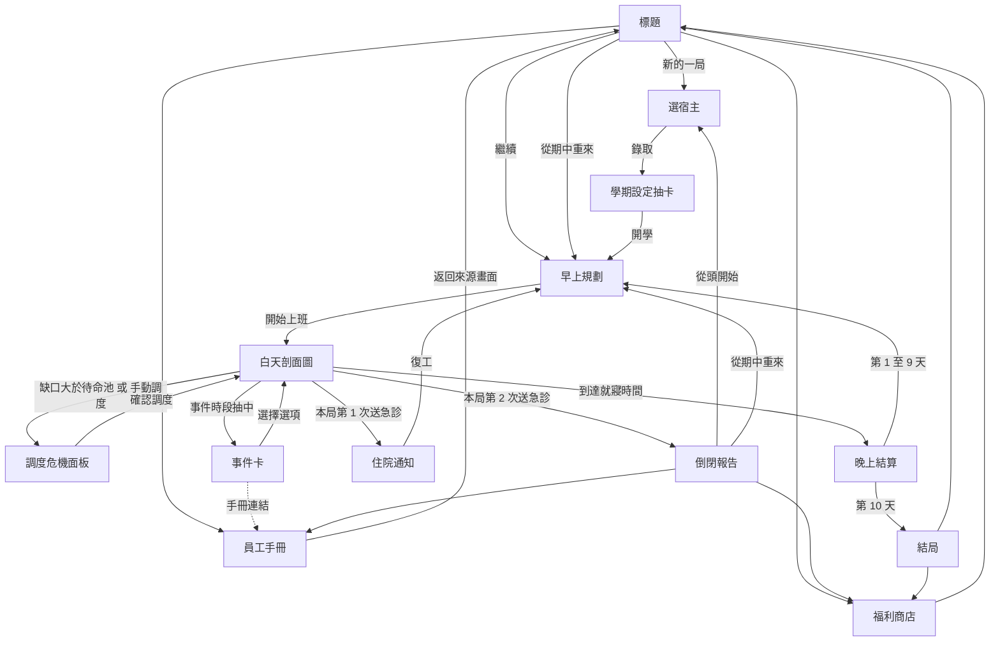

# 人體股份有限公司：玩家體驗流程與文案系統

本文件補足設計文件中「玩家實際看到什麼、怎麼操作、讀到什麼文字」的部分，涵蓋畫面流程、新手教學、調度危機生成規則、報告文案系統、員工台詞、發表用 demo 腳本、輔助與易用性，以及存檔資料結構。數值沿用設計文件現行版本；設計文件未定義而本文件必須補上的規則，以「本文件補充」標示，並彙整於文末〈需要設計文件配合的事項〉。

用語定義：「待命池」指早上規劃後尚未分配給任何部門的代幣；「需求枚數」指部門在當下效率下、不產生積壓所需的代幣數；「缺口」指需求枚數減去現有代幣；「節點」指因果紀錄中的一筆事件、標籤、徵兆或危機；「敘事日」指以起床時間為界的一天，凌晨 1 點仍屬於前一天的敘事日。

---

## 1. 畫面清單與流程

MVP 的畫面分為兩類。全畫面場景（scene）各自是 `ui/scenes/` 下的一個檔案；覆蓋層（overlay）疊在白天剖面圖上，時間暫停但剖面圖仍在背景，讓玩家做決策時看得到全局。覆蓋層只有調度危機面板、事件卡與暫停選單三個，其餘皆為場景。

### 1.1 畫面清單

**標題**
目的：進入遊戲並提供跨局入口。主要元素為遊戲標誌（公司招牌樣式）、按鈕「新的一局」「繼續」「從期中重來」「員工手冊」「福利商店」「設定」，以及右下角的跨局統計（已倒閉 N 次、手冊 X/12 頁）。「繼續」只在有進行中的局時出現；「從期中重來」只在上一局倒閉且有期中存檔點時出現。進入條件為開啟網頁、結局或倒閉報告後選「回標題」。離開條件為點選任一按鈕。

**選宿主**
目的：讓玩家選擇本局宿主，並以未解鎖的宿主預告 roguelite 的長期目標。主要元素為四張宿主卡（大學生可選；研究生、新鮮人工程師、退休阿公以剪影顯示並標註「通關大學生後解鎖」）、宿主一句話介紹與目標（「撐到期末考」）。MVP 只有一位宿主可選，因此游標預設停在大學生，玩家按一次「錄取」即可。進入條件為標題選「新的一局」或倒閉報告選「從頭開始」。離開條件為按「錄取」。

**學期設定抽卡**
目的：揭示本局的隨機條件，並讓玩家選擇本局要帶的福利。主要元素為兩張蓋著的學期設定卡（點擊翻開，翻開後顯示效果文字與圖示）、本局福利欄（列出已擁有的福利，可勾選帶入）、「開學」按鈕。首局固定翻出「新生保護期」（本文件補充，見第 2 節）與「乳糖不耐」，不隨機。進入條件為選宿主完成。離開條件為按「開學」，進入第 1 天早上規劃。

**早上規劃**
目的：讓玩家在一天開始前做出最重要的時間取捨。主要元素如下：日期橫幅（「第 4 天｜距期中考 1 天」）；昨日摘要列（睡眠債、壓力、社交、學業進度與目前的狀態標籤，每個標籤都有圖示與文字）；就寢時間滑桿（22:00 至 03:00，旁邊即時顯示「預計睡眠 X 小時」）；四個日程時段格（上午、下午、晚上、深夜），從手牌中放入 3 至 4 張日程卡；三餐欄（從食物卡中選）；代幣預配區（把待命池的代幣預先派給部門，大腦固定 2 枚以鎖頭圖示表示）；時間缺口條（讀書、睡眠、社交需要的時數總和與 24 小時的對比，超出部分以斜線紋標示）；「沿用昨天」與「開始上班」按鈕。進入條件為開學、晚上結算完成、出院後的停業整頓通知關閉，或從期中重來。離開條件為按「開始上班」。

**白天剖面圖**
目的：主畫面，呈現時間推進下的公司運作與警訊。主要元素為人體剖面圖（8 個部門隔間，各有員工立繪、產能條、代幣、狀態圖示與文字標籤）、血流粒子、頂部狀態列（時鐘、日期、睡眠債、壓力、水分、血糖、咖啡因殘留，咖啡因殘留曲線僅在手冊〈咖啡因〉解鎖後顯示）、左側待命池、右側事件時段指示（五個點，代表早上、午餐、下午、晚上、深夜，已出現事件卡者填滿）、底部跑馬燈與操作提示列、右上角速度控制（暫停、1×、2×、3×）與「手動調度」按鈕。進入條件為早上規劃按「開始上班」，或從覆蓋層返回。離開條件有四種：需求超過待命池時開啟調度危機面板；進入事件時段且抽中事件時開啟事件卡；時鐘到達就寢時間時進入晚上結算；觸發送急診條件時進入住院通知或倒閉報告。

**調度危機面板**（覆蓋層）
目的：玩家每天最主要的決策時刻，在代幣不足時決定犧牲誰。主要元素與操作見第 3 節。進入條件見第 3.1 節的觸發規則，或玩家按「手動調度」。離開條件為按「確認調度」。

**事件卡**（覆蓋層）
目的：呈現情境與取捨，是連鎖反應的起點。主要元素為卡面（情境插圖、搞笑描述、時段標記、嚴重度圖示與文字）、2 至 3 個選項按鈕（每個選項下方列出可預見的代價，例如「社交 +2｜胃部夜班｜就寢延後 1 小時」）、右下角手冊連結圖示（已解鎖則可點開閱讀，未解鎖則顯示「?」並提示「做出選擇後可能解鎖」）。選項代價是否完全揭露，依設計文件「玩家看得到的數字」原則，只揭露方向與標籤名稱，不揭露精確係數。進入條件為事件時段抽中事件，或狀態達門檻觸發嚴重與危機事件。離開條件為選擇一個選項。

**晚上結算**
目的：把睡眠的價值具體化，讓玩家看到「今晚怎麼睡」換算成明天的什麼。主要元素為逐行出現的結算明細（就寢與起床時間、睡眠時數、睡眠效率各係數、有效睡眠、睡眠債變化、各部門怨氣修復量、今日學業進度、標籤增減）、睡眠債儀表（手冊〈睡眠債〉解鎖後顯示）、新解鎖的手冊頁通知、「明日預告」（考試倒數、已知的明日日程）。考試日的晚上結算額外顯示成績單（累積學業進度 × 當天早上睡眠係數）。點擊可跳過逐行動畫。進入條件為時鐘到達就寢時間。離開條件為按「明天見」；第 1 至 9 天進入早上規劃，第 10 天進入結局。

**住院通知**
目的：第一次送急診的緩衝，讓玩家在倒閉前讀到原因。由兩段組成：先是 3 秒的救護車與病床過場（「第 N 天：住院中，全公司停業」），接著是停業整頓通知公文（模板見第 4 節）。公文下方列出處分（怨氣調整為 40、壓力 +15、年終評價點數 −20%、若為考試日則缺考），以及一行警語「下次再發生，本函將升級為倒閉調查報告」。進入條件為本局第一次觸發送急診。離開條件為按「復工」，進入住院隔天的早上規劃。

**倒閉報告**
目的：本作的記憶點與主要教學時刻。主要元素為公文本體（模板見第 4 節）、本次解鎖的手冊頁卡片（可直接點開閱讀）、本局年終評價點數、四個按鈕「從頭開始」「從期中重來（評價點數減半）」「福利商店」「回標題」。進入條件為本局第二次觸發送急診。離開條件為點選按鈕；「從期中重來」只在本局已建立期中存檔點時出現。

**員工手冊**
目的：遊戲內的衛教圖鑑，也是主要的跨局進度。主要元素為 12 格頁面目錄（已解鎖顯示標題與員工頭像；未解鎖顯示灰色剪影與提示「在某份調查報告中出現」）、頁面內文（笑點標題、3 至 5 句知識內文、「遊戲中的簡化」說明、來源連結、解鎖的功能或卡片）。進入條件為標題、暫停選單、事件卡的手冊連結、倒閉報告與停業整頓通知中的手冊卡片。離開條件為按「返回」，回到進入前的畫面；從白天覆蓋層進入時，返回後時間仍保持暫停。

**福利商店**
目的：消耗年終評價點數，換取新選項。主要元素為點數餘額、福利卡（名稱、效果、代價、價格；代價以與效果同等的字級顯示，避免玩家誤以為是純加成）、「兌換」按鈕。進入條件為標題、倒閉報告、結局。離開條件為按「返回」。

**結局**
目的：第 10 天期末考後的總結，給予過關感與下一局的動機。依「期末成績是否及格」與「健康報告是否達標」分為四種結局（及格且健康：「年度優良企業」；及格但不健康：「帳面獲利，內部空洞」；不及格但健康：「養生有成，學分重修」；兩者皆否：「勉強撐到結算日」）。健康達標的門檻建議為「本局未住院且結算時睡眠債低於 4 小時」，具體數字由策略模擬決定。主要元素為成績單、健康報告（各部門最終狀態與本局最常出現的三個標籤）、年終評鑑文案、獲得的評價點數、宿主解鎖通知（若首次及格）。進入條件為第 10 天晚上結算結束。離開條件為按「福利商店」或「回標題」。

**暫停選單**（覆蓋層，輔助畫面）
任何時刻按 Esc 開啟，包含「繼續」「員工手冊」「設定」「放棄本局」。設定項目見第 7 節。

### 1.2 流程圖



工時備註：場景共 11 個（標題、選宿主、學期設定、早上規劃、白天、晚上結算、住院通知、倒閉報告、手冊、商店、結局），其中住院通知、倒閉報告與結局可共用同一個公文版面元件；覆蓋層 3 個。選宿主與學期設定兩個畫面在 MVP 內容極少，可合併為一個場景以節省工時，玩家感受差異不大。

---

## 2. 新手教學

教學遵循三條原則。第一，一次只要求一個動作，提示文字不超過 20 字，配一個指向目標的動態手指；第二，遊戲等玩家做出動作才繼續，動作完成後立即給出看得見的回饋（產能條跳動、數字飄字、員工表情變化）；第三，規則在玩家需要它的那一刻才出現，不在開局一次講完。教學從不出現超過兩行的說明文字，需要細節的玩家可從提示旁的「?」打開對應的手冊頁。

首局固定翻出的學期設定卡「新生保護期」（本文件補充）使第 1、2 天不出現中等以上事件，並把第 1 天的調度危機改為腳本控制的 2 次，第 2 天起恢復 3 至 5 次。第二局起不再出現此卡；設定中可重新開啟教學。

### 2.1 第 1 天：逐步引導

| 遊戲時間 | 觸發 | 畫面提示（≤ 20 字） | 玩家動作 | 回饋 | 學到什麼 |
| --- | --- | --- | --- | --- | --- |
| 開學前 | 早上規劃，日程已由董事長預排（上午上課、下午讀書、晚上社團） | 「董事長已排好今天。挑一份早餐。」 | 從兩張早餐卡中選一張 | 食物卡飛進早餐欄，血糖預覽曲線出現 | 早上規劃的位置；就寢時間滑桿在第 1 天鎖定於 23:00，滑桿上顯示鎖頭與「明天開放」 |
| 08:00 | 白天開始，鏡頭從全身拉近剖面圖 | 「這是你的公司。」 | 無（2 秒後自動繼續） | 各部門員工依序抬頭打招呼 | 剖面圖是主畫面 |
| 08:30 | 固定事件「新生健檢報告」 | 「先看看員工體檢。」 | 點擊事件卡唯一選項「收下報告」 | 一份報告依序落到各部門桌上，每個部門用一句話報告近況；輪到肝時只顯示「……」，報告上蓋章「肝功能：正常」；跑馬燈出現「手冊 +1〈健康檢查〉」 | 部門的名稱與位置；肝不會主動說話，只有健檢看得到；手冊存在 |
| 09:00 | 大腦舉手要人 | 「把一枚代幣拖給大腦。」 | 從待命池拖一枚代幣到大腦（時間暫停，只允許這個動作） | 大腦產能條上升，飄字「讀書效率 110%」，董事長擺出畫大餅的手勢 | 代幣就是產能；大腦多派一枚 +10% |
| 12:00 | 腳本危機：午餐使胃要求 +3，待命池只剩 2 | 「物流部缺人！從別人那裡挪一枚。」 | 從亮起的兩個候選部門（大腦、肌肉）中挪一枚給胃 | 被挪的部門頭上冒出「怨氣 +10」與不滿表情；胃的產能條補滿；面板上「暫不處理」按鈕可按，若玩家選它，胃在下午出現抱怨泡泡，同樣算完成教學 | 調度危機的樣子；挪代幣有代價；不處理也有代價 |
| 15:00 | 日常事件「全糖手搖飲團購」 | 「每個選擇都有代價，選一個。」 | 從三個選項中任選 | 選項下方的代價依序生效（社交 +1、飯後倦怠標籤圖示出現在狀態列） | 事件卡的讀法；狀態標籤會掛在公司上 |
| 18:00 | 晚餐使胃要求 +3（非腳本，自然觸發） | 「跟中午一樣，你來決定。」 | 自行調度 | 無額外提示 | 獨立完成一次調度 |
| 23:00 | 第一次晚上結算 | 「睡覺是夜班清潔隊上工。」 | 看完逐行結算後按「明天見」 | 結算只顯示三行：睡眠 8 小時、各部門怨氣修復、今日學業進度；夜班清潔隊動畫打掃各隔間 | 睡眠會修復怨氣；明天的安排可沿用 |

第 1 天的設計重點是新生健檢事件。它在第一個小時內把八個部門與「肝不會抱怨」這件事同時介紹完，玩家不需要讀任何說明就知道剖面圖上有誰；同時讓手冊在第一個小時就解鎖一頁，後面所有「手冊 +1」的提示玩家都已經看過一次。

### 2.2 第 2 天起逐步放手

**第 2 天**：早上規劃完全開放，就寢時間滑桿解鎖，提示一次「就寢越晚，睡眠越少」。當天第一次調度危機出現時，「向夜班借調」按鈕第一次亮起並附一次性提示「借 2 枚，今晚睡眠打七折」。此後該提示不再出現。

**第 3 天**：新生保護期結束，中等事件與核心連鎖的起點事件開始出現。當天第一次出現抱怨泡泡時，泡泡加上閃爍外框與一次性提示「抱怨就是早期徵兆，點它看看」，點擊後開啟該徵兆對應的手冊頁摘要。這是玩家學會「察覺身體警訊」的起點，也是唯一一次主動教的觀念。

**第 4 天起**：不再有逐步提示，只保留「首次觸發提示」：第一次出現罷工、第一次出現某個狀態標籤、第一次接近倒閉條件（某部門罷工滿 3 小時）時，各出現一次 20 字以內的提示。首次觸發提示可在設定中關閉；第二局起預設只對新出現的標籤提示。

**驗收方式**：以未看過本作的同學試玩第 1 天，觀察三件事。其一，是否在無人說明下於 12:00 完成第一次調度；其二，第 3 天看到抱怨泡泡後，是否在下一次調度時優先處理該部門；其三，第一次倒閉發生在第幾天。第三項同時回答設計文件要求的「新手首次倒閉時間點」，若晚於第 7 天，代表怨氣累積過慢。

---

## 3. 調度危機生成規則

### 3.1 何時觸發

**需求枚數**（本文件補充）。每個部門在每個遊戲半小時計算一次需求枚數：

```latex
r_d = \operatorname{round}\left(\frac{\text{基礎需求}_d + \text{活動與標籤加成}_d}{\text{效率}_d}\right),\quad \text{效率}_d = 1 - \frac{\text{怨氣}_d}{200}
```

部門缺口為 max(0, r_d − 現有代幣_d)。以效率除需求，代表怨氣高的部門需要更多人手才做得完同樣的事，使「怨氣 → 缺口 → 危機」形成回饋。建議的需求表如下，數字需經策略模擬調整：

| 部門 | 基礎需求 | 加成來源與數值 |
| --- | --- | --- |
| 大腦 | 2（固定保障，不可挪動） | 上課與讀書時段，基礎需求改為 2 ÷ 睡眠係數 S（睡眠債越高，同樣的工作越吃力）；報告死線事件期間 +2。超過需求的代幣視為加派，每枚讀書效率 +10% |
| 胃 | 1 | 用餐後 +3 持續 2 小時（設定文件既有規則）；宵夜 +2 持續 2 小時 |
| 腸道菌 | 1 | 「腸道菌失衡」+2；腹瀉期間 +1 |
| 肝 | 1 | 空腹（未吃早餐至午餐前）+1；飲酒時現有代幣全數鎖定於代謝酒精，日常工作另需 +1 |
| 免疫 | 1 | 徵兆「喉嚨有點癢」+1；感冒 +3；發燒 +5 |
| 肌肉 | 1 | 運動時段 +4（設定文件既有規則） |

基礎需求合計 7 枚，初始 12 枚中有 5 枚可自由分配。玩家把越多代幣加派給大腦，待命池越小，危機就越容易發生；這使「貪讀書效率」與「保留緩衝」本身成為取捨。

**觸發判斷**。總缺口 G = Σ 缺口_d，待命池為 P：

1. G = 0：無事。
2. 0 < G ≤ P：由待命池自動補足，不暫停，跑馬燈顯示「物流部自動領取 3 枚待命代幣」。這涵蓋設定文件的兩條自動規則，也適用於其他需求變化。
3. G > P：觸發調度危機，時間暫停。

觸發判斷除了每半小時一次，也在需求變化的瞬間立即執行，包括用餐、運動開始、事件卡效果生效、標籤增減、部門進入罷工。

### 3.2 每天 3 至 5 次的保證

自然觸發的次數取決於玩家的配置，因此需要一個「危機導演」（本文件補充）負責下限與上限，規則如下：

1. **時窗下限**：一天分為三個時窗，起床至 12:00、12:00 至 18:00、18:00 至就寢。每個時窗至少一次危機，合計至少 3 次。若某時窗剩下 1 個遊戲小時仍未發生危機，導演注入一次「需求突波」。
2. **需求突波**：從與當下日程相符的清單中挑選，一次讓兩個部門同時要求支援，總量為待命池 + 1 至待命池 + 2，上限 6 枚。清單例：上課中「教授突然點名」大腦 +2、「教室裡有人狂咳」免疫 +2；讀書中「組員丟來新檔案」大腦 +2；運動中「隊友請假，多跑一圈」肌肉 +2；任何時段「隔壁寢室在煮泡麵」胃 +1。突波持續 1 個遊戲小時，並以正常事件的形式寫入因果紀錄（例如 `event:surprise_quiz`），報告可以追溯。
3. **冷卻與合併**：一次危機結束後 1.5 個遊戲小時內不再暫停。冷卻期間新增的缺口先以積壓累計，冷卻結束時若仍大於待命池，合併為一次危機呈現。這避免午餐與死線前後腳發生時連續暫停兩次。
4. **上限 5 次**：當天第 5 次危機之後，新的缺口不再暫停，直接成為積壓，並以跑馬燈與操作提示列顯示「今日調度次數已達上限，缺口轉為積壓」。玩家仍可隨時按「手動調度」主動暫停處理，手動調度不計入次數，代價規則相同。
5. **優先順序**：危機與事件卡同時成立時，先開危機面板，再開事件卡。
6. **例外**：第 1 天依教學腳本為 2 次；住院日為 0 次。

自然觸發的主要來源是三餐（胃 +3）、運動（肌肉 +4）、死線（大腦 +2）與疾病標籤（免疫 +1 至 +5）。實測時以策略模擬統計每天的危機次數分佈，目標是 90% 以上的天數不需要導演注入兩次以上；若導演注入過於頻繁，代表需求表的數值太低。

### 3.3 面板呈現的資訊

```
┌─ 調度危機｜第 2 天 12:00｜午餐尖峰 ────────────────────────────┐
│ 要求支援                                                        │
│   物流部（胃）  需要 4｜現有 1｜缺 3｜持續 2 小時                 │
│     不處理的後果：積壓每小時 +3，約 3 小時後開始抱怨              │
│ 可挪用的部門（拖曳代幣即可）                                     │
│   大腦  5 枚（2 枚鎖定）怨氣 55 ▲ 再 +10 將進入「徵兆」           │
│   肌肉  1 枚            怨氣 10    今天無運動                     │
│   免疫  1 枚            怨氣 62 ! 徵兆中：「喉嚨有點癢」          │
│ 待命池：2 枚                                                     │
│ [向夜班借調 +2]  今晚有效睡眠預估 8.0 → 5.6 小時（睡眠債 +2.4）  │
│ [暫不處理]                                     [確認調度]        │
└───────────────────────────────────────────────────────────────┘
```

面板固定呈現以下資訊：危機標題（時間與原因，取自觸發缺口的事件，例如「午餐尖峰」「死線加喉嚨癢」）；每個要求支援的部門的需要、現有、缺口與持續時間；不處理的後果預估（積壓速率與距離抱怨、罷工的預估時數）；每個可挪用部門的現有代幣、鎖定數、怨氣數值與門檻提示，正處於徵兆狀態的部門附上徵兆台詞；待命池；借調按鈕與今晚睡眠的預估變化；相關的狀態標籤圖示。

預估以簡單公式計算（積壓 × 5 為每小時怨氣增量，除以距門檻的差值），不需要複製整個模擬狀態往前跑，工時可控。所有數字旁都附文字，例如「▲ 再 +10 將進入徵兆」，不只靠顏色。

### 3.4 玩家的操作與代價

| 操作 | 效果 | 代價 |
| --- | --- | --- |
| 從待命池補 | 待命池代幣移到缺口部門 | 無 |
| 挪代幣 | 從其他部門拖代幣到缺口部門；大腦鎖定的 2 枚不可挪 | 每個被挪用的部門怨氣立即 +10（本文件建議以「每次危機、每個部門」計一次，而非每枚計一次）；被挪用的部門若因此出現缺口，開始累積積壓 |
| 向夜班借調 | 待命池立即 +2，持續到就寢 | 當晚睡眠效率再乘 0.7（與酒精 0.8、宵夜 0.9 同一個乘積）；每天限 1 次 |
| 暫不處理 | 缺口部門照常運作但產生積壓 | 缺口部門怨氣每小時增加「積壓 × 5」，可能進入徵兆或罷工 |
| 復原 | 按「確認調度」前可任意拖回，不計代價 | 無 |
| 確認調度 | 關閉面板，時間繼續 | 所有挪用、借調在此時寫入因果紀錄（`transfer`、`borrow` 節點） |

「暫不處理」與「挪代幣」的代價刻意設計得接近：缺 1 枚、持續 2 小時的積壓約使怨氣 +15，略高於挪一次的 +10。玩家的判斷因此不在於哪個操作永遠比較好，而在於誰離門檻比較近。

借調的「修復量 −30%」在設計文件中未指明作用對象。本文件採「睡眠效率 × 0.7」的解讀，理由是它接在現有的睡眠效率乘積上，一行程式即可實作，且效果與熬夜同向：睡 8 小時時有效睡眠剩 5.6 小時，等於多欠 2.4 小時睡眠債，確實是「把熬夜的取捨做進白天」。此數值偏重，需由策略模擬確認借調不會成為永遠不划算的選項。

### 3.5 三個情境範例

**情境一：午餐尖峰（第 2 天 12:00）**
早上規劃時玩家把 3 枚代幣加派給大腦（大腦 5 枚，讀書效率 130%），其餘部門各 1 枚，待命池剩 2 枚。午餐使胃的需求變為 4，缺 3 枚，待命池只能補 2 枚，觸發危機。
可行方案有三。方案甲：待命池補 2 枚，再從大腦挪 1 枚。大腦怨氣 55 → 65，進入徵兆狀態，下午讀書效率 120%。方案乙：待命池補 2 枚，向夜班借調再補 1 枚，剩 1 枚留在待命池。下午讀書效率維持 130%，但今晚有效睡眠從 8 小時降為 5.6 小時。方案丙：待命池補 2 枚，剩下 1 枚缺口不處理。胃積壓 2 小時，怨氣約 +15，從 20 升到 35，不會進入徵兆。
這一幕的教學點在於，方案丙看似「什麼都沒做」，反而是代價最低的選擇，因為胃離門檻最遠；而方案甲把大腦推進徵兆狀態，下午就會開始出現「同一行字看了三次」。

**情境二：死線加喉嚨癢（第 4 天 15:00）**
報告死線使大腦需求 +2；免疫部在上午已回報「喉嚨有點癢」（需求 +1，怨氣 62）；下午排了體育課，肌肉需求 +4。玩家的配置為大腦 4 枚、其餘各 1 枚、待命池 3 枚。缺口合計為大腦 0（4 枚剛好）、免疫 1、肌肉 4，共 5 枚，待命池 3 枚，觸發危機。
可行方案有三。方案甲：先補免疫 1 枚，剩 2 枚給肌肉，肌肉缺 2 枚不處理。體育課表現差、肌肉怨氣上升，但免疫的徵兆被及時處理，感冒升級的機率下降。方案乙：待命池 3 枚全給肌肉，再從免疫挪走僅有的 1 枚補足肌肉。免疫正處於徵兆中，面板會以「!」與徵兆台詞提醒；挪走後免疫怨氣 72 且缺口擴大為 2，感染機率上升。方案丙：借調 +2 補滿所有缺口，今晚睡眠打七折，而死線本來就讓玩家想熬夜，兩者疊加後睡眠債大幅增加。
這一幕對應設計文件的升級規則：喉嚨癢是可以止住感冒的那一級，面板把徵兆台詞直接放在可挪用名單旁，讓「察覺警訊」與「資源分配」發生在同一個畫面上。

**情境三：系烤（第 3 天 20:00）**
玩家原本把晚上排為讀書，大腦加派 4 枚（大腦 6 枚，其餘各 1 枚，待命池 1 枚）；事件卡「系烤」選了「去」並喝了 3 杯。飲酒使肝的 1 枚代幣鎖定於代謝酒精，日常工作另需 1 枚；燒烤晚餐使胃需求 +3。缺口合計 4 枚，待命池只能補 1 枚。
可行方案有二。方案甲：待命池補 1 枚，再把大腦加派中的 3 枚收回給胃與肝，大腦怨氣 +10。人在系烤，大腦加派本來就沒有讀書效益，這是正確的判斷，代價只有怨氣。方案乙：借調 +2，保留大腦加派。面板的睡眠預估會顯示「今晚有效睡眠 6.0 → 3.4 小時（酒精 × 0.8、借調 × 0.7）」，玩家直接看到兩個係數相乘的後果。
這一幕教兩件事：日程改變時要重新配置代幣，以及酒精與熬夜對睡眠的傷害會疊加。

---

## 4. 報告文案系統

### 4.1 共同原則

報告的笑點來自「正式公文」與「荒謬內容」的反差，笑的對象是公司的官僚體系與營運長的決策，不是宿主的身體或疾病。報告中涉及醫療的句子（結果與建議兩段）一律採保守措辭，以「可能」「與……有關」「建議就醫」表達，不寫具體診斷以外的推論。心理健康相關節點（例如情緒低落事件）出現在報告中時，該句不加笑點，並在建議段附上「學校諮商中心可以提供協助」。

### 4.2 停業整頓通知模板

```
人體股份有限公司　函
發文日期：第 {出院日} 天 07:00
發文字號：人體急字第 {急診日2位}{急診時2位} 號
受文者：營運長

主旨：本公司因{直接原因}，於第 {住院日} 天停業整頓一日，即日起復工，請查照。

說明：
一、事故經過：{最多 3 句}
二、整頓處分：住院一日；全體部門怨氣調整為 40；壓力 +15；年終評價點數 −20%{；考試缺考}。
三、整頓建議：請詳閱員工手冊〈{手冊頁}〉（本次解鎖）。{一句衛教重點}

下次再發生，本函將升級為倒閉調查報告。

調查委員會　主任委員　肝（{書面意見}）
正本：營運長
副本：大腦董事長、全體部門、夜班清潔隊
```

### 4.3 倒閉調查報告模板

```
人體股份有限公司　函
發文日期：第 {急診日} 天 {急診時刻}
發文字號：人體倒字第 {急診日2位}{急診時2位} 號
受文者：營運長
前案：第 {前次急診日} 天{前次直接原因}，停業整頓一日（人體急字第 {前案字號} 號）

主旨：本公司因{直接原因}，宿主送醫，即日起宣告倒閉，請查照。

說明：
一、事故經過：
（一）至（五）{最多 5 句，依時間排序}
二、結果：{結果句：觸發倒閉條件的部門與標籤、宿主的處境、保守的醫療結果}

調查委員會建議：
一、請詳閱員工手冊〈{手冊頁}〉（本次解鎖）。{1 至 2 句衛教重點}
二、{一句可執行的建議}
三、{一句與徵兆有關的提醒，或職場梗收尾}

調查委員會　主任委員　肝（{書面意見}）
正本：營運長
副本：大腦董事長、全體部門、夜班清潔隊
```

「每份最多 5 句」的限制套用於事故經過一段；結果與建議各自獨立。主任委員由肝擔任且永遠缺席，是貫穿所有報告的固定笑點，同時呼應「肝不會說話」的人設；書面意見依情境從句庫抽取。

### 4.4 部門正式名稱

| 部門 | 報告中的稱呼 |
| --- | --- |
| 大腦 | 大腦董事長室 |
| 胃 | 物流部 |
| 腸道菌 | 腸道菌外包團隊 |
| 肝 | 肝臟部門 |
| 免疫 | 免疫保全部 |
| 肌肉 | 業務部 |
| 心臟 | 24 小時值班室 |
| 腎臟 | 會計部 |

### 4.5 句型庫

佔位符：`{D}` 為敘事日與時段（規則見 4.6），`{Dr}` 為日期區間，`{N}` 為次數（以國字書寫，2 寫作「兩」），`{h}` 為時刻，`{dept}` 為部門正式名稱。每個節點鍵可有 2 至 3 個變體，以本局亂數種子挑選，避免連續兩局讀到一模一樣的句子。

| 節點鍵 | 單句 | 合併句 |
| --- | --- | --- |
| `activity:stayed_up` | {D}，宿主凌晨 {h} 點才就寢，夜班清潔隊未能完成修復 | {Dr}，宿主連續 {N} 晚於凌晨後就寢，夜班清潔隊連續 {N} 晚未能完成修復 |
| `activity:study_late` | {D}，宿主熬夜讀書至凌晨 {h} 點，大腦董事長室持續加班 | {Dr}，宿主連續 {N} 晚熬夜趕工 |
| `choice:coffee` | {D}，董事長批准咖啡採購 | {Dr}，董事長連續 {N} 天於傍晚後批准咖啡採購，共 {cups} 杯 |
| `choice:energy_drink` | {D}，董事長批准能量飲料緊急採購 | {Dr}，能量飲料連續 {N} 晚進貨 |
| `effect:caffeine_insomnia` | 當晚就寢時咖啡因殘留約 {r} 單位，宿主輾轉難眠 | 連續 {N} 晚就寢時咖啡因殘留逾 {rmin} 單位 |
| `tag:sleep_debt` | {D}起，公司背負「睡眠債」 | 不合併 |
| `warning:{dept}` | {D}，{dept}回報「{徵兆台詞}」，未獲處理 | {dept}自{D}起共回報 {N} 次「{徵兆台詞}」，均未獲處理 |
| `transfer:{dept}` | {D}，營運長自{dept}挪用代幣支援{受援部門} | {dept}於{Dr}間共遭挪用 {N} 次 |
| `borrow` | {D}，營運長向夜班借調兩名人力，當晚修復工時遭壓縮 | 營運長於{Dr}間共向夜班借調 {N} 次 |
| `choice:skip_breakfast` | {D}，宿主早八賴床未進早餐，肝臟部門默默加班釋放庫存葡萄糖 | {Dr}，宿主連續 {N} 天未進早餐，肝臟部門連續 {N} 天默默加班，未提出任何意見 |
| `choice:binge_lunch` | {D}中午，物流部迎來大份量午餐加全糖手搖飲 | 同期每日中午，物流部連續 {N} 天迎來大份量午餐加全糖手搖飲 |
| `tag:post_meal_slump` | 下午宿主昏昏沉沉，讀書效率打八五折 | 連續 {N} 個下午讀書效率打八五折 |
| `event:deadline` | {D}，報告死線逼近 | {Dr}，報告死線接連逼近 |
| `tag:chronic_stress` | {D}起，公司進入「長期高壓」狀態 | 不合併 |
| `event:immune_budget_cut` | 免疫保全部預算遭緊急應變小組挪用 | 免疫保全部預算於{Dr}間共遭挪用 {N} 次 |
| `event:roommate_cold` | {D}，室友把感冒病毒帶進宿舍 | 不合併 |
| `tag:cold` | 病毒突破防線，宿主感冒 | 不合併 |
| `choice:no_rest` | {D}，宿主感冒仍照常上課趕工，未請假休息 | 宿主感冒期間連續 {N} 天未請假休息 |
| `tag:fever` | {D}，感冒升級為發燒，免疫保全部滿載 | 不合併 |
| `choice:drink` | {D}，宿主於 {hrs} 小時內乾杯 {cups} 杯（約 {g} 公克酒精） | 宿主於{Dr}間共出席 {N} 場聚餐，合計約 {g} 公克酒精 |
| `effect:liver_alcohol` | 肝臟部門全員投入酒精代謝，其他業務全數延後 | 不合併 |
| `effect:alcohol_sleep` | 當晚睡眠品質變差，夜班清潔隊效率打八折 | 連續 {N} 晚睡眠品質變差 |
| `choice:antibiotic_request` | {D}，宿主於診間堅持索取抗生素 | 不合併 |
| `tag:gut_imbalance` | 腸道菌外包團隊遭抗生素波及，菌相失衡 | 不合併 |
| `tag:diarrhea` | {D}起，宿主腹瀉，物流部與外包團隊全面出清庫存 | 不合併 |
| `tag:dehydration` | {D}，水分跌破警戒線，「嚴重脫水」危機標籤成立 | 不合併 |
| `strike:{dept}` | {D}，{dept}宣布罷工 | {dept}於{Dr}間罷工 {N} 次 |
| `event:surprise_*` | {D}，{突波描述} | 不合併 |
| `exam:midterm` | {D}期中考，成績依睡眠係數 {S} 折算 | 不合併 |
| 缺模板時 | {D}，{dept}受到「{標籤中文名}」影響 | 不適用 |

缺模板時使用最後一列的通用句，並在開發模式下於主控台輸出警告；批次模擬以「報告中出現通用句的比例」作為缺模板檢查的指標，目標為 0。

**主任委員書面意見句庫**：「無意見。」「我沒事。」「……」「本人另有要務，無法出席。」「（附件：加班時數表一份，未附說明）」；聚餐宿醉情境專用：「……我需要休假。」；肝罷工後專用：「本人已於日前離職，請洽交接人（從缺）。」

### 4.6 合併與時間界線規則

**合併規則**（處理原型中留白的「連續 N 晚」）：

1. 先依節點鍵分組。同一鍵在連續的敘事日出現 2 次以上，合併為一句「連續 {N} 晚」或「連續 {N} 天」；夜間活動（就寢、熬夜、宵夜、失眠）用「晚」，其他用「天」。
2. 同一鍵出現 2 次以上但日期不連續，合併為「共 {N} 次」，日期區間取首尾。
3. 同一鍵在同一敘事日出現多次，合併為「接連」或數量句，例如咖啡寫「共兩杯」。
4. 合併後的句子在排序時以該組最早的時間為準。
5. 數字規則：日期與時刻用阿拉伯數字（第 6 天、凌晨 2 點），次數與數量用國字（連續三晚、共兩杯），與設計文件範例一致。

**時間界線規則**：

1. 追溯以危機節點的時間戳 t 為界：只沿著 `causeAt ≤ t` 的因果邊往上走，時間戳大於 t 的節點一律排除。這是原型中已驗證的規則，避免報告寫出急診之後才喝的咖啡。
2. 敘事日以起床為界：凌晨 0 點至起床前的節點，歸入前一天的敘事日，寫作「第 3 天深夜」或「第 3 天凌晨 1 點」，而不是「第 4 天凌晨」。原型以 `hour = 25` 表示同一件事，本文件改以絕對時間戳加敘事日欄位處理（見第 8 節）。
3. 時段用詞：05:00 至 10:59 為上午，11:00 至 13:59 為中午，14:00 至 17:59 為下午，18:00 至 22:59 為晚間，23:00 至起床為深夜；凌晨 0 點以後需要寫出時刻時用「凌晨 {h} 點」。
4. 相對日期：事故經過的第一句一律寫絕對日期；之後與前一句同日寫「同日」或「當晚」，相差一天寫「隔天」，相差兩天以上寫絕對日期。
5. 倒閉報告與停業整頓通知使用同一套追溯；倒閉報告另以「前案」欄列出前一次急診，前案的節點只有在仍是本次危機的祖先時才會出現在事故經過中。

**句子選擇**：追溯結果常超過 5 句。合併之後依以下分數排序，取前 5 句再按時間重排：玩家的選擇節點（`choice`、`transfer`、`borrow`）5 分；未獲處理的徵兆（`warning`）4 分；狀態標籤 3 分；外部事件 2 分；效果節點 1 分。危機節點的直接父節點一律保留。被捨棄的節點不顯示，避免報告變成流水帳。玩家選擇與徵兆的權重最高，因為報告要回答的是「我哪裡可以做得不一樣」。

### 4.7 範例報告

以下五份範例分別對應五條核心連鎖。早餐翹班這條連鎖在真實世界中很少單獨造成急診，因此範例中它以「主要成因」與睡眠債共同出現；這一點也建議寫回設計文件（見文末）。聚餐宿醉多發生在第 2 至 4 天，最常以第一次急診的形式出現，因此以停業整頓通知呈現，同時作為該模板的完整範例。

#### 範例一：咖啡因陷阱（倒閉調查報告）

```
人體股份有限公司　函
發文日期：第 8 天 16:00
發文字號：人體倒字第 0816 號
受文者：營運長
前案：第 3 天大腦董事長室與業務部同時罷工逾 6 小時，停業整頓一日（人體急字第 0315 號）

主旨：本公司因大腦董事長室罷工逾 6 小時，併發免疫保全部失守，宿主送醫，即日起宣告倒閉，請查照。

說明：
一、事故經過：
（一）第 5 天期中考後，宿主慶祝至凌晨 2 點才就寢，夜班清潔隊未能完成修復。
（二）第 6 至 7 天，大腦董事長室回報「這一行字我是不是看第三次了」，董事長連續兩天於傍晚後批准咖啡採購，共四杯。
（三）連續兩晚就寢時咖啡因殘留逾 80 單位，宿主輾轉難眠，睡眠債累積至 7 小時。
（四）第 8 天上午，大腦董事長室宣布罷工。
（五）同日中午，室友帶回的感冒病毒突破防線，免疫保全部滿載罷工。
二、結果：大腦董事長室罷工滿 6 小時，且免疫保全部同時罷工。宿主頭昏、發燒，由室友陪同至急診，經評估為感冒合併嚴重睡眠不足，所幸無大礙，但本公司已無力營運至期末考。

調查委員會建議：
一、請詳閱員工手冊〈咖啡因與能量飲料〉（本次解鎖）。咖啡因在體內的半衰期約 5 小時，個體差異約 3 至 7 小時；傍晚以後的咖啡因仍可能延後入睡、縮短睡眠。
二、提神飲料請安排在上午。累的時候最有效的提神方式，仍然是睡覺。
三、睡眠不足的人較容易感冒。董事長的大餅，請在睡飽之後再畫。

調查委員會　主任委員　肝（未出席，書面意見：「無意見。」）
正本：營運長
副本：大腦董事長、全體部門、夜班清潔隊
```

#### 範例二：早餐翹班（倒閉調查報告）

```
人體股份有限公司　函
發文日期：第 9 天 14:30
發文字號：人體倒字第 0914 號
受文者：營運長
前案：第 4 天宿主感冒發燒，停業整頓一日（人體急字第 0421 號）

主旨：本公司因大腦董事長室與物流部同時罷工，宿主送醫，於期末考前一日宣告倒閉，請查照。

說明：
一、事故經過：
（一）第 6 至 8 天，宿主連續三天早八賴床未進早餐，肝臟部門連續三天默默加班釋放庫存葡萄糖，未提出任何意見。
（二）同期每日中午，物流部連續三天迎來大份量午餐加全糖手搖飲。
（三）連續三個下午讀書效率打八五折，學業進度落後，壓力升至 78。
（四）第 8 天，宿主為追趕進度熬夜至凌晨 3 點，隔天上午大腦董事長室宣布罷工。
（五）第 9 天中午，物流部在午餐尖峰遭挪用代幣後積壓爆表，宣布罷工。
二、結果：兩部門同時罷工滿 6 小時。宿主上腹悶痛、頭昏腦脹，由室友陪同就醫，經評估為暴飲暴食後的腸胃不適合併睡眠不足，所幸無大礙。經查宿主全程並無低血糖，血糖一直由肝臟部門默默維持。

調查委員會建議：
一、請詳閱員工手冊〈早餐與肝臟〉（本次解鎖）。健康的人不吃早餐，肝臟會分解儲存的肝醣維持血糖，通常不會因此低血糖；但空腹太久後，有些人下一餐容易吃得又快又多。
二、請詳閱員工手冊〈糖分與疲倦〉。午後本來就是生理時鐘的低點，大餐與大量含糖飲料可能讓下午更昏沉。早八來不及時，一瓶無糖豆漿也算早餐。
三、本會特別表揚肝臟部門三天來的貢獻。也提醒營運長：肝臟有事時，通常也是這樣一聲不吭。

調查委員會　主任委員　肝（未出席，書面意見：「我沒事。」）
正本：營運長
副本：大腦董事長、全體部門、夜班清潔隊
```

#### 範例三：壓力螺旋（倒閉調查報告）

```
人體股份有限公司　函
發文日期：第 8 天 20:00
發文字號：人體倒字第 0820 號
受文者：營運長
前案：第 2 天大腦董事長室與物流部同時罷工逾 6 小時，停業整頓一日（人體急字第 0222 號）

主旨：本公司因免疫保全部滿載罷工逾 6 小時，併發大腦董事長室罷工，宿主送醫，即日起宣告倒閉，請查照。

說明：
一、事故經過：
（一）第 4 至 6 天，報告死線接連逼近，宿主連續三晚熬夜趕工。
（二）第 5 天起，公司進入「長期高壓」狀態；免疫保全部預算於第 5 至 7 天間共遭挪用三次。
（三）第 6 天下午，免疫保全部回報「喉嚨有點癢」，未獲處理。
（四）隔天，室友把感冒病毒帶進宿舍，宿主感冒，仍連續兩天照常上課趕工，未請假休息。
（五）第 8 天，感冒升級為發燒，免疫保全部滿載罷工；同日大腦董事長室因睡眠債宣布罷工。
二、結果：宿主高燒不退、吃不下東西，由室友陪同至急診，經評估為感冒併發燒，需要休息與補充水分。期末週前夕，本公司宣告倒閉。

調查委員會建議：
一、請詳閱員工手冊〈壓力與免疫〉（本次解鎖）。長期壓力與免疫功能下降有關，睡眠不足的人也較容易感冒。
二、死線前排進睡眠與短時間運動，不是偷懶，是替保全部保住預算。感冒初期多喝水、早點睡，最有機會止住升級。
三、壓力大到喘不過氣時，學校諮商中心可以提供協助。

調查委員會　主任委員　肝（未出席，書面意見：「（附件：加班時數表一份，未附說明）」）
正本：營運長
副本：大腦董事長、全體部門、夜班清潔隊
```

#### 範例四：聚餐宿醉（停業整頓通知）

```
人體股份有限公司　函
發文日期：第 4 天 07:00
發文字號：人體急字第 0223 號
受文者：營運長

主旨：本公司因宿主急性酒精中毒送醫，於第 3 天停業整頓一日，即日起復工，請查照。

說明：
一、事故經過：
（一）第 2 天晚間系烤，宿主於兩小時內接連乾杯七杯（約 70 公克酒精），肝臟部門全員投入酒精代謝，其他業務全數延後。
（二）同日 22:00，物流部回報「胃在翻攪」，營運長仍向夜班借調兩名人力續攤。
（三）23:30，宿主叫不醒，同學讓宿主側躺、留在身邊並撥打 119。
二、整頓處分：住院一日；全體部門怨氣調整為 40；壓力 +15；年終評價點數 −20%。
三、整頓建議：請詳閱員工手冊〈酒精代謝〉（本次解鎖）。肝臟每小時約只能代謝 7 至 10 公克酒精，台灣一個標準杯為 10 公克；連續乾杯時，喝下的速度遠超過肝臟處理的速度，喝咖啡或沖冷水都不會讓酒退得更快。酒精也可能讓人較快睡著，但會使後半夜睡得更淺。

本會特別感謝當晚的同學。朋友喝到叫不醒時：讓對方側躺、不要留他獨處、撥打 119。拒絕勸酒，是正當的選項。

下次再發生，本函將升級為倒閉調查報告。

調查委員會　主任委員　肝（未出席，書面意見：「……我需要休假。」）
正本：營運長
副本：大腦董事長、全體部門、夜班清潔隊
```

此範例的事故經過刻意不放笑點，笑點只留在公文框架與肝的書面意見。急救步驟在寫入遊戲前須由衛教查證負責人對照官方資料確認，與設計文件的查證原則一致。

#### 範例五：抗生素陷阱（倒閉調查報告）

```
人體股份有限公司　函
發文日期：第 8 天 13:00
發文字號：人體倒字第 0813 號
受文者：營運長
前案：第 2 天宿主急性酒精中毒，停業整頓一日（人體急字第 0223 號）

主旨：本公司因嚴重脫水，併發免疫保全部罷工逾 6 小時，宿主送醫，即日起宣告倒閉，請查照。

說明：
一、事故經過：
（一）第 5 天，室友把感冒病毒帶進宿舍；當時公司背負睡眠債，宿主隔天感冒。
（二）第 6 天，宿主於診間堅持索取抗生素。
（三）抗生素對感冒病毒無效，感冒未見改善；腸道菌外包團隊卻遭波及，菌相失衡。
（四）第 7 天起，宿主腹瀉，會計部回報「帳目顏色有點深」，未獲處理。
（五）第 8 天，水分跌破警戒線，「嚴重脫水」危機標籤成立。
二、結果：免疫保全部罷工滿 6 小時，且宿主帶有嚴重脫水危機標籤。宿主頭暈無力，由室友陪同至急診補充水分與電解質，所幸無大礙，但本公司已無力營運。

調查委員會建議：
一、請詳閱員工手冊〈抗生素不治感冒〉（本次解鎖）。一般感冒多由病毒引起，抗生素對病毒無效，還可能造成腹瀉等副作用，並助長細菌抗藥性。醫師判斷不需要而不開立，是專業，不是刁難。
二、若醫師確實開立抗生素，請依醫囑完整服用，不要自行停藥，也不要把剩藥留到下次或分給別人。
三、腹瀉時請補充水分與電解質；尿液顏色變深是會計部的正式公文，請勿已讀不回。

調查委員會　主任委員　肝（未出席，書面意見：「本人另有要務，無法出席。」）
正本：營運長
副本：大腦董事長、全體部門、夜班清潔隊
```

範例四與範例五可以是同一局的前後兩份文件，玩家會在倒閉報告的前案欄看到自己上一次收到的通知，形成「整頓期滿後再度出事」的連貫笑點。

---

## 5. 員工台詞

狀態對應：正常為怨氣 0 至 30；忙碌為當下有需求加成或怨氣 31 至 60；抱怨為怨氣超過 60，即設計文件定義的早期徵兆；罷工為怨氣超過 85。心臟與腎臟在 MVP 不參與代幣分配，其狀態改由指標驅動（心臟看運動量與咖啡因殘留，腎臟看水分），而且第四狀態不能是「罷工」：心臟停工等同死亡、腎臟停工等同腎衰竭，兩者都違反「不涉及死亡、維持搞笑」的原則，因此改為「緊急警報」與「帳目凍結」，台詞內容轉為就醫提醒。

抱怨台詞是玩家學習察覺警訊的主要來源，每一句都對應一個真實的早期症狀，括號內為對應症狀，供衛教查證負責人核對。

**大腦（董事長，畫大餅）**
- 正常：「今天的願景很清楚：把這章讀完，然後上市。」／「各位，本公司是一間以知識為本的企業。」
- 忙碌：「會議連開三場，但我每一場都很有想法。」／「再給我一個人，我保證這季翻倍。」
- 抱怨：「這一行字……我是不是看第三次了？」（注意力不集中）／「剛剛要講什麼來著？算了，下一個議題。」（記憶力下降）
- 罷工：「本董事長宣布：今天的大餅，不畫了。」／「抗議！沒有睡眠就沒有記憶，沒有記憶就沒有期末考！」

**胃（物流主管，脾氣暴躁）**
- 正常：「貨到了就收，收完就送，簡單。」／「今天進貨時間很準，給你一個讚。」
- 忙碌：「午餐尖峰！三台貨車同時進場！人呢？」／「慢慢吃好不好！我又不是輸送帶！」
- 抱怨：「肚子脹得跟爆倉一樣。」（腹脹）／「怎麼有股酸酸的往上衝……誰半夜叫鹹酥雞？」（胃酸逆流、火燒心）
- 罷工：「胃痛中，物流全面停擺，請勿再下單。」／「物流部罷工！今天一粒米都不收！」

**腸道菌（外包團隊，最愛纖維）**
- 正常：「今天有地瓜葉？團隊士氣大好！」／「雖然是外包，但向心力是全公司第一。」
- 忙碌：「纖維進場，全員加班發酵中！」／「這批貨有點難分解，有點脹氣是正常的，別緊張。」
- 抱怨：「肚子一直咕嚕咕嚕，團隊內部在開檢討會。」（腸鳴、腹部不適）／「一天跑三趟廁所，這不是 KPI 吧？」（排便習慣改變）
- 罷工：「外包合約終止，本團隊遭抗生素集體裁員。」／「腹瀉警報！所有庫存緊急出清！」

**肝（資深社畜，沉默）**
- 正常：「……」／「（默默蓋章）」
- 忙碌：「（桌上的公文又疊高了一層）」／「……沒事，我來就好。」
- 抱怨：「我很好。」／「真的，沒事。」（對應肝臟病變初期常無明顯症狀：抱怨狀態不說出任何症狀，只在立繪上出現細節變化，例如公文堆到天花板、黑眼圈、桌上的空咖啡杯變多。玩家只有透過健檢事件或手冊才能確認肝的狀態。）
- 罷工（辭職）：辭職信「本人因個人生涯規劃，即日起離職。交接清單另附（數百項）。」／「這是我第一次說話，也是最後一次。」

**免疫（熱血保全，偶爾誤報）**
- 正常：「巡邏完畢，本棟無可疑人士！」／「來過的病菌，我都記得它的臉。」
- 忙碌：「花粉！是花粉！全員警戒……喔，不是敵人，算了先打再說。」／「室友在咳嗽，全區加強門禁！」
- 抱怨：「喉嚨有點癢，可能有人翻牆進來。」（喉嚨癢、喉嚨痛）／「鼻子塞住了，我先把大門關起來。」（鼻塞、打噴嚏）
- 罷工：「預算砍成這樣，保全全部回家！」／「發燒中：本部門正在全力作戰，其他案子一律不接。」

**肌肉（業務部，不活動就被裁員）**
- 正常：「今天也穩穩扛著宿主走路，業績達標！」／「爬樓梯？小意思。」
- 忙碌：「跑起來了！客戶在終點等！」／「明天可能會痠，那是我在升級。」
- 抱怨：「坐了四個小時，肩頸已經硬得像辦公椅。」（久坐造成的肩頸僵硬）／「爬三樓就喘，業務部業績下滑中。」（體能下降）
- 罷工：「業務部罷工！再不動，我就要被裁員了！」／「腳踝扭到，業務部全面停工，請讓我休息。」

**心臟（24 小時值班，不能請假）**
- 正常：「咚、咚、咚。今天也準時打卡。」／「我沒有請假這個選項，所以請對我好一點。」
- 忙碌：「運動中，配送速度加倍！」／「爬坡時心跳加快，是正常的業務量。」
- 抱怨：「心跳好大聲，誰又灌了能量飲料？」（咖啡因引起的心悸）／「怦怦怦……不是戀愛，是咖啡因。」（心悸）
- 緊急警報（取代罷工）：「我不能罷工，所以只能大聲抗議：請立刻休息！」／「胸悶、心悸、喘不過氣？這種時候請直接就醫，不要硬撐。」

**腎臟（會計部，水少帳就不平）**
- 正常：「收支平衡，帳目清澈。」／「今天水分進帳充足，報表顏色很淡，很好。」
- 忙碌：「運動流了好多汗，正在重新對帳。」／「宵夜的鹽分進帳了，加班處理中。」
- 抱怨：「帳目顏色有點深，這個月是不是水沒進帳？」（尿液顏色變深）／「好渴，懷疑有人挪用水分預算。」（口渴）
- 帳目凍結（取代罷工）：「帳目凍結！水分低於警戒線，請立刻補充水分與電解質！」／「頭暈、尿量變少？會計部正式請你就醫。」

需要衛教查證確認的句子：肌肉「明天可能會痠」（延遲性肌肉痠痛）、肌肉「腳踝扭到」相關處置、腎臟「鹽分進帳」（腎臟調節鈉的排出）、免疫「記得它的臉」（免疫記憶的比喻）。

---

## 6. 發表用 5 分鐘 demo 腳本

### 6.1 準備

發表存檔不手改數值，而是以 Node 腳本按固定選擇重播第 1 至 3 天產生，使報告追溯到的前情真實存在。重播的選擇為：第 1、2 天就寢 01:00，第 3 天下午 17:00 喝一杯咖啡、就寢 01:00。目標狀態為第 4 天 07:00、睡眠債約 3 小時、大腦與免疫怨氣皆超過 60（開場即出現徵兆泡泡）、手冊〈咖啡因〉已解鎖（咖啡因殘留曲線可見）、本局尚未送過急診。亂數種子固定，三個投票選項各自以 Node 預先跑過，確認每個分支在下列時間表內觸發罷工與送急診。

本局尚未送過急診，因此 demo 結尾出現的是停業整頓通知而非倒閉調查報告。兩者使用同一套追溯與公文模板，笑點相同；通知末尾的「下次再發生，本函將升級為倒閉調查報告」由講者順勢預告倒閉報告的存在。若團隊堅持結尾要出現倒閉報告，需要額外做一個「本局已住院一次」的存檔，但住院會把怨氣重設為 40，很難在第 4 天開場就有徵兆泡泡，兩者難以兼得，建議以通知收尾。

發表模式以網址參數 `?demo=1` 開啟，提供三個快捷鍵：F8 跳到下一個腳本節點，F9 載入備援存檔「平行宇宙」（第 4 天 20:00 已喝能量飲料），F10 直接顯示預先產生的報告。發表模式下文字放大為 1.25 倍，並在事件卡選項上顯示大字母 A、B、C 方便台下舉手。

### 6.2 逐分鐘腳本

| 時間 | 畫面 | 操作 | 台下互動 | 講者重點 |
| --- | --- | --- | --- | --- |
| 0:00 至 0:30 | 標題 → 早上規劃（第 4 天） | 開啟 `?demo=1`，按「繼續」載入發表存檔 | 無 | 一句話介紹：「身體是一間公司，你是營運長，任務是撐到期末考。」指出狀態列的睡眠債 3 小時 |
| 0:30 至 1:10 | 早上規劃 | 指給台下看大腦泡泡「這一行字我是不是看第三次了」與免疫泡泡「喉嚨有點癢」；就寢時間拉到 01:00；加派 3 枚代幣給大腦；按「開始上班」 | 問台下：「明天期中考，今晚幾點睡？」 | 這兩句抱怨是真實的早期症狀；時間硬缺口讓每天都要取捨 |
| 1:10 至 1:50 | 白天剖面圖（2×）→ 12:00 調度危機 | 午餐使物流部缺 3 枚、待命池 0；講者從免疫挪 1 枚、從大腦挪 2 枚；面板上免疫的「!」與「喉嚨有點癢」清楚可見 | 講者自嘲：「我是很壞的營運長。」 | 挪代幣有代價（怨氣 +10）；面板直接預告不處理的後果 |
| 1:50 至 2:50 | 白天（2×）→ 20:00 事件卡「報告還剩三頁」 | 讀出三個選項：A 灌能量飲料（咖啡因 +150）；B 向夜班借調（+2 枚，今晚睡眠打七折）；C 放棄，提早睡（壓力 +15，學業進度少一截）。依投票結果點選 | 舉手投票 A／B／C | 三個選項都有代價，本作沒有標準答案；發表模式會把這次選擇標記為「經股東會表決」 |
| 2:50 至 3:20 | 晚上結算 | 逐行結算；若選 A，展示咖啡因殘留曲線：20:00 的 150 單位到 01:00 剩 75，咖啡因睡眠係數 0.7，有效睡眠 4.2 小時，睡眠債升到 6.8 小時，睡眠係數 0.52 | 無 | 咖啡因半衰期約 5 小時；明天期中考分數會乘上 0.52。若台下選了 C，展示睡眠係數較高，講者說「好，那看看平行宇宙」，按 F9 載入備援存檔 |
| 3:20 至 4:00 | 白天（3×），第 5 天期中考 | 大腦董事長室舉抗議牌罷工、隔間變灰並出現「罷工」字樣與罷工時數；中午室友感冒事件，免疫保全部隨後罷工 | 無 | 罷工前一天就有徵兆；這一局玩家都看到了，只是選擇不處理 |
| 4:00 至 4:50 | 救護車過場 → 住院通知（停業整頓通知） | 停在公文上，朗讀事故經過中「經股東會舉手表決，董事長批准能量飲料緊急採購」一句與肝的書面意見 | 台下發現自己被寫進公文 | 公文由因果紀錄自動追溯產生，不是寫死的劇情；最後一行「下次再發生，本函將升級為倒閉調查報告」 |
| 4:50 至 5:00 | 員工手冊〈咖啡因與能量飲料〉 | 點開本次解鎖的手冊頁 | 無 | 收尾：「每一次倒閉，都是一堂衛教課。」 |

投票選項的事件卡在一般遊戲中也存在（死線事件後的能量飲料事件），demo 只是把它安排在固定時刻。「經股東會表決」標記只在發表模式寫入節點（`byVote: true`），模板多一個變體句即可，工時極小，卻是整場 demo 最容易引起笑聲的設計。

時間預算：第 4 天 07:00 至 01:00 共 18 個遊戲小時，以 2× 執行約 45 秒；第 5 天 07:00 至 15:30 以 3× 執行約 14 秒。其餘時間全在暫停中講解。若任何一段超時，F8 可直接跳到下一個節點，F10 是最後的保險。

---

## 7. 輔助與易用性

### 7.1 嚴重度不只靠顏色

每一個狀態同時以顏色、圖示、文字與動態四個管道表達，任一管道單獨存在都能辨認。色盲模擬（紅綠色盲與藍黃色盲）下，靠圖示與文字即可完整理解。

| 狀態 | 顏色 | 圖示 | 文字標籤 | 動態 |
| --- | --- | --- | --- | --- |
| 正常 | 部門原色 | 無 | 滑鼠移入時顯示「正常」 | 一般待機動畫 |
| 忙碌 | 黃 | 汗滴 | 「忙碌」 | 打字速度加快 |
| 抱怨（徵兆） | 橘 | 驚嘆號對話框 | 「徵兆」與徵兆台詞 | 泡泡彈出一次，並同步出現在跑馬燈 |
| 罷工 | 灰加斜線紋 | 抗議牌 | 「罷工 N/6 小時」 | 停止動畫 |
| 離職（肝）、緊急警報（心）、帳目凍結（腎） | 灰加斜線紋 | 空椅、警示燈、凍結鎖 | 對應文字 | 各自專屬動畫 |
| 危機標籤 | 狀態列紅底 | 三角警示 | 標籤全名 | 首次出現時閃爍兩次 |

狀態標籤在狀態列一律以「圖示加中文名稱」呈現，不使用縮寫。

### 7.2 字級

以 1280 × 720 的邏輯畫布為基準，依視窗等比縮放；投影時發表模式再放大 1.25 倍。

| 用途 | 最小字級 |
| --- | --- |
| 標題 | 40 px |
| 公文、事件卡內文 | 22 px |
| 狀態列數字 | 20 px |
| 對話泡泡 | 18 px |
| 操作提示列 | 16 px |

字型為 Noto Sans TC，行高 1.4，對話泡泡設定 `textWrap(CHAR)`。設定中提供「文字大小」三段（100%、125%、150%）；放大時泡泡尺寸隨字級調整，不截斷文字。

### 7.3 暫停與快轉

空白鍵或 P 隨時暫停與繼續；視窗失去焦點時自動暫停。速度 1×、2×、3× 對應數字鍵 1、2、3，也可點右上角按鈕。所有決策（調度危機、事件卡、報告）都沒有時間限制，等玩家操作才繼續。晚上結算的逐行動畫可點擊跳過。設定中提供「出現徵兆時自動降回 1×」（預設開啟），避免玩家在快轉中錯過警訊。

### 7.4 操作提示與輸入

畫面底部的操作提示列隨情境顯示目前可用的操作，例如「拖曳代幣到部門｜空白鍵暫停｜1 2 3 調速｜Esc 選單」。代幣除了拖曳，也支援「點代幣，再點部門」的兩次點擊模式，降低觸控板與精細操作的負擔（設定中切換，預設兩者皆可）。滑鼠移到任何數值、圖示或標籤上，都會顯示一句話的說明。

### 7.5 其他

設定提供「減少動態」（關閉血流粒子與畫面震動，同時改善低階電腦的效能）、音量分軌（音樂、音效）、首次觸發提示的開關、重新開啟教學。重要事件的音效一律搭配視覺訊號，不以聲音作為唯一提示。

---

## 8. 存檔資料結構

localStorage 分成三個鍵，各自獨立讀寫，任何一個損壞都不影響另外兩個。每次讀取都以 try/catch 包住；解析失敗時把原始字串另存到 `hbc.v1.corrupt` 再以預設值開始，避免一次寫壞就讓玩家失去所有手冊頁。

| 鍵 | 內容 | 寫入時機 |
| --- | --- | --- |
| `hbc.v1.meta` | 跨局進度 | 解鎖手冊頁、兌換福利、一局結束時 |
| `hbc.v1.run` | 進行中的局、期中存檔點 | 每天早上規劃開始時；第 5 天早上規劃開始時另存期中存檔點 |
| `hbc.v1.settings` | 設定 | 設定變更時 |

一天之中不存檔，重新整理網頁會回到當天早上。這讓存檔只需要在場景切換時寫入，避免白天每幀序列化整個狀態。

### 8.1 跨局進度

```json
{
  "schema": 1,
  "handbook": {
    "health_checkup": { "unlockedRun": "run-0001", "via": "event:freshman_checkup" },
    "caffeine": { "unlockedRun": "run-0003", "via": "report:run-0003" }
  },
  "perks": { "owned": ["gym_card"], "equippedDefault": ["gym_card"] },
  "points": 140,
  "hosts": {
    "student": { "unlocked": true, "cleared": false, "bestEnding": null }
  },
  "tutorial": { "done": true, "tipsSeen": ["first_borrow", "first_warning", "first_strike"] },
  "stats": { "runs": 7, "hospitalizations": 6, "bankruptcies": 4, "clears": 0 },
  "reportArchive": [
    {
      "runId": "run-0007",
      "type": "bankrupt",
      "day": 8,
      "chains": ["caffeine_trap", "stress_spiral"],
      "subject": "本公司因大腦董事長室罷工逾 6 小時，併發免疫保全部失守……",
      "unlocked": ["caffeine"]
    }
  ],
  "nextRunSeq": 8
}
```

`reportArchive` 只保留最近 10 份的摘要，不存因果圖，控制體積。

### 8.2 進行中的局與期中存檔點

```json
{
  "schema": 1,
  "runId": "run-0008",
  "host": "student",
  "seed": 20261207,
  "semesterCards": ["early8", "lactose_intolerant"],
  "perks": ["gym_card"],
  "fromCheckpoint": false,
  "erHistory": [
    { "t": 3330, "nday": 3, "docNo": "人體急字第 0315 號", "crisisNode": 212 }
  ],
  "current": { "savedAt": "dayStart", "state": "SimState，結構見下" },
  "checkpointMidterm": { "savedAt": "day5Start", "state": "SimState" }
}
```

`SimState` 是模擬層的完整可序列化狀態：

```json
{
  "day": 5,
  "minute": 420,
  "rngState": 1937265541,
  "metrics": { "glucose": 72, "water": 80, "sleepDebt": 3.2, "stress": 58, "social": 4, "study": 31.5 },
  "caffeine": { "residual": 12, "dailyCups": [2, 1, 0], "tolerance": false },
  "departments": {
    "brain":   { "tokens": 5, "locked": 2, "grudge": 64, "backlog": 0 },
    "stomach": { "tokens": 1, "locked": 0, "grudge": 20, "backlog": 0 },
    "gut":     { "tokens": 1, "locked": 0, "grudge": 10, "backlog": 0 },
    "liver":   { "tokens": 1, "locked": 0, "grudge": 35, "backlog": 0 },
    "immune":  { "tokens": 1, "locked": 0, "grudge": 62, "backlog": 0 },
    "muscle":  { "tokens": 1, "locked": 0, "grudge": 15, "backlog": 0 }
  },
  "pool": 2,
  "borrowedToday": false,
  "crisisCountToday": 0,
  "plan": { "bedtime": 1500, "slots": ["class", "study", "club", null], "meals": ["soy_milk", "bento", "noodles"] },
  "tags": [
    { "tag": "sleep_debt", "nid": 88, "startT": 2940, "untilT": null }
  ],
  "eventCooldown": { "bubble_tea_group_buy": 5460 },
  "chainStartsSeen": ["caffeine_trap", "breakfast_skip"],
  "causal": { "nodes": [], "ledger": {} }
}
```

`bedtime` 以當天 00:00 起算的分鐘數表示，可超過 1440，例如 1500 代表隔天凌晨 1 點；`untilT` 為 null 代表無期限標籤。從期中重來時，載入 `checkpointMidterm.state`，並把 `fromCheckpoint` 設為 true（結算時年終評價點數減半）。若第 5 天恰好是住院日，期中存檔點改存在第 6 天早上，期中考成績記為 0。

### 8.3 因果紀錄

因果紀錄是報告的唯一資料來源。格式延續可行性原型，但改用絕對時間戳並加上敘事日欄位，取代原型的 `hour = 25` 寫法。

```json
{
  "id": 141,
  "kind": "choice",
  "key": "energy_drink",
  "t": 5940,
  "nday": 4,
  "data": { "card": "deadline_energy_drink", "choice": 0, "caffeine": 150, "byVote": true },
  "causes": [
    { "id": 120, "at": 5940 },
    { "id": 88, "at": 5940 }
  ]
}
```

| 欄位 | 說明 |
| --- | --- |
| `id` | 節點流水號，同一局內唯一 |
| `kind` | `activity`、`choice`、`event`、`effect`、`tag`、`warning`、`transfer`、`borrow`、`strike`、`exam`、`crisis` 之一 |
| `key` | 對應句型庫的鍵；`warning`、`transfer`、`strike` 另在 `data.dept` 記錄部門 |
| `t` | 絕對時間戳，自第 1 天 00:00 起算的遊戲分鐘數 |
| `nday` | 敘事日，以起床為界；報告的日期一律讀這個欄位 |
| `data` | 句型需要的數值，例如杯數、殘留量、睡眠係數、事件卡 id、玩家選項、是否經投票 |
| `causes` | 成因清單，每筆帶 `at`（這條因果邊建立的時間）；追溯時只走 `at ≤ 危機 t` 的邊 |

`ledger` 記錄指標變動的來源，供「壓力高於 70」「睡眠債達 3 小時」這類門檻型標籤找出主要貢獻者，結構為 `ledger[指標][敘事日][節點 id] = 累計變化量`，與原型相同。

實作時遵守可行性審查的四條規則，並對應到資料格式：

1. 每一筆指標變動都必須帶來源節點 id。寫入 `ledger` 的函式在來源為空值時直接拋出錯誤，而不是靜默略過，讓問題在開發期就暴露。
2. 標籤已存在時，新的成因以附加方式寫入該標籤節點的 `causes`，並帶上當下的 `at`。
3. 追溯以危機節點的 `t` 為界，只走 `at ≤ t` 的邊。
4. 批次模擬時把每份報告中出現通用句（缺模板）的次數寫入統計，作為 CI 檢查項目。

徵兆節點（`warning`）是本文件新增的節點種類：部門進入抱怨狀態時建立一筆，危機發生時若該部門在追溯路徑上，這筆節點就會以「回報……未獲處理」出現在報告中。這讓報告能直接指出「其實有徵兆」，是本作公平性主張在失敗時刻的具體呈現。

體積估算：一局約 40 至 60 個節點／天，十天約 600 個，每個約 120 位元組，合計約 70 KB，遠低於 localStorage 的上限。

---

## 需要設計文件配合的事項

1. **待命池與自動補位**：設定文件未定義未分配代幣的去處，也未說明缺口小於閒置代幣時是否自動補上。本文件採「待命池」與「缺口小於等於待命池時自動補足，否則觸發危機」。
2. **需求枚數表**：設定文件只寫了胃 +3 與肌肉 +4 兩條規則，未給各部門的基礎需求，也未說明怨氣如何影響需求。本文件提出需求表與「需求除以效率」的公式。
3. **睡眠債與大腦怨氣的連結**：依現行規則，部門怨氣只來自積壓與被挪用，睡眠債只影響讀書效率，因此大腦無法因睡眠債罷工；可行性原型是以 `grudge += sleepDebt × 6 − 8` 硬接上的。本文件建議讀書時大腦需求改為 2 ÷ S，讓睡眠債自然產生缺口與怨氣。
4. **借調的代價定義**：「當晚睡眠修復量減少 30%」未指明作用對象、持續時間與次數上限。本文件採「睡眠效率 × 0.7、代幣持續到就寢、每天 1 次」。
5. **挪用怨氣的計算單位**：「被挪走代幣時 +10」未說明是每枚還是每次。本文件建議每次危機、每個部門計一次。
6. **危機導演**：每天 3 至 5 次需要下限注入、上限、冷卻與合併規則，以及「手動調度」按鈕；第 1 天教學為 2 次。
7. **新生保護期**：首局專用的學期設定卡，第 1、2 天不出現中等以上事件。
8. **心臟與腎臟的第四狀態**：設定文件寫「8 位員工各 4 種狀態」，但心臟與腎臟不應罷工（等同死亡或器官衰竭）。建議改為「緊急警報」與「帳目凍結」，並註明兩者由指標驅動。
9. **徵兆節點進入因果紀錄**：設定文件只要求標籤記錄成因。徵兆也需要寫成節點，報告才能指出「有徵兆但未處理」。
10. **敘事日與時間戳**：原型以 `hour = 25` 表示凌晨，建議設定文件改為「絕對時間戳加敘事日」，並寫明敘事日以起床為界。
11. **報告長度的適用範圍**：「每份最多 5 句」建議明定為事故經過一段，結果與建議另計。
12. **各連鎖的危險程度不同**：早餐翹班在真實世界很少單獨導致急診，建議設定文件註明它主要是「助攻型」連鎖，透過學業落後與壓力間接促成危機，避免文案為了湊急診而誇大。
13. **發表存檔與風險五**：設定文件寫 5 分鐘內出現倒閉報告，但倒閉需要第二次急診，而第一次住院會把怨氣重設為 40，與「第 4 天開場就有徵兆」難以兼得。建議改為以停業整頓通知收尾，並把發表模式（`?demo=1`、快捷鍵、`byVote` 標記、Node 重播產生存檔）列入時程。
14. **速度控制**：設定文件只寫「每個遊戲小時約 5 秒」，建議加入 1×、2×、3× 與「出現徵兆時自動降速」。
15. **期中存檔點的邊界**：第 5 天若為住院日，存檔點改存第 6 天早上，期中考記 0 分。
16. **衛教措辭**：「飯後倦怠」與「大量糖分後的疲倦感」的證據強度有限，手冊與報告建議寫成「可能讓下午更昏沉」並同時提到午後生理時鐘低點；肝的辭職信避免引用「500 項功能」這類流行數字，改寫「數百項」或待查證後再寫。
